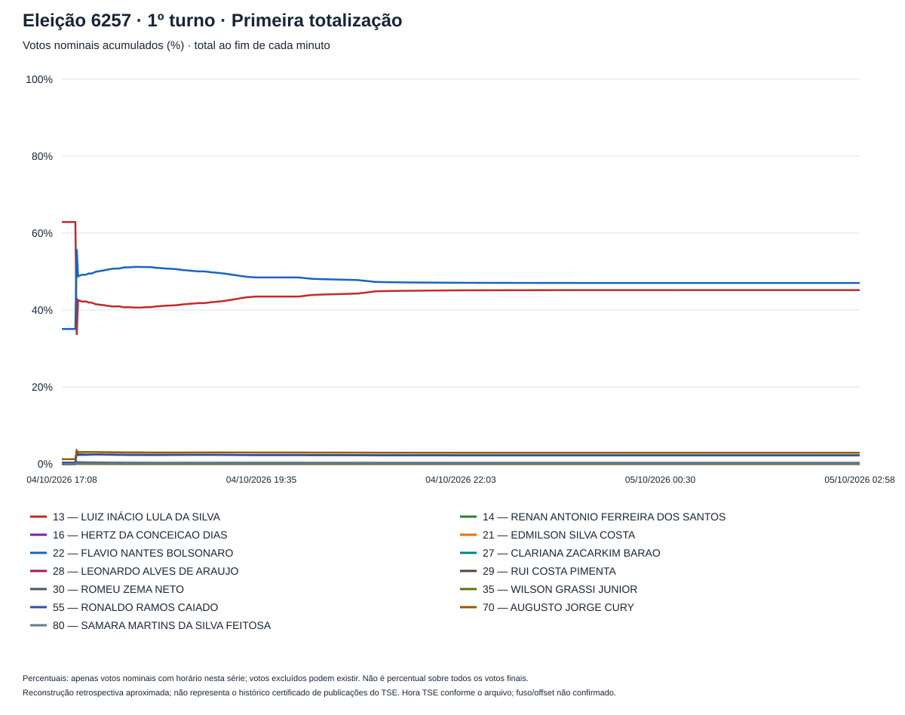
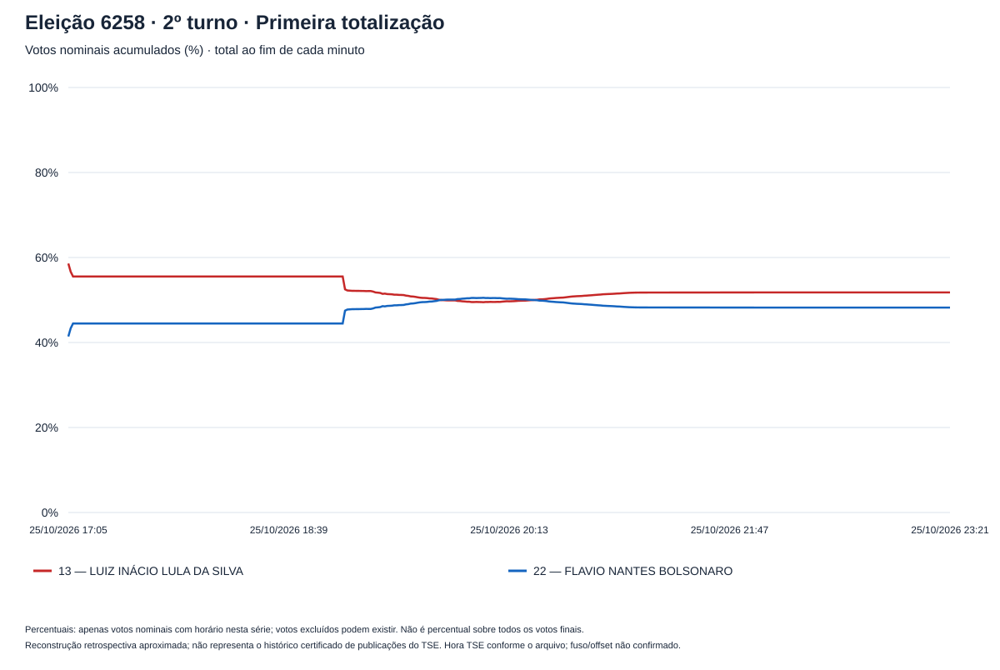

# Stage 1 — Reconstructing the count minute by minute

[Study index](README.md) · [Method](METHOD.md) · [Reproduction](../../README.md#run-locally)

**Question:** Can the supplied section-level files reproduce how the presidential count accumulated over time?

**Answer:** They support a complete retrospective timeline for both rounds: every recorded vote has a usable section timestamp, and the final accumulated counts match the supplied totals. This reconstructs final section results against recorded times; it does not recover every update or revision displayed by the TSE during election night.

## What the reconstruction delivers

Each section's final votes enter at its recorded first-totalization time. A second timeline uses ballot report (**BU**) receipt time. Both include minutes with no new votes.

| Supplied round | First-totalization window | Minutes represented | Sections with vote records | Recorded votes, all classes |
|---|---|---:|---:|---:|
| Round 1, election 6257 | October 4, 17:08 → October 5, 02:58 | 591 | 499,206 | 125,275,835 |
| Round 2, election 6258 | October 25, 17:05 → 23:21 | 377 | 499,205 | 128,236,074 |

Times retain the source's **Hora TSE** label; its UTC offset was not established. BU receipt has the same first and last minute in each round, but its intermediate curve differs.

**Explore the result:** download [the interactive report](replay-report.html) and open it in a browser. It supports both rounds, both timestamp references, vote counts, and candidate shares. GitHub displays the HTML source instead of running the chart. Complete minute series are available as [first-totalization CSV](replay-first-totalization-minute.csv) and [BU-receipt CSV](replay-bu-received-minute.csv).

## Where the timelines end

Final totals anchor every later analysis. The two finalists below are identified as in the supplied files; shares use all nominal candidate votes in each round.

| Candidate | Round 1 votes | Round 1 nominal share | Round 2 votes | Round 2 nominal share |
|---|---:|---:|---:|---:|
| Lula (13) | 53,879,538 | 45.16% | 64,256,232 | 51.79% |
| Flávio Bolsonaro (22) | 56,104,503 | 47.03% | 59,826,041 | 48.21% |

Other candidacies remain in the Round 1 denominator. Blank, null, and separately counted votes are outside the nominal-share denominator. All candidacies and classes remain in [final-results.csv](final-results.csv).

## What the published checks establish

The original execution read **5,731,614 vote rows** and **998,496 detail rows**, covering the 27 domestic federative units and overseas voting (`ZZ`). All **998,411 section-round keys with vote records** matched one unique detail record. The 85 detail-only keys had no recorded votes or turnout and contributed no vote events.

Published independent checks found **no difference in the 19 candidate/class totals**, no discrepancies between the four comparable detail categories and the vote records, and **no votes excluded from either timeline** because of missing or invalid times. These establish internal integrity and conservation of the supplied files, without independently authenticating their contents against external election records.

## How to use this result

The replay shows which final results were represented at each stage. A changing candidate share reflects the mix of counted sections; it does not show voters changing decisions during the count. Stage 2 examines that composition.

The remaining interpretive limit is the snapshot itself: later corrections, replacements, retotalizations, and successive public releases cannot all be recovered from final votes and recorded section timestamps.

## Method and evidence

- [Method guide](METHOD.md): timestamps, denominators, record matching, and scope.
- [Execution and validation record](../../docs/results-2026.md): published checks and their evidence.
- [Input manifest](input-manifest.json): source fingerprints and the full original run inventory.
- [Original generated report, in Portuguese](report.md): preserved execution record with complete candidate and state tables.

This English report is an editorial reading of published results. Numerical outputs, charts, code, and validation records have not been regenerated for this revision.
