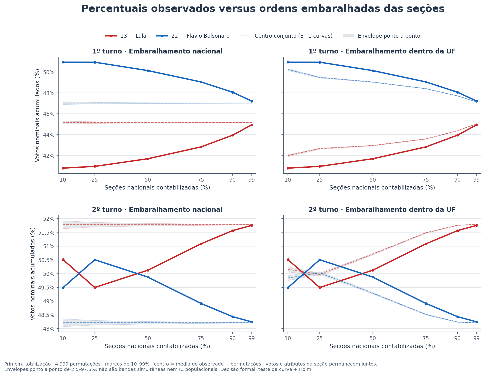
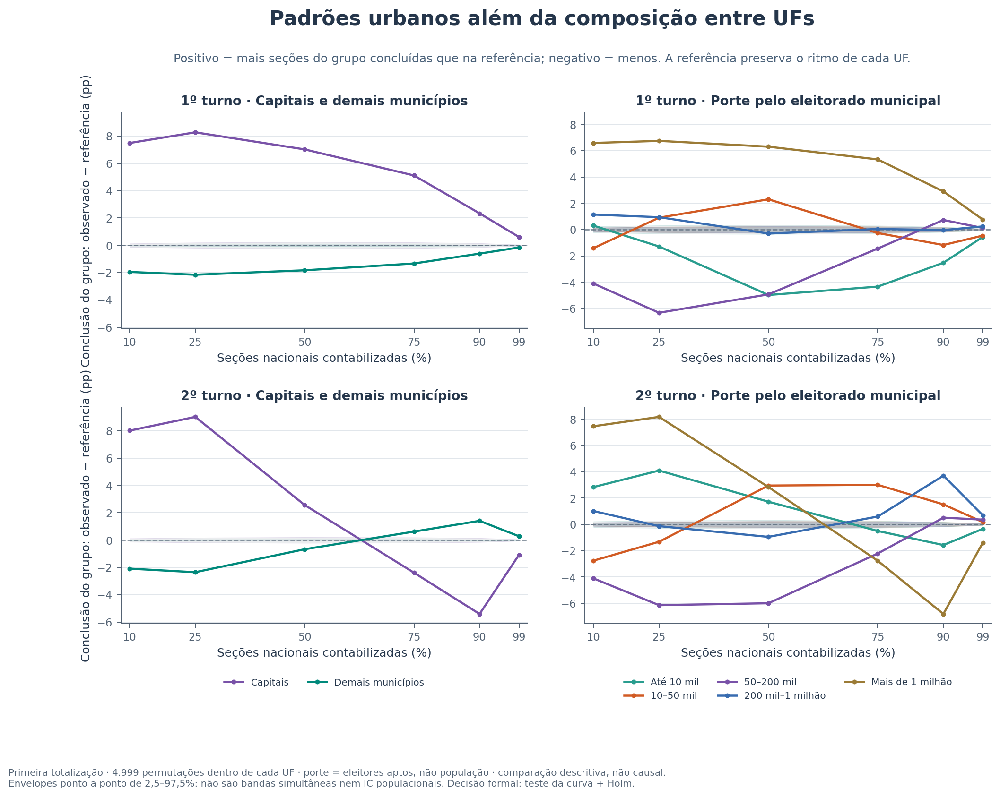

# Etapa 2 — Composição das seções contabilizadas e evolução da apuração

[Índice do estudo](../README.md) · [Etapa 1 — Reconstrução minuto a minuto](../report.md)

**Registro principal em Markdown do segundo passo do estudo.** A etapa 1 reconstruiu os votos minuto a minuto. Esta etapa examina **quem estava representado no acumulado em cada momento** — regiões, UFs, capitais e porte dos municípios — e como essa combinação se relacionou aos percentuais dos candidatos nos dois turnos. PDF e HTML são formatos complementares.

Neste documento, “demografia da apuração” significa **composição territorial e porte eleitoral das seções contabilizadas**. Não significa renda, idade, escolaridade ou população residente. A referência principal é a primeira totalização parcial; o recebimento do BU é uma sensibilidade. Todos os horários permanecem em Hora TSE, sem offset UTC confirmado.

<a id="leitura"></a>

## Leitura do estudo

- [1. Síntese dos padrões e da evidência](#sintese)
- [2. Participação de todas as regiões](#regioes)
- [3. Ritmo e percentuais por UF](#ufs)
- [4. Capitais e porte dos municípios](#cidades)
- [5. Composição territorial e mudança dos percentuais](#percentuais)
- [6. Referência formal de aleatoriedade](#aleatoriedade)
- [7. Sensibilidade e limites de interpretação](#limites)
- [8. Evidências, método e reprodução](#reproducao)

<a id="sintese"></a>

## 1. Síntese dos padrões e da evidência

| Turno | Recorte | Magnitude / evidência observada | Referência aleatória |
|---|---|---|---|
| 1º | Nordeste no marco nacional de 50% | 39,07% das próprias seções; peso nominal 21,34% | desvio detectado |
| 1º | Capitais versus demais municípios | t50 18:37:19 / 18:49:14 | desvio detectado |
| 1º | Porte versus mediana municipal | Spearman 0,117; ranks ajustados por UF -0,002 | associação descritiva; testes por faixa na seção 4 |
| 1º | Lula em SP, de 10% ao final | 33,55% → 38,20% (4,65 pp) | desvio detectado |
| 2º | Nordeste no marco nacional de 50% | 48,97% das próprias seções; peso nominal 27,96% | desvio detectado |
| 2º | Capitais versus demais municípios | t50 20:24:56 / 20:27:04 | desvio detectado |
| 2º | Porte versus mediana municipal | Spearman 0,136; ranks ajustados por UF 0,087 | associação descritiva; testes por faixa na seção 4 |
| 2º | Lula em SP, de 10% ao final | 40,91% → 46,15% (5,24 pp) | desvio detectado |

**Resultado formal em uma leitura:** 198 curvas primárias; 191 com desvio detectado e 7 sem desvio detectado após Holm a 5%. As exceções abaixo identificam exatamente os recortes que não se afastaram de forma detectável da referência, em vez de atribuir aleatoriedade a todo um estado ou a uma faixa de cidades.

- **Amapá (AP), 1º turno:** avanço da UF, referência nacional; S 1,002 pp.
- **Distrito Federal (DF), 1º turno:** percentuais de Lula e Flávio Bolsonaro, referência dentro da UF; S 0,450–0,455 pp.
- **Tocantins (TO), 1º turno:** percentuais de Lula e Flávio Bolsonaro, referência dentro da UF; S 1,235–1,403 pp.
- **Distrito Federal (DF), 2º turno:** percentuais de Lula e Flávio Bolsonaro, referência dentro da UF; S 0,418 pp.

**Desvio não detectado não é prova de aleatoriedade.** As classificações são específicas da curva, dos marcos e da referência usados; não se transferem automaticamente para outras características do mesmo território. Magnitude em pontos percentuais e significância são leituras separadas.

As tabelas distinguem **ordenamento observado**, **tamanho da variação** e **evidência contra uma referência aleatória específica**. Um resultado estatisticamente detectado pode ter magnitude pequena; uma correlação fraca não demonstra aleatoriedade. A falta de rejeição também não prova que a sequência seja aleatória.

As conclusões se referem aos arquivos desta execução. As comparações completas abaixo incluem todas as regiões e UFs; Nordeste e SP funcionam como exemplos concretos, e não como substitutos da análise nacional.

| Turno | Código da eleição | Seções/turno com votos | Votos nominais |
|---|---|---|---|
| 1 | 6257 | 499.206 | 119.306.034 |
| 2 | 6258 | 499.205 | 124.082.273 |

O universo contém 998.411 registros seção/turno. O mesmo local físico pode aparecer nos dois turnos. O progresso é contado por **seções**, mas percentuais dos candidatos e pesos territoriais usam **votos nominais**. Todos os empates de horário entram juntos, portanto o progresso efetivo pode exceder ligeiramente o marco solicitado. O denominador de cada tabela é indicado explicitamente.

<a id="regioes"></a>

## 2. Participação de todas as regiões

Peso regional = votos nominais daquela região já contabilizados / votos nominais nacionais já contabilizados. Compará-lo ao peso final mostra a **representação territorial da amostra acumulada**, não quantos por cento da própria região já foram concluídos. São medidas diferentes.

### 1º turno — participação nos votos nominais nacionais (%)

| Região | 10% | 25% | 50% | 75% | 90% | 99% | Final |
|---|---|---|---|---|---|---|---|
| Norte | 18,93 | 13,87 | 10,60 | 9,20 | 8,70 | 8,52 | 8,54 |
| Nordeste | 17,11 | 20,26 | 21,34 | 23,19 | 25,74 | 27,88 | 28,25 |
| Centro-Oeste | 18,05 | 15,00 | 11,51 | 9,28 | 8,31 | 7,69 | 7,61 |
| Sudeste | 15,02 | 24,54 | 34,52 | 39,74 | 40,80 | 40,82 | 40,64 |
| Sul | 29,03 | 25,56 | 21,65 | 18,33 | 16,21 | 14,82 | 14,68 |
| Exterior | 1,85 | 0,76 | 0,38 | 0,26 | 0,24 | 0,27 | 0,28 |

| Região | BR=10%: Lula / Flávio | BR=50% | BR=90% | Final |
|---|---|---|---|---|
| Norte | 42,61% / 50,14% | 41,80% / 51,44% | 43,26% / 50,36% | 44,65% / 49,15% |
| Nordeste | 61,87% / 32,39% | 62,33% / 31,96% | 63,09% / 31,39% | 63,77% / 30,85% |
| Centro-Oeste | 34,35% / 55,94% | 32,29% / 57,39% | 32,50% / 56,67% | 32,62% / 56,51% |
| Sudeste | 38,43% / 52,67% | 38,16% / 52,82% | 39,34% / 51,62% | 39,68% / 51,36% |
| Sul | 31,64% / 59,24% | 31,71% / 59,50% | 31,29% / 60,05% | 31,28% / 60,08% |
| Exterior | 52,50% / 37,87% | 52,18% / 38,20% | 49,77% / 40,89% | 47,55% / 43,47% |

Na tabela de candidaturas, o denominador é o voto nominal já contado **dentro da própria região**, observado no marco nacional indicado. Essa fração não deve ser confundida com o peso da região no total brasileiro.

### 1º turno — avanço próprio e perfil da região

| Região | Seções concluídas quando BR=50% | t50 da região | Peso em BR=50% / final | Perfil em BR=10–90% | Teste global; S (pp) |
|---|---|---|---|---|---|
| Norte | 61,80% | 18:31:55 | 10,60% / 8,54% | adiantado em todos os marcos | desvio detectado; 15,239 |
| Nordeste | 39,07% | 19:03:52 | 21,34% / 28,25% | atrasado em todos os marcos | desvio detectado; 12,291 |
| Centro-Oeste | 74,45% | 18:21:37 | 11,51% / 7,61% | adiantado em todos os marcos | desvio detectado; 24,428 |
| Sudeste | 42,50% | 18:57:50 | 34,52% / 40,64% | posição heterogênea entre marcos | desvio detectado; 9,877 |
| Sul | 72,34% | 18:26:08 | 21,65% / 14,68% | adiantado em todos os marcos | desvio detectado; 22,318 |
| Exterior | 61,80% | 17:20:16 | 0,38% / 0,28% | posição heterogênea entre marcos | desvio detectado; 50,038 |

### 2º turno — participação nos votos nominais nacionais (%)

| Região | 10% | 25% | 50% | 75% | 90% | 99% | Final |
|---|---|---|---|---|---|---|---|
| Norte | 24,82 | 19,13 | 13,30 | 10,11 | 8,84 | 8,15 | 8,10 |
| Nordeste | 23,29 | 25,05 | 27,96 | 29,34 | 29,15 | 28,50 | 28,41 |
| Centro-Oeste | 15,40 | 13,87 | 11,25 | 9,29 | 8,25 | 7,57 | 7,53 |
| Sudeste | 11,40 | 16,69 | 24,93 | 32,63 | 37,34 | 40,69 | 41,01 |
| Sul | 23,19 | 24,47 | 22,17 | 18,35 | 16,17 | 14,80 | 14,66 |
| Exterior | 1,90 | 0,79 | 0,40 | 0,28 | 0,25 | 0,29 | 0,30 |

| Região | BR=10%: Lula / Flávio | BR=50% | BR=90% | Final |
|---|---|---|---|---|
| Norte | 50,41% / 49,59% | 49,82% / 50,18% | 49,77% / 50,23% | 50,01% / 49,99% |
| Nordeste | 68,60% / 31,40% | 68,34% / 31,66% | 69,24% / 30,76% | 69,37% / 30,63% |
| Centro-Oeste | 42,80% / 57,20% | 39,83% / 60,17% | 39,99% / 60,01% | 39,99% / 60,01% |
| Sudeste | 47,58% / 52,42% | 45,66% / 54,34% | 46,84% / 53,16% | 47,24% / 52,76% |
| Sul | 38,28% / 61,72% | 37,41% / 62,59% | 37,42% / 62,58% | 37,42% / 62,58% |
| Exterior | 59,47% / 40,53% | 58,53% / 41,47% | 58,06% / 41,94% | 53,86% / 46,14% |

Na tabela de candidaturas, o denominador é o voto nominal já contado **dentro da própria região**, observado no marco nacional indicado. Essa fração não deve ser confundida com o peso da região no total brasileiro.

### 2º turno — avanço próprio e perfil da região

| Região | Seções concluídas quando BR=50% | t50 da região | Peso em BR=50% / final | Perfil em BR=10–90% | Teste global; S (pp) |
|---|---|---|---|---|---|
| Norte | 80,37% | 19:57:38 | 13,30% / 8,10% | adiantado em todos os marcos | desvio detectado; 31,876 |
| Nordeste | 48,97% | 20:27:31 | 27,96% / 28,41% | posição heterogênea entre marcos | desvio detectado; 2,955 |
| Centro-Oeste | 74,62% | 20:05:43 | 11,25% / 7,53% | adiantado em todos os marcos | desvio detectado; 24,611 |
| Sudeste | 30,68% | 20:41:54 | 24,93% / 41,01% | atrasado em todos os marcos | desvio detectado; 19,320 |
| Sul | 74,86% | 20:08:40 | 22,17% / 14,66% | adiantado em todos os marcos | desvio detectado; 24,851 |
| Exterior | 63,23% | 17:05:26 | 0,40% / 0,30% | posição heterogênea entre marcos | desvio detectado; 49,897 |

**Nordeste como exemplo:** no marco nacional de 50%, sua conclusão própria foi 39,07% no primeiro turno e 48,97% no segundo; o peso nominal foi 21,34% / 27,96%. O avanço relativo foi diferente do relógio: o t50 regional ocorreu às 19:03:52 / 20:27:31. As tabelas por UF impedem generalizar essa trajetória para todos os estados nordestinos.


*Figura 1 — Peso do Nordeste no mesmo progresso nacional; as demais regiões constam integralmente nas tabelas. A linha pontilhada indica seu peso final.*


*Figura 2 — Todas as regiões no relógio registrado, com a mesma escala temporal nos dois turnos.*

<a id="ufs"></a>

## 3. Ritmo e percentuais por UF

A primeira comparação fixa o **progresso do Brasil** e pergunta quão concluída estava cada UF. As tabelas seguintes fixam o **progresso da própria UF** e acompanham Lula e Flávio. Misturar essas réguas produziria comparações enganosas. Exterior (`ZZ`) permanece na composição nacional e é apresentado separadamente dos 27 recortes domésticos.

### 1º turno — avanço relativo das 27 UFs

| UF | Conclusão própria: BR=10% | BR=50% | BR=90% | Peso nominal: BR=50% / final | Teste global | S (pp) |
|---|---|---|---|---|---|---|
| AC | 24,45% | 84,67% | 99,12% | 0,68% / 0,39% | desvio detectado | 34,639 |
| AL | 2,04% | 20,73% | 69,34% | 0,57% / 1,52% | desvio detectado | 32,908 |
| AM | 20,96% | 58,35% | 90,35% | 2,19% / 1,82% | desvio detectado | 14,014 |
| AP | 9,25% | 50,42% | 90,70% | 0,35% / 0,39% | desvio não detectado | 1,002 |
| BA | 3,20% | 30,59% | 75,79% | 4,23% / 7,18% | desvio detectado | 20,666 |
| CE | 3,00% | 28,05% | 77,51% | 2,59% / 4,71% | desvio detectado | 21,964 |
| DF | 60,96% | 95,68% | 100,00% | 2,91% / 1,49% | desvio detectado | 60,856 |
| ES | 14,93% | 84,92% | 99,59% | 3,24% / 1,89% | desvio detectado | 34,910 |
| GO | 6,89% | 58,47% | 95,66% | 3,78% / 3,21% | desvio detectado | 8,526 |
| MA | 7,08% | 40,51% | 82,40% | 2,64% / 3,36% | desvio detectado | 11,159 |
| MG | 7,43% | 41,81% | 87,18% | 8,70% / 10,04% | desvio detectado | 8,200 |
| MS | 25,06% | 91,01% | 99,93% | 2,34% / 1,25% | desvio detectado | 43,351 |
| MT | 21,36% | 72,62% | 97,92% | 2,48% / 1,67% | desvio detectado | 22,608 |
| PA | 18,67% | 53,03% | 87,71% | 4,38% / 4,08% | desvio detectado | 8,666 |
| PB | 31,09% | 80,75% | 99,03% | 3,45% / 2,11% | desvio detectado | 32,363 |
| PE | 4,56% | 35,60% | 85,20% | 3,15% / 4,69% | desvio detectado | 14,413 |
| PI | 8,09% | 55,25% | 89,47% | 2,02% / 1,80% | desvio detectado | 5,500 |
| PR | 31,03% | 87,84% | 99,72% | 9,94% / 5,52% | desvio detectado | 37,823 |
| RJ | 1,13% | 28,03% | 81,92% | 4,14% / 7,85% | desvio detectado | 21,983 |
| RN | 8,13% | 45,06% | 90,96% | 1,50% / 1,74% | desvio detectado | 4,959 |
| RO | 27,20% | 75,95% | 99,66% | 1,27% / 0,81% | desvio detectado | 25,922 |
| RR | 6,78% | 54,84% | 99,47% | 0,30% / 0,27% | desvio detectado | 18,338 |
| RS | 14,87% | 70,21% | 98,97% | 7,78% / 5,38% | desvio detectado | 20,187 |
| SC | 8,40% | 51,43% | 97,36% | 3,93% / 3,77% | desvio detectado | 9,426 |
| SE | 1,47% | 52,73% | 96,05% | 1,18% / 1,14% | desvio detectado | 10,320 |
| SP | 1,57% | 44,07% | 94,12% | 18,44% / 20,86% | desvio detectado | 12,890 |
| TO | 46,40% | 90,28% | 99,25% | 1,44% / 0,78% | desvio detectado | 46,983 |

Nos marcos nacionais de 10%, 25%, 50%, 75% e 90%, ficaram sempre relativamente adiantadas: AC, AM, DF, ES, MS, MT, PB, PR, RO, RS, TO. Sempre relativamente atrasadas: AL, BA, CE, MA, MG, PE, RJ. Alternaram posição ao longo dos marcos: AP, GO, PA, PI, RN, RR, SC, SE, SP. Esta é uma descrição da trajetória, não um teste de monotonicidade ou de causalidade.

### 1º turno — Lula conforme o avanço da própria UF

| UF | 10% | 50% | 90% | Final | Variação 10% → final (pp) | Teste dentro da UF | S (pp) |
|---|---|---|---|---|---|---|---|
| AC | 32,68% | 29,09% | 28,46% | 28,73% | -3,95 | desvio detectado | 3,939 |
| AL | 57,46% | 56,52% | 54,79% | 54,73% | -2,74 | desvio detectado | 3,563 |
| AM | 41,49% | 42,28% | 46,52% | 48,23% | 6,74 | desvio detectado | 6,742 |
| AP | 54,05% | 48,71% | 46,04% | 45,71% | -8,34 | desvio detectado | 8,336 |
| BA | 64,51% | 64,70% | 65,52% | 66,17% | 1,66 | desvio detectado | 1,819 |
| CE | 60,08% | 61,31% | 62,48% | 63,28% | 3,21 | desvio detectado | 3,207 |
| DF | 38,43% | 38,35% | 38,15% | 38,11% | -0,32 | desvio não detectado | 0,450 |
| ES | 35,93% | 36,21% | 37,15% | 37,76% | 1,83 | desvio detectado | 1,826 |
| GO | 27,63% | 29,20% | 30,57% | 31,06% | 3,43 | desvio detectado | 3,433 |
| MA | 60,23% | 61,97% | 63,29% | 63,99% | 3,75 | desvio detectado | 3,754 |
| MG | 41,57% | 41,90% | 42,66% | 43,32% | 1,76 | desvio detectado | 1,768 |
| MS | 34,23% | 32,61% | 33,68% | 34,68% | 0,45 | desvio detectado | 2,066 |
| MT | 31,06% | 28,62% | 28,66% | 29,18% | -1,88 | desvio detectado | 1,859 |
| PA | 48,40% | 47,64% | 48,69% | 49,91% | 1,50 | desvio detectado | 2,442 |
| PB | 63,40% | 60,62% | 60,91% | 61,31% | -2,10 | desvio detectado | 2,093 |
| PE | 61,36% | 61,95% | 62,90% | 63,45% | 2,09 | desvio detectado | 2,176 |
| PI | 67,71% | 68,58% | 70,49% | 70,99% | 3,28 | desvio detectado | 3,695 |
| PR | 31,26% | 30,80% | 30,93% | 31,20% | -0,06 | desvio detectado | 0,472 |
| RJ | 39,41% | 38,97% | 39,21% | 39,41% | -0,00 | desvio detectado | 0,445 |
| RN | 61,08% | 60,24% | 59,72% | 59,75% | -1,34 | desvio detectado | 1,335 |
| RO | 31,80% | 28,32% | 26,31% | 25,89% | -5,91 | desvio detectado | 5,913 |
| RR | 27,81% | 23,80% | 22,68% | 22,86% | -4,95 | desvio detectado | 4,950 |
| RS | 31,95% | 34,68% | 35,89% | 35,73% | 3,77 | desvio detectado | 3,772 |
| SC | 31,61% | 26,34% | 25,10% | 25,04% | -6,56 | desvio detectado | 6,568 |
| SE | 57,63% | 60,45% | 61,98% | 62,75% | 5,12 | desvio detectado | 5,114 |
| SP | 33,55% | 36,65% | 37,98% | 38,20% | 4,65 | desvio detectado | 4,650 |
| TO | 44,47% | 43,67% | 43,36% | 43,42% | -1,05 | desvio não detectado | 1,235 |

### 1º turno — Flávio Bolsonaro conforme o avanço da própria UF

| UF | 10% | 50% | 90% | Final | Variação 10% → final (pp) | Teste dentro da UF | S (pp) |
|---|---|---|---|---|---|---|---|
| AC | 61,84% | 63,77% | 64,71% | 64,55% | 2,71 | desvio detectado | 2,699 |
| AL | 38,01% | 38,92% | 40,42% | 40,45% | 2,44 | desvio detectado | 3,166 |
| AM | 50,57% | 49,89% | 46,41% | 44,99% | -5,58 | desvio detectado | 5,578 |
| AP | 38,79% | 43,22% | 45,40% | 45,66% | 6,88 | desvio detectado | 6,871 |
| BA | 29,55% | 29,64% | 29,06% | 28,53% | -1,01 | desvio detectado | 1,254 |
| CE | 33,82% | 32,85% | 31,94% | 31,27% | -2,54 | desvio detectado | 2,546 |
| DF | 51,21% | 51,05% | 51,24% | 51,31% | 0,09 | desvio não detectado | 0,455 |
| ES | 56,83% | 56,23% | 55,38% | 54,78% | -2,05 | desvio detectado | 2,044 |
| GO | 57,65% | 55,73% | 54,10% | 53,60% | -4,05 | desvio detectado | 4,053 |
| MA | 34,18% | 32,70% | 31,53% | 30,89% | -3,28 | desvio detectado | 3,283 |
| MG | 48,88% | 49,26% | 48,75% | 48,24% | -0,64 | desvio detectado | 1,144 |
| MS | 58,26% | 60,24% | 59,40% | 58,60% | 0,34 | desvio detectado | 1,633 |
| MT | 62,56% | 65,34% | 65,59% | 65,14% | 2,59 | desvio detectado | 2,563 |
| PA | 44,39% | 45,96% | 45,53% | 44,50% | 0,11 | desvio detectado | 1,465 |
| PB | 31,06% | 33,55% | 33,39% | 33,07% | 2,01 | desvio detectado | 2,007 |
| PE | 32,85% | 32,32% | 31,53% | 31,03% | -1,81 | desvio detectado | 1,910 |
| PI | 26,87% | 26,06% | 24,50% | 24,09% | -2,78 | desvio detectado | 3,109 |
| PR | 58,54% | 60,12% | 60,07% | 59,91% | 1,37 | desvio detectado | 1,368 |
| RJ | 53,11% | 53,56% | 53,23% | 53,01% | -0,10 | desvio detectado | 0,553 |
| RN | 33,44% | 34,30% | 34,75% | 34,77% | 1,34 | desvio detectado | 1,337 |
| RO | 59,52% | 64,26% | 66,95% | 67,45% | 7,93 | desvio detectado | 7,934 |
| RR | 68,04% | 70,70% | 71,18% | 71,05% | 3,01 | desvio detectado | 3,004 |
| RS | 59,66% | 56,71% | 55,43% | 55,64% | -4,02 | desvio detectado | 4,017 |
| SC | 59,29% | 65,13% | 66,50% | 66,65% | 7,36 | desvio detectado | 7,365 |
| SE | 35,19% | 32,60% | 31,24% | 30,63% | -4,56 | desvio detectado | 4,555 |
| SP | 57,36% | 53,59% | 52,17% | 51,93% | -5,43 | desvio detectado | 5,427 |
| TO | 49,03% | 50,07% | 50,44% | 50,44% | 1,41 | desvio não detectado | 1,403 |

### 2º turno — avanço relativo das 27 UFs

| UF | Conclusão própria: BR=10% | BR=50% | BR=90% | Peso nominal: BR=50% / final | Teste global | S (pp) |
|---|---|---|---|---|---|---|
| AC | 28,28% | 84,98% | 99,07% | 0,60% / 0,35% | desvio detectado | 39,252 |
| AL | 9,84% | 73,62% | 99,80% | 2,22% / 1,53% | desvio detectado | 23,607 |
| AM | 36,07% | 84,49% | 97,51% | 2,98% / 1,71% | desvio detectado | 43,736 |
| AP | 10,45% | 86,94% | 99,84% | 0,59% / 0,34% | desvio detectado | 36,926 |
| BA | 2,80% | 28,00% | 84,92% | 4,08% / 7,33% | desvio detectado | 21,996 |
| CE | 2,15% | 49,59% | 93,77% | 4,88% / 4,72% | desvio detectado | 11,524 |
| DF | 58,92% | 96,36% | 98,12% | 2,82% / 1,45% | desvio detectado | 65,586 |
| ES | 6,47% | 93,21% | 97,41% | 3,48% / 1,85% | desvio detectado | 43,204 |
| GO | 3,28% | 54,92% | 98,26% | 3,49% / 3,17% | desvio detectado | 12,941 |
| MA | 12,85% | 74,64% | 98,34% | 4,98% / 3,25% | desvio detectado | 24,630 |
| MG | 7,66% | 42,63% | 90,99% | 9,00% / 10,15% | desvio detectado | 7,369 |
| MS | 15,68% | 95,27% | 99,62% | 2,40% / 1,25% | desvio detectado | 48,053 |
| MT | 23,86% | 75,94% | 97,10% | 2,53% / 1,65% | desvio detectado | 25,925 |
| PA | 27,40% | 78,46% | 97,11% | 6,34% / 3,94% | desvio detectado | 28,452 |
| PB | 48,19% | 90,03% | 98,41% | 3,86% / 2,14% | desvio detectado | 52,437 |
| PE | 4,21% | 46,59% | 92,95% | 4,41% / 4,80% | desvio detectado | 12,893 |
| PI | 3,25% | 25,55% | 97,34% | 0,87% / 1,76% | desvio detectado | 24,449 |
| PR | 29,75% | 92,77% | 99,02% | 10,33% / 5,53% | desvio detectado | 42,759 |
| RJ | 0,15% | 7,58% | 53,75% | 1,12% / 7,85% | desvio detectado | 49,230 |
| RN | 11,84% | 69,38% | 97,74% | 2,40% / 1,73% | desvio detectado | 19,385 |
| RO | 25,61% | 71,52% | 98,45% | 1,13% / 0,78% | desvio detectado | 21,511 |
| RR | 8,03% | 55,23% | 99,80% | 0,26% / 0,24% | desvio detectado | 15,909 |
| RS | 6,86% | 64,70% | 98,03% | 7,09% / 5,40% | desvio detectado | 14,694 |
| SC | 8,22% | 62,95% | 99,61% | 4,74% / 3,74% | desvio detectado | 18,738 |
| SE | 0,14% | 10,86% | 74,51% | 0,27% / 1,15% | desvio detectado | 46,438 |
| SP | 0,62% | 27,14% | 86,65% | 11,33% / 21,16% | desvio detectado | 22,862 |
| TO | 49,20% | 94,73% | 98,18% | 1,40% / 0,73% | desvio detectado | 59,805 |

Nos marcos nacionais de 10%, 25%, 50%, 75% e 90%, ficaram sempre relativamente adiantadas: AC, AM, AP, DF, MA, MS, MT, PA, PB, PR, RN, RO, TO. Sempre relativamente atrasadas: BA, RJ, SE, SP. Alternaram posição ao longo dos marcos: AL, CE, ES, GO, MG, PE, PI, RR, RS, SC. Esta é uma descrição da trajetória, não um teste de monotonicidade ou de causalidade.

### 2º turno — Lula conforme o avanço da própria UF

| UF | 10% | 50% | 90% | Final | Variação 10% → final (pp) | Teste dentro da UF | S (pp) |
|---|---|---|---|---|---|---|---|
| AC | 37,43% | 34,44% | 33,49% | 33,43% | -3,99 | desvio detectado | 3,987 |
| AL | 63,17% | 64,06% | 61,70% | 60,77% | -2,40 | desvio detectado | 3,289 |
| AM | 49,03% | 48,93% | 53,11% | 54,02% | 4,99 | desvio detectado | 5,590 |
| AP | 64,11% | 55,27% | 53,02% | 52,88% | -11,23 | desvio detectado | 11,221 |
| BA | 70,38% | 71,13% | 71,22% | 71,31% | 0,93 | desvio detectado | 0,939 |
| CE | 64,54% | 66,44% | 68,58% | 68,93% | 4,39 | desvio detectado | 4,392 |
| DF | 45,41% | 45,39% | 45,64% | 45,72% | 0,32 | desvio não detectado | 0,418 |
| ES | 42,14% | 43,05% | 43,92% | 43,63% | 1,49 | desvio detectado | 1,488 |
| GO | 37,23% | 39,14% | 39,88% | 40,34% | 3,11 | desvio detectado | 3,104 |
| MA | 67,43% | 66,63% | 68,79% | 69,54% | 2,12 | desvio detectado | 3,452 |
| MG | 49,80% | 49,97% | 50,28% | 50,43% | 0,63 | desvio detectado | 0,631 |
| MS | 41,97% | 39,02% | 39,90% | 40,40% | -1,57 | desvio detectado | 1,576 |
| MT | 40,10% | 34,79% | 33,54% | 33,94% | -6,16 | desvio detectado | 6,148 |
| PA | 56,21% | 54,61% | 54,56% | 55,02% | -1,20 | desvio detectado | 1,199 |
| PB | 71,27% | 68,09% | 67,99% | 67,46% | -3,81 | desvio detectado | 3,805 |
| PE | 73,33% | 71,30% | 69,49% | 69,20% | -4,13 | desvio detectado | 4,133 |
| PI | 77,38% | 75,93% | 75,61% | 75,88% | -1,50 | desvio detectado | 1,507 |
| PR | 38,88% | 37,58% | 37,44% | 37,42% | -1,46 | desvio detectado | 1,461 |
| RJ | 45,69% | 46,61% | 46,79% | 46,90% | 1,21 | desvio detectado | 1,211 |
| RN | 69,95% | 67,90% | 66,06% | 65,72% | -4,23 | desvio detectado | 4,226 |
| RO | 38,21% | 33,37% | 30,61% | 30,39% | -7,82 | desvio detectado | 7,821 |
| RR | 38,64% | 30,20% | 27,76% | 27,54% | -11,09 | desvio detectado | 11,084 |
| RS | 36,40% | 40,93% | 42,17% | 42,16% | 5,77 | desvio detectado | 5,767 |
| SC | 40,52% | 32,21% | 30,78% | 30,58% | -9,94 | desvio detectado | 9,932 |
| SE | 67,94% | 68,99% | 69,10% | 69,53% | 1,59 | desvio detectado | 2,140 |
| SP | 40,91% | 44,03% | 45,65% | 46,15% | 5,24 | desvio detectado | 5,241 |
| TO | 51,63% | 50,64% | 48,55% | 48,63% | -3,00 | desvio detectado | 2,992 |

### 2º turno — Flávio Bolsonaro conforme o avanço da própria UF

| UF | 10% | 50% | 90% | Final | Variação 10% → final (pp) | Teste dentro da UF | S (pp) |
|---|---|---|---|---|---|---|---|
| AC | 62,57% | 65,56% | 66,51% | 66,57% | 3,99 | desvio detectado | 3,987 |
| AL | 36,83% | 35,94% | 38,30% | 39,23% | 2,40 | desvio detectado | 3,289 |
| AM | 50,97% | 51,07% | 46,89% | 45,98% | -4,99 | desvio detectado | 5,590 |
| AP | 35,89% | 44,73% | 46,98% | 47,12% | 11,23 | desvio detectado | 11,221 |
| BA | 29,62% | 28,87% | 28,78% | 28,69% | -0,93 | desvio detectado | 0,939 |
| CE | 35,46% | 33,56% | 31,42% | 31,07% | -4,39 | desvio detectado | 4,392 |
| DF | 54,59% | 54,61% | 54,36% | 54,28% | -0,32 | desvio não detectado | 0,418 |
| ES | 57,86% | 56,95% | 56,08% | 56,37% | -1,49 | desvio detectado | 1,488 |
| GO | 62,77% | 60,86% | 60,12% | 59,66% | -3,11 | desvio detectado | 3,104 |
| MA | 32,57% | 33,37% | 31,21% | 30,46% | -2,12 | desvio detectado | 3,452 |
| MG | 50,20% | 50,03% | 49,72% | 49,57% | -0,63 | desvio detectado | 0,631 |
| MS | 58,03% | 60,98% | 60,10% | 59,60% | 1,57 | desvio detectado | 1,576 |
| MT | 59,90% | 65,21% | 66,46% | 66,06% | 6,16 | desvio detectado | 6,148 |
| PA | 43,79% | 45,39% | 45,44% | 44,98% | 1,20 | desvio detectado | 1,199 |
| PB | 28,73% | 31,91% | 32,01% | 32,54% | 3,81 | desvio detectado | 3,805 |
| PE | 26,67% | 28,70% | 30,51% | 30,80% | 4,13 | desvio detectado | 4,133 |
| PI | 22,62% | 24,07% | 24,39% | 24,12% | 1,50 | desvio detectado | 1,507 |
| PR | 61,12% | 62,42% | 62,56% | 62,58% | 1,46 | desvio detectado | 1,461 |
| RJ | 54,31% | 53,39% | 53,21% | 53,10% | -1,21 | desvio detectado | 1,211 |
| RN | 30,05% | 32,10% | 33,94% | 34,28% | 4,23 | desvio detectado | 4,226 |
| RO | 61,79% | 66,63% | 69,39% | 69,61% | 7,82 | desvio detectado | 7,821 |
| RR | 61,36% | 69,80% | 72,24% | 72,46% | 11,09 | desvio detectado | 11,084 |
| RS | 63,60% | 59,07% | 57,83% | 57,84% | -5,77 | desvio detectado | 5,767 |
| SC | 59,48% | 67,79% | 69,22% | 69,42% | 9,94 | desvio detectado | 9,932 |
| SE | 32,06% | 31,01% | 30,90% | 30,47% | -1,59 | desvio detectado | 2,140 |
| SP | 59,09% | 55,97% | 54,35% | 53,85% | -5,24 | desvio detectado | 5,241 |
| TO | 48,37% | 49,36% | 51,45% | 51,37% | 3,00 | desvio detectado | 2,992 |

### Exterior — registro separado

| Turno | Conclusão ZZ quando BR=10% | BR=50% | BR=90% | Peso nominal em BR=50% / final |
|---|---|---|---|---|
| 1º | 60,05% | 61,80% | 71,58% | 0,38% / 0,28% |
| 2º | 59,94% | 63,23% | 71,56% | 0,40% / 0,30% |

Os percentuais de Flávio são calculados a partir dos votos do candidato 22. **No primeiro turno não se usa 100% − Lula**, pois outros candidatos fazem parte dos votos nominais.


*Figura 3 — t50 e avanço até 90% por UF; o agrupamento regional não elimina a heterogeneidade estadual.*

<a id="cidades"></a>

## 4. Capitais e porte dos municípios

Capital e porte são atributos territoriais das seções, não perfis individuais dos eleitores. Brasília é classificada como capital; DF não tem contraparte de interior. Porte utiliza eleitores aptos agregados no primeiro turno disponível e mantém a mesma faixa entre turnos; não utiliza população residente. Os pesos nominais abaixo têm denominador nacional; exterior fica fora das classes domésticas.

### 1º turno — como os tipos de cidade estavam representados

| Recorte | Conclusão própria: BR=10% | BR=50% | BR=90% | Peso nominal: BR=50% / final | Teste dentro de UF | S (pp) |
|---|---|---|---|---|---|---|
| Capitais | 19,23% | 57,94% | 92,76% | 26,64% / 22,78% | desvio detectado | 8,268 |
| Demais municípios | 7,43% | 47,91% | 89,35% | 72,98% / 76,94% | desvio detectado | 2,155 |
| Até 10 mil | 13,24% | 51,44% | 89,56% | 10,32% / 10,01% | desvio detectado | 4,977 |
| Mais de 10 a 50 mil | 8,65% | 51,59% | 87,31% | 28,38% / 27,80% | desvio detectado | 2,299 |
| Mais de 50 a 200 mil | 4,65% | 44,09% | 90,90% | 19,90% / 22,77% | desvio detectado | 6,328 |
| Mais de 200 mil a 1 milhão | 9,39% | 49,60% | 91,27% | 20,71% / 20,85% | desvio detectado | 1,138 |
| Mais de 1 milhão | 17,49% | 54,60% | 92,73% | 20,32% / 18,29% | desvio detectado | 6,741 |

| Recorte | BR=10%: Lula / Flávio | BR=50% | BR=90% | Final |
|---|---|---|---|---|
| Capitais | 39,11% / 50,97% | 42,79% / 47,34% | 44,89% / 45,43% | 44,92% / 45,53% |
| Demais municípios | 41,74% / 51,37% | 41,23% / 51,22% | 43,64% / 48,89% | 45,22% / 47,48% |
| Até 10 mil | 47,49% / 46,77% | 47,56% / 46,50% | 48,16% / 45,79% | 49,05% / 44,91% |
| Mais de 10 a 50 mil | 43,02% / 50,57% | 44,22% / 49,23% | 48,59% / 45,23% | 50,77% / 43,27% |
| Mais de 50 a 200 mil | 36,44% / 55,97% | 37,05% / 54,71% | 39,26% / 52,59% | 40,84% / 51,18% |
| Mais de 200 mil a 1 milhão | 37,02% / 53,94% | 38,10% / 52,52% | 39,84% / 50,93% | 40,33% / 50,54% |
| Mais de 1 milhão | 39,46% / 50,26% | 43,14% / 46,58% | 45,35% / 44,65% | 45,36% / 44,77% |

Os pares Lula / Flávio usam os votos nominais já contados do próprio grupo de cidade. Mudança na fração interna e mudança no peso do grupo são mecanismos contábeis diferentes; ambos aparecem separadamente nas tabelas.

| Recorte | t10 | t50 | t90 |
|---|---|---|---|
| Capitais | 17:38:11 | 18:37:19 | 20:06:25 |
| Demais municípios | 17:59:01 | 18:49:14 | 20:21:31 |
| Até 10 mil | 17:47:07 | 18:45:23 | 20:20:25 |
| Mais de 10 a 50 mil | 17:56:13 | 18:45:06 | 20:40:42 |
| Mais de 50 a 200 mil | 18:11:10 | 18:56:10 | 20:12:58 |
| Mais de 200 mil a 1 milhão | 17:54:53 | 18:47:26 | 20:11:30 |
| Mais de 1 milhão | 17:39:12 | 18:41:48 | 20:07:15 |

No 1º turno, o t50 agregado das capitais ocorreu 11,92 minutos antes dos demais municípios. Na comparação dentro de cada UF, a capital chegou ao t50 antes do restante em 19 de 26 pares. A agregação depende da composição regional e da quantidade de seções; não é um efeito isolado de ser capital.

### 2º turno — como os tipos de cidade estavam representados

| Recorte | Conclusão própria: BR=10% | BR=50% | BR=90% | Peso nominal: BR=50% / final | Teste dentro de UF | S (pp) |
|---|---|---|---|---|---|---|
| Capitais | 19,95% | 51,42% | 82,66% | 23,59% / 22,86% | desvio detectado | 9,018 |
| Demais municípios | 7,28% | 49,59% | 91,98% | 76,01% / 76,84% | desvio detectado | 2,351 |
| Até 10 mil | 15,70% | 58,78% | 92,90% | 11,82% / 9,93% | desvio detectado | 4,088 |
| Mais de 10 a 50 mil | 8,03% | 57,47% | 94,02% | 32,09% / 27,72% | desvio detectado | 3,002 |
| Mais de 50 a 200 mil | 4,32% | 42,82% | 90,30% | 19,59% / 22,77% | desvio detectado | 6,146 |
| Mais de 200 mil a 1 milhão | 8,86% | 44,81% | 91,39% | 18,75% / 20,84% | desvio detectado | 3,700 |
| Mais de 1 milhão | 18,22% | 46,41% | 79,01% | 17,35% / 18,45% | desvio detectado | 8,171 |

| Recorte | BR=10%: Lula / Flávio | BR=50% | BR=90% | Final |
|---|---|---|---|---|
| Capitais | 46,76% / 53,24% | 49,87% / 50,13% | 52,24% / 47,76% | 52,75% / 47,25% |
| Demais municípios | 53,37% / 46,63% | 50,16% / 49,84% | 51,37% / 48,63% | 51,49% / 48,51% |
| Até 10 mil | 55,59% / 44,41% | 53,33% / 46,67% | 53,82% / 46,18% | 54,06% / 45,94% |
| Mais de 10 a 50 mil | 55,75% / 44,25% | 53,66% / 46,34% | 56,09% / 43,91% | 56,22% / 43,78% |
| Mais de 50 a 200 mil | 49,77% / 50,23% | 46,06% / 53,94% | 47,35% / 52,65% | 47,67% / 52,33% |
| Mais de 200 mil a 1 milhão | 46,44% / 53,56% | 45,67% / 54,33% | 47,72% / 52,28% | 47,88% / 52,12% |
| Mais de 1 milhão | 46,74% / 53,26% | 50,61% / 49,39% | 52,92% / 47,08% | 53,37% / 46,63% |

Os pares Lula / Flávio usam os votos nominais já contados do próprio grupo de cidade. Mudança na fração interna e mudança no peso do grupo são mecanismos contábeis diferentes; ambos aparecem separadamente nas tabelas.

| Recorte | t10 | t50 | t90 |
|---|---|---|---|
| Capitais | 19:27:23 | 20:24:56 | 21:06:28 |
| Demais municípios | 19:43:40 | 20:27:04 | 20:59:55 |
| Até 10 mil | 19:31:39 | 20:18:37 | 20:57:31 |
| Mais de 10 a 50 mil | 19:41:39 | 20:20:50 | 20:57:43 |
| Mais de 50 a 200 mil | 19:54:02 | 20:32:19 | 21:01:39 |
| Mais de 200 mil a 1 milhão | 19:40:27 | 20:31:18 | 21:00:52 |
| Mais de 1 milhão | 19:27:53 | 20:31:21 | 21:07:48 |

No 2º turno, o t50 agregado das capitais ocorreu 2,13 minutos antes dos demais municípios. Na comparação dentro de cada UF, a capital chegou ao t50 antes do restante em 16 de 26 pares. A agregação depende da composição regional e da quantidade de seções; não é um efeito isolado de ser capital.


*Figura 4 — Distribuição do horário das seções por capital e faixa eleitoral; ponto=t50 e intervalo=t10–t90.*

| Correlação entre porte e t50 municipal — municípios com pesos iguais | 1º turno | 2º turno |
|---|---|---|
| Spearman global | 0,117 | 0,136 |
| Relação entre ranks globais após retirar médias de UF | -0,002 | 0,087 |

Os valores acima medem associação entre tamanho e mediana de cada município, dando peso igual aos municípios. Eles não são a média de correlações estaduais e não têm a ponderação por seções das tabelas anteriores. Uma relação global reduzida, faixas não monotônicas ou trajetórias que mudam entre turnos são evidências contra uma regra simples de porte; **não equivalem a uma demonstração de aleatoriedade**. O teste condicionado por UF responde à pergunta adicional de quanto cada curva se afasta de um embaralhamento dentro dos estados.

<a id="percentuais"></a>

## 5. Composição territorial e mudança dos percentuais

A porcentagem acumulada pode variar sem que ninguém tenha mudado de preferência: entram seções com resultados finais diferentes. Uma região pode ganhar peso e, simultaneamente, mudar a composição das seções já contadas dentro dela. A decomposição abaixo distingue essas duas contribuições contábeis.

| Turno e progresso BR | Lula corrente | Flávio corrente | Lula final | Flávio final | Desvio de Lula (pp) |
|---|---|---|---|---|---|
| 1º, 10% | 40,78% | 50,94% | 45,16% | 47,03% | -4,377 |
| 1º, 50% | 41,68% | 50,14% | 45,16% | 47,03% | -3,478 |
| 1º, 90% | 43,95% | 48,06% | 45,16% | 47,03% | -1,215 |
| 2º, 10% | 50,51% | 49,49% | 51,79% | 48,21% | -1,275 |
| 2º, 50% | 50,12% | 49,88% | 51,79% | 48,21% | -1,661 |
| 2º, 90% | 51,57% | 48,43% | 51,79% | 48,21% | -0,218 |

| Turno e marco BR | Desvio de Lula frente ao próprio final (pp) | Composição entre regiões (pp) | Ordenação dentro das regiões (pp) |
|---|---|---|---|
| 1º, 10% | -4,377 | -3,988 | -0,389 |
| 1º, 50% | -3,478 | -2,417 | -1,061 |
| 2º, 10% | -1,275 | -1,972 | 0,697 |
| 2º, 50% | -1,661 | -0,955 | -0,706 |

Os componentes variam com a granularidade geográfica: regiões, UFs e municípios produzem referências diferentes. São identidades sobre os dados fornecidos, não estimativas causais. Níveis brutos do primeiro e segundo turnos não isolam ordenação, porque o primeiro turno possui outras candidaturas; por isso a comparação utiliza o resultado final do próprio turno como referência.


*Figura 5 — Composição entre territórios e ordenação interna; o agrupamento de SP utiliza municípios.*

### São Paulo como estudo de caso: a capital não explica tudo

| Progresso próprio de SP | 1º: Lula / Flávio | 2º: Lula / Flávio |
|---|---|---|
| 10% | 33,55% / 57,36% | 40,91% / 59,09% |
| 25% | 35,12% / 55,35% | 42,70% / 57,30% |
| 50% | 36,65% / 53,59% | 44,03% / 55,97% |
| 75% | 37,56% / 52,60% | 45,07% / 54,93% |
| 90% | 37,98% / 52,17% | 45,65% / 54,35% |
| 99% | 38,20% / 51,92% | 46,11% / 53,89% |
| 100% | 38,20% / 51,93% | 46,15% / 53,85% |

| Turno | Capital: peso em SP=10% | Capital: peso final | Lula final na capital | Lula no restante: SP=10% → final |
|---|---|---|---|---|
| 1º | 14,60% | 26,33% | 46,58% | 31,85% → 35,20% |
| 2º | 13,11% | 26,51% | 55,50% | 38,84% → 42,78% |

A capital paulista foi sub-representada no início desta execução e tem uma participação final de Lula acima da média estadual. Sua entrada ajuda a descrever a subida, mas o restante do estado também muda. Isso é compatível com diferenças entre municípios e com ordenação interna, em vez de uma única oposição capital/interior. Crescimento global da curva não significa monotonicidade em todos os eventos.

| Turno e progresso SP | Desvio de Lula (pp) | Composição municipal (pp) | Ordenação interna (pp) |
|---|---|---|---|
| 1º, 10% | -4,651 | -3,701 | -0,950 |
| 1º, 50% | -1,551 | -1,004 | -0,547 |
| 2º, 10% | -5,240 | -4,762 | -0,478 |
| 2º, 50% | -2,126 | -1,964 | -0,162 |

| SP=10% | Município | Peso corrente | Peso final | Contribuição centrada (pp) |
|---|---|---|---|---|
| 1º | SÃO PAULO | 14,60% | 26,33% | -0,983 |
| 1º | PIRACICABA | 3,61% | 0,91% | -0,286 |
| 1º | CATANDUVA | 2,17% | 0,25% | -0,243 |
| 2º | SÃO PAULO | 13,11% | 26,51% | -1,253 |
| 2º | PIRACICABA | 4,24% | 0,91% | -0,384 |
| 2º | CATANDUVA | 2,45% | 0,25% | -0,321 |

A contribuição individual usa o percentual municipal centrado no resultado estadual final. Um termo negativo pode representar um município mais favorável a Lula ainda sub-representado ou um município menos favorável já super-representado. Os termos não centrados, preservados no CSV, não são interpretados isoladamente porque podem se cancelar.


*Figura 6 — Percentuais de ambos os candidatos no Brasil e em SP em marcos de progresso; as tabelas da seção 3 estendem a leitura às demais UFs.*

<a id="aleatoriedade"></a>

## 6. Referência formal de aleatoriedade

Foram realizadas 4.999 permutações por configuração, com semente 20261027. Na referência principal, 191 curvas tiveram desvio detectado e 7 não tiveram desvio detectado após o ajuste de Holm a 5%; 0 hipóteses ficaram não aplicáveis. As hipóteses dos dois turnos integram a mesma família de testes primários.

A resolução mínima do p-valor Monte Carlo é 0,000200. Resultados no piso não fornecem precisão adicional sobre quão pequeno seria o p-valor com mais permutações. A coluna S mede o afastamento máximo em pontos percentuais da referência média conjunta, não a variação do candidato entre o começo e o fim da contagem.

| Turno | Referência | Família de curvas | Desvio detectado | Não detectado | Não aplicável |
|---|---|---|---|---|---|
| 1º | nacional | percentual do candidato | 2 | 0 | 0 |
| 1º | nacional | avanço regional | 6 | 0 | 0 |
| 1º | nacional | avanço da UF | 27 | 1 | 0 |
| 1º | dentro da UF | percentual do candidato | 52 | 4 | 0 |
| 1º | dentro da UF | capital versus demais municípios | 2 | 0 | 0 |
| 1º | dentro da UF | porte municipal | 5 | 0 | 0 |
| 2º | nacional | percentual do candidato | 2 | 0 | 0 |
| 2º | nacional | avanço regional | 6 | 0 | 0 |
| 2º | nacional | avanço da UF | 28 | 0 | 0 |
| 2º | dentro da UF | percentual do candidato | 54 | 2 | 0 |
| 2º | dentro da UF | capital versus demais municípios | 2 | 0 | 0 |
| 2º | dentro da UF | porte municipal | 5 | 0 | 0 |

### Percentuais nacionais: desvio além da composição estadual preservada?

| Turno | Candidato | Referência | Máximo desvio S (pp) | p ajustado (Holm) | Resultado |
|---|---|---|---|---|---|
| 1º | Lula | nacional | 4,375 | 0,0396 | desvio detectado |
| 1º | Lula | dentro da UF | 1,708 | 0,0396 | desvio detectado |
| 1º | Flávio Bolsonaro | nacional | 3,917 | 0,0396 | desvio detectado |
| 1º | Flávio Bolsonaro | dentro da UF | 1,459 | 0,0396 | desvio detectado |
| 2º | Lula | nacional | 2,289 | 0,0396 | desvio detectado |
| 2º | Lula | dentro da UF | 0,586 | 0,0396 | desvio detectado |
| 2º | Flávio Bolsonaro | nacional | 2,289 | 0,0396 | desvio detectado |
| 2º | Flávio Bolsonaro | dentro da UF | 0,586 | 0,0396 | desvio detectado |

### Onde não foi detectado afastamento da referência

| Turno | Referência | Dimensão / recorte | Candidato | S observado (pp) | p ajustado |
|---|---|---|---|---|---|
| 1º | nacional | avanço da UF / Amapá (AP) | — | 1,002 | 0,6978 |
| 1º | dentro da UF | percentual do candidato / Distrito Federal (DF) | Lula | 0,450 | 0,2820 |
| 1º | dentro da UF | percentual do candidato / Distrito Federal (DF) | Flávio Bolsonaro | 0,455 | 0,2820 |
| 1º | dentro da UF | percentual do candidato / Tocantins (TO) | Lula | 1,235 | 0,2820 |
| 1º | dentro da UF | percentual do candidato / Tocantins (TO) | Flávio Bolsonaro | 1,403 | 0,1078 |
| 2º | dentro da UF | percentual do candidato / Distrito Federal (DF) | Lula | 0,418 | 0,2820 |
| 2º | dentro da UF | percentual do candidato / Distrito Federal (DF) | Flávio Bolsonaro | 0,418 | 0,2820 |



*Referência aleatória dos percentuais nacionais dos candidatos nos dois turnos. Envelopes de 95% ponto a ponto; não são intervalos populacionais nem bandas simultâneas. A decisão formal utiliza o teste da curva com Holm.*



*Capital e faixas de porte diante do embaralhamento dentro de UF. Os desvios são relativos à referência condicionada, não necessariamente a uma linha horizontal final. Os envelopes são ponto a ponto.*

### O que os dois embaralhamentos preservam

Os rótulos legíveis “nacional” e “dentro da UF” correspondem aos identificadores `null_model=global` e `null_model=within_uf` nos CSVs. As famílias de curvas usam `dimension=region`, `uf`, `capital_status`, `size_band` ou `candidate`; os identificadores são mantidos nas evidências para reprodução.

- **Global:** a seção completa troca de slot de horário com qualquer outra seção; examina ordenação entre regiões e UFs. Votos, município, capital e porte permanecem juntos.
- **Dentro de UF:** troca de slots apenas entre seções da mesma UF. O avanço estadual observado é preservado; capital/porte e percentuais dos candidatos são comparados à sua referência condicionada. A referência não precisa ser uma linha horizontal no percentual final.
- Os horários disponíveis e seus empates permanecem: os tamanhos dos lotes temporais são preservados. O embaralhamento de seções não preserva os agrupamentos geográficos e operacionais originalmente presentes dentro desses lotes.
- Marcos formais: 10%, 25%, 50%, 75%, 90% e 99%. Brasil utiliza progresso nacional; cada UF utiliza o próprio progresso. Recebimento do BU reaproveita os mesmos índices aleatórios como sensibilidade, sem constituir amostra independente ou oportunidade de selecionar o menor p-valor.
- Cada curva é centrada pela média ponto a ponto das B+1 realizações, incluindo a observada. Para todas as realizações aplica-se simetricamente S = máximo desvio absoluto dessa média. O p-valor Monte Carlo usa (1 + número de estatísticas permutadas ao menos tão extremas) / (B+1).
- Os envelopes 2,5–97,5% das permutações são referências aleatórias ponto a ponto; não são bandas simultâneas nem intervalos de confiança de uma população. A decisão é o teste da curva com ajuste múltiplo, não a inspeção de um ponto fora do envelope.
- Um p ajustado acima de 0,05 significa que não foi detectado desvio desta referência com este desenho e resolução. Não prova aleatoriedade ou equivalência. Diferença entre os resultados de rejeição dos turnos não demonstra diferença estatisticamente significativa entre turnos.

<a id="limites"></a>

## 7. Sensibilidade e limites de interpretação

| Indicador | 1º: totalização / recebimento | 2º: totalização / recebimento |
|---|---|---|
| Peso NE quando BR=50% | 21,34% / 21,42% | 27,96% / 27,95% |
| Composição municipal SP quando SP=10% (pp) | -3,701 / -3,745 | -4,762 / -4,797 |

Os resultados de BU da referência aleatória estão identificados como sensibilidade em `randomization-results.csv` (198 curvas), sem uma segunda decisão primária por Holm. Não se escolhe o horário pelo p-valor mais favorável.

| Indicador temporal | 1º turno | 2º turno |
|---|---|---|
| Seções nacionais contabilizadas às 19:00:00 | 58,456% | 0,374% |
| Brasil: horário de 10% / 90% | 17:53:18 / 20:16:26 | 19:38:15 / 21:01:47 |

O trecho inicial horizontal do segundo turno cobre pouquíssimas seções nos horários registrados. Estabilidade visual nesse trecho não significa representatividade ampla. Os arquivos mostram o desenho temporal, mas não identificam a causa operacional. “Mais cedo” relativo ao progresso nacional não é sinônimo de mais cedo no relógio.

- Os votos finais da extração são atribuídos retrospectivamente ao horário da seção. O replay não reconstrói integralmente substituições de BUs, retotalizações ou publicações sucessivas do painel público.
- As diferenças geográficas não identificam renda, idade, escolaridade, perfil urbano/rural ou mecanismos individuais; não foram acrescentadas essas fontes. Também não mostram eleitores mudando de preferência durante a apuração.
- Os resultados são descritivos e os testes usam uma referência explícita de troca livre de seções, não uma amostra probabilística da população. Detectar ordenação não identifica sua causa.
- A decomposição depende da granularidade do agrupamento; seus componentes não são percentuais causais de explicação. Significância e magnitude prática são apresentadas separadamente.

<a id="reproducao"></a>

## 8. Evidências, método e reprodução

### Identidade da decomposição

Se w_g(t) é o peso do grupo g nos votos nominais já contados, p_g(t) a fração de Lula dentro dele e p_g(F) sua fração final, o contrafactual contábil é C(t) = Σ_g w_g(t) p_g(F). Composição = C(t) − P(F); ordenação interna = P(t) − C(t); desvio total = P(t) − P(F). A soma dos dois componentes é verificada numericamente. As tabelas expressam as diferenças em pontos percentuais.

A contribuição municipal centrada é [w_g(t) − w_g(F)] × [p_g(F) − P(F)], com a mesma soma total da composição. O t50 é o primeiro instante em que ao menos metade das seções do grupo entrou; empates são incluídos integralmente. Horários fixos incluem até HH:MM:00 e as curvas por minuto incluem o minuto completo. Percentuais nominais não incluem brancos, nulos e separados no denominador.

### Controle municipal adicional

| Modelo com pesos iguais por município | 1º turno | 2º turno |
|---|---|---|
| Minutos por eleitorado 10 vezes maior, ajustando UF e capital | 0,14 | 6,43 |
| Indicador de capital: diferença em minutos, ajustando UF e log10 do eleitorado | -17,73 | -18,05 |

Esse ajuste linear da mediana municipal usa log10 do eleitorado, indicador de capital e interceptos de UF. Dá igual peso a cada município; não tem a ponderação por seções das tabelas agregadas. O suporte de comparações entre capitais e demais municípios de porte semelhante é limitado. Os coeficientes são associações condicionais, não efeitos causais.

| Arquivo | Onde conferir |
|---|---|
| [analysis-manifest.json](analysis-manifest.json) | Proveniência, hashes das fontes e da implementação, cobertura, capitais e porte |
| [independent-validation.json](independent-validation.json) | Conferência independente dos marcos, horários e ajustes contra o replay original |
| [uf-milestones.csv](uf-milestones.csv) | Marcos próprios de cada UF: percentuais reais de Lula e Flávio, denominadores e cobertura |
| [national-milestones.csv](national-milestones.csv) | Brasil/SP: progresso próprio, percentuais e representação do Nordeste |
| [milestone-composition.csv](milestone-composition.csv) | Participação e avanço por região, UF, capital e porte em marcos nacionais |
| [timing-summary.csv](timing-summary.csv) | t10/t50/t90/t99 e totais por grupo, inclusive comparações dentro de UF |
| [clock-completion.csv](clock-completion.csv) | Cobertura em horários fixos e percentuais dos dois candidatos |
| [geographic-minute.csv](geographic-minute.csv) | Séries completas de regiões e UFs, percentuais acumulados e entrantes |
| [composition-decomposition.csv](composition-decomposition.csv) | Componentes entre grupos e de ordenação interna |
| [sp-municipality-contributions.csv](sp-municipality-contributions.csv) | Pesos municipais de SP e contribuições centradas |
| [municipality-controls.json](municipality-controls.json) | Correlações e coeficientes com e sem ajuste por UF |
| [municipality-timing.csv](municipality-timing.csv) | Mediana, eleitorado, porte e capital de cada município |
| [randomization-manifest.json](randomization-manifest.json) | Definições dos nulos, configurações, semente, permutações e status |
| [randomization-validation.json](randomization-validation.json) | Auditoria independente das curvas observadas, estatísticas, p-valores e ajuste múltiplo |
| [randomization-results.csv](randomization-results.csv) | Estatísticas por curva, p-valores, Holm e classificação |
| [randomization-bands.csv](randomization-bands.csv) | Observado e envelopes aleatórios ponto a ponto; pesos nominais descritivos |

A conferência independente comparou 864 valores dos marcos e 1.632 de horários fixos; divergências: 0. O ajuste municipal foi resolvido por outro método numérico. Os testes da implementação também cobrem empates, ponderação nominal, preservação das fontes e denominadores do primeiro turno. Essas verificações não autenticam externamente as fontes.

A auditoria independente das permutações confrontou 3.360 valores observados e 3.360 progressos com o replay original; verificou 396 p-valores Monte Carlo, 396 estatísticas observadas e 198 ajustes de Holm, além dos centros e contagens dos 4 arquivos de curvas simuladas. Divergências: 0, com tolerância numérica 1e-09. Essa auditoria recalcula os resultados a partir das curvas simuladas retidas; não gera uma segunda sequência independente de atribuições aleatórias.

Para reproduzir as tabelas, figuras e este registro com os testes formais, use uma pasta nova, com o replay original concluído e as dependências de análise instaladas:

```bash
PYTHONPATH=src python3 -m election_replay.geography_run --output output/geography-step2 --randomizations 4999 --seed 20261027
```

Sem `--randomizations`, o fluxo mantém a análise descritiva e identifica explicitamente que a referência aleatória não foi executada. As fontes originais são abertas somente para leitura; hashes, semente e parâmetros permitem rastrear a execução. Em novas extrações, refaça os cálculos e revise as conclusões, sem transportar automaticamente as interpretações desta fotografia de dados.
