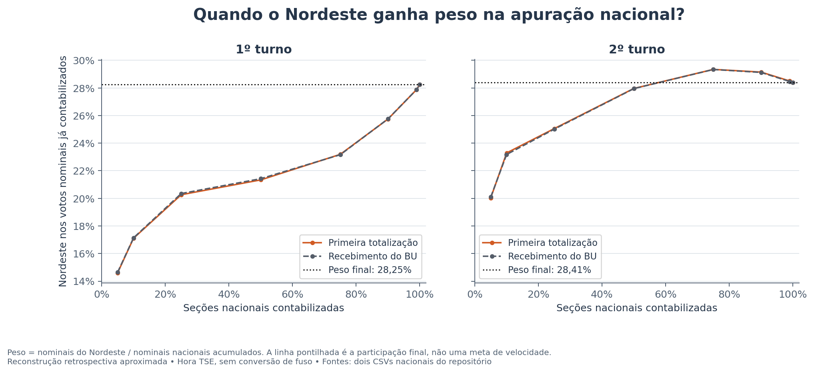
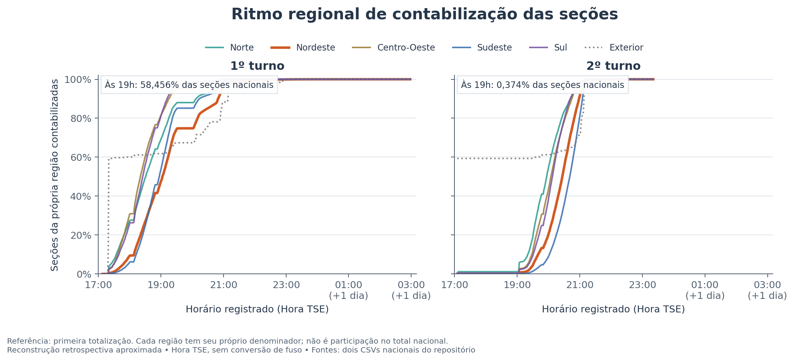
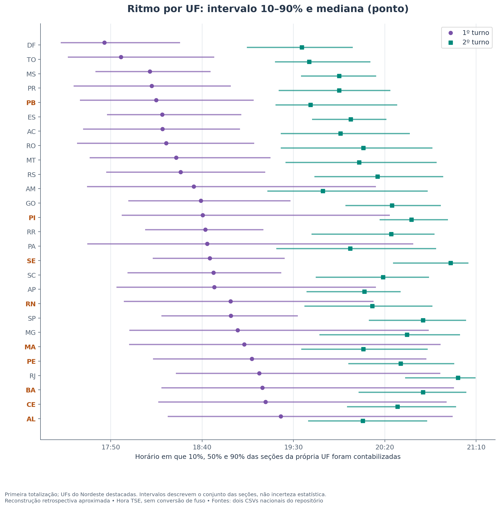
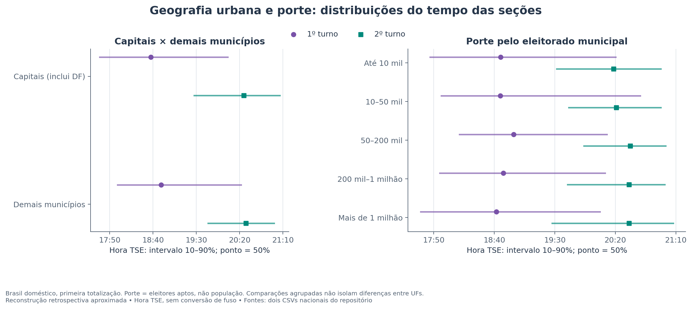
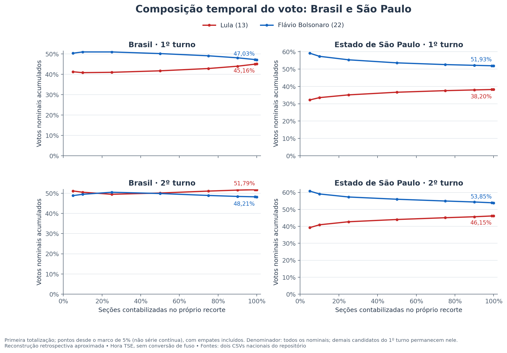
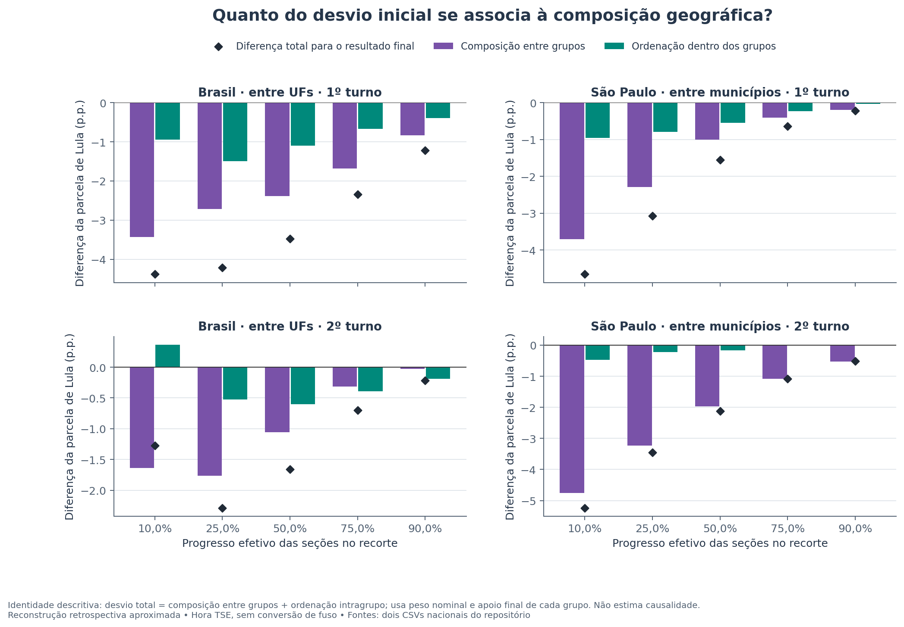

# Geografia da apuração presidencial de 2026

**Primeiro e segundo turnos — conclusões e evidências.** Análise dos arquivos fornecidos no repositório; referência principal: primeira totalização parcial de cada seção. A referência alternativa de recebimento do BU é usada como teste de sensibilidade. Horários preservados em Hora TSE, sem offset UTC confirmado.

## Conclusões principais

- **Há um padrão geográfico claro na ordem de entrada.** O Nordeste ficou mais sub-representado no primeiro turno. No marco de 50% das seções nacionais, tinha 39,07% de suas seções contabilizadas, contra 48,97% no segundo.
- **“Mais cedo” no segundo turno significa mais cedo em relação ao avanço nacional.** Em horário absoluto, o Nordeste atingiu 50% mais tarde: 19:03:52 no primeiro turno e 20:27:31 no segundo.
- **Capitais tenderam a avançar antes, mas isso não é uma regra universal.** A vantagem agregada foi maior no primeiro turno; a relação com porte municipal foi fraca e variou entre turnos e UFs.
- **A subida de Lula em São Paulo é confirmada.** A combinação de municípios que entravam no acumulado explica boa parte do desvio inicial frente ao resultado final, e há também ordenação dentro dos municípios. A capital ajuda, mas não explica sozinha o movimento.
- **Os arquivos mostram geografia e porte eleitoral, não o perfil individual dos eleitores.** Não permitem atribuir os padrões a renda, escolaridade, idade ou mudança de preferência durante a apuração.

## 1. Como a comparação foi feita

| Turno | Código da eleição | Seções com votos | Votos nominais |
|---|---|---|---|
| 1 | 6257 | 499.206 | 119.306.034 |
| 2 | 6258 | 499.205 | 124.082.273 |

São 998.411 chaves de seção/turno analisadas, todas pareadas sem multiplicação de votos e sem horários ausentes nas duas referências. Uma mesma seção física pode aparecer em ambos os turnos; a contagem acima é de registros seção/turno. As 85 chaves presentes apenas no detalhe, todas sem votos, não geram eventos nesta análise.

Foram usadas duas réguas: **horário fixo** e **mesmo percentual de seções contabilizadas**. O primeiro responde quando os dados entraram; o segundo mede quais territórios estavam adiantados ou atrasados em relação ao restante do país. Os marcos de progresso incluem todos os eventos empatados no instante em que o limiar é alcançado; por isso o percentual efetivamente atingido pode superar ligeiramente 10%, 50% etc.

O progresso é medido por **número de seções**, enquanto os percentuais dos candidatos e os pesos geográficos usam **votos nominais**. Seções não têm o mesmo número de votos. Exterior (`ZZ`) é mantido na agregação nacional e separado dos grupos domésticos de capital e porte. Brasília é tratada como capital; o DF não tem contraparte de interior nesta classificação.

## 2. Nordeste: a hipótese é confirmada em termos relativos

| Marco nacional de seções | NE concluído — 1º | NE concluído — 2º | Peso NE nos nominais — 1º | Peso NE — 2º |
|---|---|---|---|---|
| 10% | 6,50% | 8,45% | 17,11% | 23,29% |
| 50% | 39,07% | 48,97% | 21,34% | 27,96% |
| 90% | 82,52% | 92,34% | 25,74% | 29,15% |
| 100% | 100,00% | 100,00% | 28,25% | 28,41% |

No marco de 50%, o peso do Nordeste entre os votos nominais contados era 21,34%, frente a 28,25% no resultado final do primeiro turno. No segundo, esses pesos eram 27,96% e 28,41%. A composição já se parecia muito mais com a final no segundo turno, nesse estágio.



*Figura 1 — Representação do Nordeste comparando o mesmo progresso nacional. A linha de referência mostra o peso final, e a referência alternativa usa recebimento do BU.*

### Nem todos os estados do Nordeste avançaram mais no segundo turno

| UF | Seções da UF concluídas no marco nacional de 50% — 1º | 2º | Diferença (pp) |
|---|---|---|---|
| AL | 20,73% | 73,62% | 52,89 |
| BA | 30,59% | 28,00% | -2,59 |
| CE | 28,05% | 49,59% | 21,54 |
| MA | 40,51% | 74,64% | 34,13 |
| PB | 80,75% | 90,03% | 9,28 |
| PE | 35,60% | 46,59% | 10,99 |
| PI | 55,25% | 25,55% | -29,70 |
| RN | 45,06% | 69,38% | 24,31 |
| SE | 52,73% | 10,86% | -41,87 |

O avanço relativo maior foi observado em AL, MA, RN, CE, PE e PB. BA ficou ligeiramente menos avançada, e PI e SE ficaram substancialmente mais atrasados nesse marco. Portanto, a formulação correta é **“alguns estados do Nordeste entraram relativamente antes”**, sem generalizar o comportamento da região a todas as suas UFs.

### O relógio e o platô inicial do segundo turno

| Indicador | 1º turno | 2º turno |
|---|---|---|
| Nordeste: horário em que alcançou 50% das próprias seções | 19:03:52 | 20:27:31 |
| Brasil: seções contabilizadas às 19:00:00 | 58,456% | 0,374% |
| Brasil: horário de 10% das seções | 17:53:18 | 19:38:15 |
| Brasil: horário de 90% das seções | 20:16:26 | 21:01:47 |

O longo trecho horizontal inicial do segundo turno se apoia em pouquíssimas seções: às 19h havia apenas 0,374% do total nacional. Ele não deve ser lido como evidência de representatividade ampla ou de estabilidade do eleitorado. O avanço de 10% a 90% foi mais comprimido no segundo turno. Os arquivos permitem observar esse desenho temporal, mas não identificar sua causa operacional.



*Figura 2 — Ritmo das regiões no relógio registrado, com a mesma escala temporal nos dois turnos. A cobertura nacional às 19h explicita o tamanho reduzido da base inicial do segundo turno.*



*Figura 3 — Mediana e avanço até 90% por UF. Diferenças entre estados impedem interpretar o Nordeste ou qualquer região como bloco uniforme.*

## 3. Capitais e municípios menores: tendência, não regra

| Turno | Capitais: 50% | Demais municípios: 50% | Antecedência agregada das capitais | UFs com capital antes do restante |
|---|---|---|---|---|
| 1º | 18:37:19 | 18:49:14 | 11,92 min | 19/26 |
| 2º | 20:24:56 | 20:27:04 | 2,13 min | 16/26 |

As capitais chegaram à metade das seções antes no agregado, mas a vantagem foi pequena no segundo turno. As comparações dentro de UF mostram exceções relevantes. A comparação agregada é ponderada por seções e depende da distribuição regional; não mede um efeito isolado de “ser capital”.

| Porte: eleitorado municipal registrado | 50% das seções — 1º | 50% das seções — 2º |
|---|---|---|
| Até 10 mil | 18:45:23 | 20:18:37 |
| Mais de 10 a 50 mil | 18:45:06 | 20:20:50 |
| Mais de 50 a 200 mil | 18:56:10 | 20:32:19 |
| Mais de 200 mil a 1 milhão | 18:47:26 | 20:31:18 |
| Mais de 1 milhão | 18:41:48 | 20:31:21 |

Porte foi definido pelo total de eleitores aptos do município no primeiro turno disponível, mantido fixo entre os turnos. **Não é população residente.** As faixas não formam uma escada uniforme: municípios com mais de um milhão de eleitores chegaram à metade antes dos de até 10 mil no primeiro turno, mas depois deles no segundo. Região, UF e heterogeneidade dentro das faixas importam.



*Figura 4 — Capitais e faixas de eleitorado municipal. As medianas são de eventos de seção; o porte é eleitoral, não populacional.*

### Controle por UF e unidade de comparação

| Associação entre porte e horário mediano municipal | 1º turno | 2º turno |
|---|---|---|
| Correlação de Spearman, municípios com mesmo peso | 0,117 | 0,136 |
| Correlação entre ranks após retirar médias de UF | -0,002 | 0,087 |

A associação global é positiva, mas fraca: municípios maiores tenderam a ter mediana um pouco mais tardia. Ao retirar diferenças médias de UF, a relação praticamente desaparece no primeiro turno e permanece pequena no segundo. Isso enfraquece uma explicação geral baseada apenas em tamanho. Esses cálculos dão o mesmo peso a cada município, ao contrário das medianas nacionais de seção da tabela anterior.

## 4. São Paulo: a subida de Lula é real, mas tem mais de um componente

| Progresso das seções de SP | Lula — 1º turno | Lula — 2º turno |
|---|---|---|
| 10% | 33,55% | 40,91% |
| 25% | 35,12% | 42,70% |
| 50% | 36,65% | 44,03% |
| 75% | 37,56% | 45,07% |
| 90% | 37,98% | 45,65% |
| 99% | 38,20% | 46,11% |
| 100% | 38,20% | 46,15% |

O crescimento é geral, não estritamente monotônico. Por exemplo, no primeiro turno o percentual em SP cai ligeiramente entre o marco de 99% (38,2042%) e o resultado final (38,1984%). Pequenas oscilações não contradizem a tendência de conjunto.



*Figura 5 — Percentuais acumulados dos candidatos em marcos de progresso do Brasil e de São Paulo. Os pontos começam em 5% e usam os votos nominais do próprio turno; não são uma linha contínua de todos os eventos.*

| Turno | Capital: peso nos nominais no marco de 10% de SP | Capital: peso final | Lula: resultado final na capital | Lula no restante: marco de 10% → final |
|---|---|---|---|---|
| 1º | 14,60% | 26,33% | 46,58% | 31,85% → 35,20% |
| 2º | 13,11% | 26,51% | 55,50% | 38,84% → 42,78% |

A capital começou sub-representada nos dois turnos e termina mais favorável a Lula do que o restante do estado. Sua entrada ajuda a elevar o percentual estadual. Porém, Lula também sobe no conjunto dos demais municípios: a explicação não se reduz a “capital tardia versus interior precoce”.

### Separando combinação de municípios e ordenação interna

| Turno e marco de SP | Desvio de Lula frente ao próprio final (pp) | Composição entre municípios (pp) | Ordenação dentro dos municípios (pp) |
|---|---|---|---|
| 1º, 10% | -4,651 | -3,701 | -0,950 |
| 1º, 50% | -1,551 | -1,004 | -0,547 |
| 2º, 10% | -5,240 | -4,762 | -0,478 |
| 2º, 50% | -2,126 | -1,964 | -0,162 |

No marco de 10% de SP, a mistura de municípios responde por um componente de -3,701 pp no primeiro turno e -4,762 pp no segundo, relativamente ao resultado final. O restante é a diferença entre a votação já contada dentro de cada município e sua votação final. É uma identidade descritiva; não é prova de causalidade.

| Turno, marco de 10% de SP | Município | Peso corrente | Peso final | Contribuição centrada (pp) |
|---|---|---|---|---|
| 1º | SÃO PAULO | 14,60% | 26,33% | -0,983 |
| 1º | PIRACICABA | 3,61% | 0,91% | -0,286 |
| 1º | CATANDUVA | 2,17% | 0,25% | -0,243 |
| 2º | SÃO PAULO | 13,11% | 26,51% | -1,253 |
| 2º | PIRACICABA | 4,24% | 0,91% | -0,384 |
| 2º | CATANDUVA | 2,45% | 0,25% | -0,321 |

As contribuições acima são centradas na votação final estadual. Um termo negativo pode surgir tanto de um município mais favorável a Lula ainda sub-representado quanto de um município menos favorável já super-representado. Não significa que todos os municípios listados foram tardios. Os termos individuais não centrados, também disponíveis no CSV para auditoria, não devem ser interpretados isoladamente porque valores grandes se cancelam.

## 5. O mecanismo nacional: mudança na composição geográfica

| Turno e marco nacional | Desvio de Lula frente ao final (pp) | Composição entre regiões (pp) | Ordenação dentro das regiões (pp) |
|---|---|---|---|
| 1º, 10% | -4,377 | -3,988 | -0,389 |
| 1º, 50% | -3,478 | -2,417 | -1,061 |
| 2º, 10% | -1,275 | -1,972 | 0,697 |
| 2º, 50% | -1,661 | -0,955 | -0,706 |

No primeiro turno, a composição regional inicial é bastante menos favorável a Lula que a composição final. No segundo, esse componente continua presente, mas é menor nos mesmos marcos. No marco de 10% do segundo turno, a ordenação interna às regiões o compensa parcialmente. Assim, não basta olhar somente para o peso do Nordeste: também importa quais seções de cada região já tinham entrado.

Os níveis brutos dos candidatos não são diretamente comparáveis entre turnos: o primeiro contém outros candidatos, e o segundo apenas dois. Por isso, a tabela usa o desvio de cada turno frente ao **próprio resultado final**. O “mais estável” do segundo turno é compatível com menor desvio geográfico nesses marcos, mas o platô inicial com cobertura minúscula não deve fundamentar essa conclusão.



*Figura 6 — Identidade descritiva: composição entre regiões/UFs e ordenação interna. A decomposição de SP usa municípios. Os componentes variam com a granularidade geográfica e não são efeitos causais.*

## 6. Sensibilidade ao horário escolhido

| Indicador | 1º: totalização / recebimento | 2º: totalização / recebimento |
|---|---|---|
| Peso NE nos nominais no marco nacional de 50% | 21,34% / 21,42% | 27,96% / 27,95% |
| Composição municipal de SP no marco estadual de 10% (pp) | -3,701 / -3,745 | -4,762 / -4,797 |

As conclusões centrais se mantêm usando recebimento do BU. Isso mostra robustez à escolha entre os dois horários disponíveis, sem transformar o replay em histórico certificado das atualizações públicas.

## Método, limites e rastreabilidade

### Identidade da decomposição

Para cada grupo geográfico g, seja w_g(t) seu peso nos votos nominais já contados, p_g(t) a fração de Lula dentro desses votos e p_g(F) sua fração final. O contrafactual descritivo é C(t) = Σ_g w_g(t) p_g(F). Não altera votos nem simula uma eleição; apenas substitui a composição interna corrente de cada grupo pela sua composição final.

- Composição entre grupos = C(t) − P(F).
- Ordenação dentro dos grupos = P(t) − C(t).
- Desvio total = P(t) − P(F) = composição + ordenação interna.
- As tabelas expressam essas diferenças em pontos percentuais. Para contribuição municipal centrada, usa-se [w_g(t) − w_g(F)] × [p_g(F) − P(F)]; a soma continua igual ao componente de composição.

O t50 é o primeiro instante em que pelo menos metade das seções de um grupo foi contabilizada; o mesmo vale para t10/t90/t99. Seções simultâneas entram juntas. Horários fixos incluem eventos até HH:MM:00; curvas por minuto incluem o intervalo inteiro do minuto. O horizonte temporal mantém datas completas. Percentuais de candidato excluem brancos, nulos e votos em separado do denominador nominal.

### Controle descritivo adicional por UF

| Modelo municipal, pesos iguais | 1º turno | 2º turno |
|---|---|---|
| Minutos por multiplicar o eleitorado por 10, controlando UF e indicador de capital | 0,14 | 6,43 |
| Indicador de capital: diferença em minutos, controlando UF e log10 do eleitorado | -17,73 | -18,05 |

A regressão é um ajuste linear descritivo da mediana municipal por log10 do eleitorado, indicador de capital e interceptos de UF. Usa 5.571 municípios domésticos com igual peso por turno. Difere da ponderação por seções das tabelas agregadas; coeficientes não são efeitos causais. A comparação capital/interior tem suporte limitado em faixas de tamanho semelhantes, e características não observadas podem explicar associações. Não foram usados testes de significância como substitutos de magnitude: o universo observado é censitário, condicionado à cobertura dos arquivos.

- Os quantitativos são finais na extração, associados retrospectivamente ao horário da seção. Substituições de BUs, retotalizações e publicações sucessivas não são reconstruídas integralmente.
- Geografia e porte eleitoral não equivalem a renda, idade, escolaridade, perfil urbano/rural ou comportamento individual. Nenhuma dessas características foi adicionada de outra fonte.
- Diferenças no ritmo registrado não identificam, por si só, causas técnicas ou administrativas. Tampouco demonstram que eleitores mudaram de preferência enquanto a apuração avançava.
- A decomposição depende de usar regiões, UFs ou municípios. Os componentes são contábeis, não percentuais causais de explicação.
- Os hashes das duas entradas foram conferidos contra o replay antes desta análise; o banco derivado é lido sem modificar as fontes.

### Arquivos de evidência e reprodução

| Arquivo | Onde conferir |
|---|---|
| [analysis-manifest.json](analysis-manifest.json) | Proveniência, hashes, cobertura, capitais e definição de porte |
| [independent-validation.json](independent-validation.json) | Conferência independente dos marcos e horários contra o banco do replay original |
| [national-milestones.csv](national-milestones.csv) | Progresso nacional/estadual e percentuais de Lula/Flávio; colunas scope e requested_sections_percentage |
| [milestone-composition.csv](milestone-composition.csv) | Pesos geográficos corrente/final e conclusão própria de cada grupo |
| [timing-summary.csv](timing-summary.csv) | t10/t50/t90/t99 por região, UF, capital e faixa; comparações dentro de UF |
| [clock-completion.csv](clock-completion.csv) | Cobertura em HH:MM:00; referência temporal explícita |
| [composition-decomposition.csv](composition-decomposition.csv) | componentes composition_effect_pp e within_group_effect_pp |
| [sp-municipality-contributions.csv](sp-municipality-contributions.csv) | Pesos de municípios de SP e centered_composition_contribution_pp |
| [municipality-controls.json](municipality-controls.json) | Correlações e coeficientes municipais com e sem controle por UF |
| [municipality-timing.csv](municipality-timing.csv) | Mediana, faixa, eleitorado e indicador de capital de cada município |
| [geographic-minute.csv](geographic-minute.csv) | Séries completas por minuto de regiões e UFs |

A suíte de validação da implementação cobre cálculos do replay e da análise geográfica, inclusive empates temporais, ponderação nominal, decomposição e preservação dos dados. Essas verificações não são certificação externa das fontes.

Nesta execução, a conferência independente comparou 864 valores dos marcos e 1.632 valores de horários fixos ao banco do replay; divergências: 0. Também verificou os coeficientes do ajuste municipal por outro método numérico. O resultado completo está em `independent-validation.json`.

Na raiz do repositório, com o replay original concluído e as dependências de análise instaladas:

```bash
PYTHONPATH=src python3 -m election_replay.geography_run --output output/geography-new
```

A pasta de saída deve ser nova. A reprodução gera tabelas, gráficos e este relatório a partir das mesmas regras. Em novas extrações ou alterações de cobertura, as conclusões devem ser reavaliadas junto com os valores recalculados.
