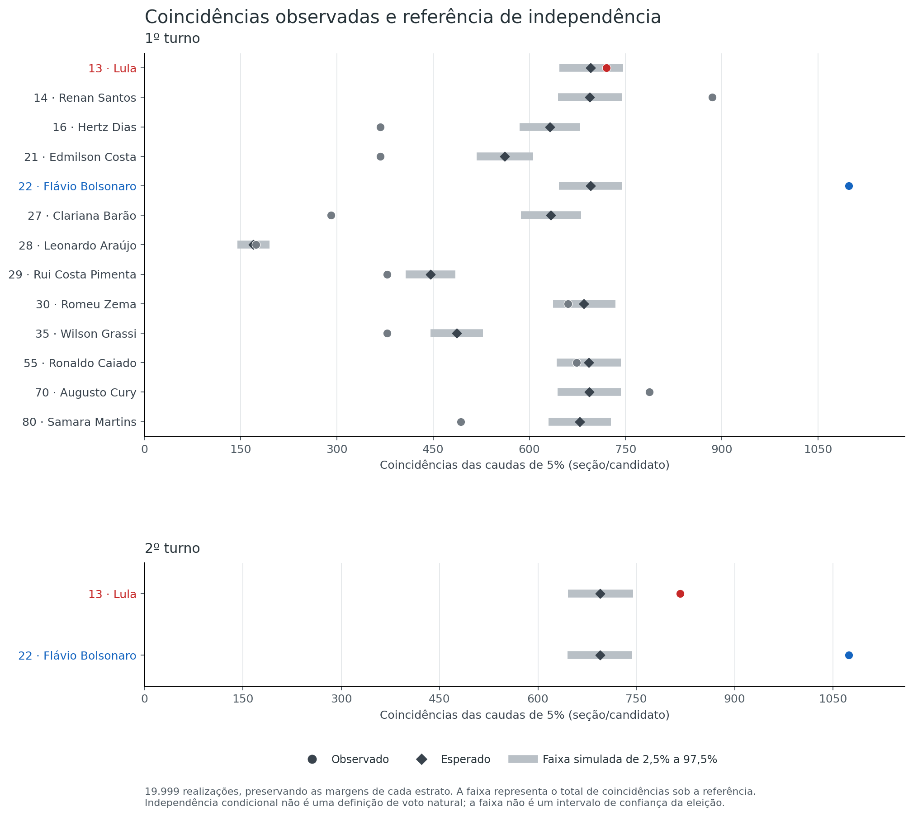
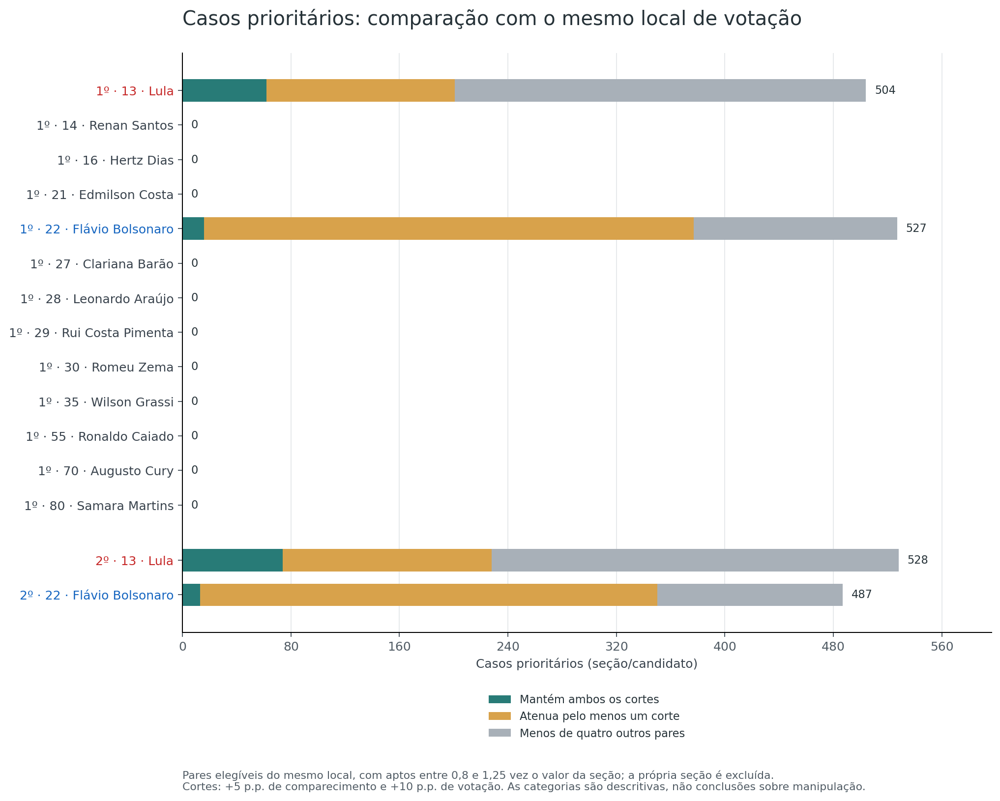

# H2 — High turnout and candidate concentration

[Hypothesis index](../README.md) · [Method](METHOD.md) · [Evidence and reproduction](README.md)

**Question:** Do comparable polling sections show more overlap between high turnout and high candidate support than the statistical reference predicts?

**Answer:** Yes, for **five of 15 candidate/round combinations** under the primary reference. A separate magnitude screen identifies **2,046 priority cases**. Of these, **165** still meet both magnitude thresholds when compared with other sections at the same polling place, **991** attenuate, and **890** lack enough local peers. These findings identify associations and local contrasts; they do not establish an artificial cause.

**Assessment: 6/10 — partial support for the statistical hypothesis.** Scale: **0 — Fully refuted → 10 — Fully confirmed**. The detected associations support part of the hypothesis, while attenuation, incomplete coverage, and sensitivity to the definition of an extreme limit the conclusion. The score is a qualitative summary, not a probability of manipulation; see the [assessment scale](../README.md#assessment-scale).

**Identification difficulty: medium.** Finding a contrast is simpler than determining its source.

## What was compared

The analysis covers all nominal candidates **in each round**: 13 in round 1 and two in round 2. It compares sections in the same state, municipality, electoral zone, and registered-electorate size band. Turnout means voters who attended divided by registered voters; candidate share uses votes assigned to candidates as its denominator.

Within each comparison group, a section is screened for membership in both upper 5% tails. The formal test asks whether their overlap exceeds a conditional-independence reference. It preserves how many sections fall in each tail, rather than assuming an expected electoral result for any candidate.

| Coverage | Round 1 | Round 2 |
|---|---:|---:|
| Eligible sections | 498,484 | 498,528 |
| Sections with enough comparison peers | 348,776 | 348,776 |
| Coverage of eligible sections | 69.97% | 69.96% |
| Supported comparison groups | 3,877 | 3,877 |

Approximately 30% of eligible sections have too few comparable peers and remain outside the reference. Smaller municipalities are more often uncovered. The findings therefore describe the supported sections, not every section in the source files. Full exclusions and state coverage are in [coverage.csv](evidence/analysis/coverage.csv).

## Where association was detected

The primary family contains 15 tests, adjusted together using Holm. Five detect excess overlap; Lula in round 1 is included below to show why an aggregate test and a local screen can lead to different findings.

| Round | Candidate | Observed overlap | Expected under independence | Holm-adjusted p | Excess detected? |
|---|---|---:|---:|---:|---|
| 1 | Lula (13) | 720 | 695.8 | 1.000 | No |
| 1 | Renan Santos (14) | 885 | 693.9 | 0.00075 | Yes |
| 1 | Flávio Bolsonaro (22) | 1,098 | 695.5 | 0.00075 | Yes |
| 1 | Augusto Cury (70) | 787 | 693.3 | 0.00275 | Yes |
| 2 | Lula (13) | 817 | 694.9 | 0.00075 | Yes |
| 2 | Flávio Bolsonaro (22) | 1,074 | 694.6 | 0.00075 | Yes |

The other nine candidate/round combinations do not show excess under this reference. All 15 results, including raw p-values and simulated reference ranges, appear in [association-tests.csv](evidence/analysis/association-tests.csv).

**Statistical detection and local magnitude answer different questions.** Renan Santos and Augusto Cury show aggregate association but no case passes both additional magnitude thresholds. Conversely, Lula has 504 priority cases in round 1 without detected aggregate excess. A non-detection in the aggregate does not remove those descriptive cases.

## What changes with a closer local comparison

The complete inventory contains **9,165 section/candidate/round occurrences**, representing **7,867 section/round keys**. The priority screen selects cases at least **5 percentage points above the group median in turnout** and **10 points above it in candidate share**. This is a descriptive filter, not an individual significance test.

The 2,046 priorities are distinct section/round keys. Their closer comparison uses at least four other eligible sections at the same polling place, with similar registered electorates; the section itself is excluded from those peer medians.

| Round and candidate | Priority cases | Both thresholds persist | At least one attenuates | Insufficient peers |
|---|---:|---:|---:|---:|
| 1 — Lula | 504 | 62 | 139 | 303 |
| 1 — Flávio Bolsonaro | 527 | 16 | 361 | 150 |
| 2 — Lula | 528 | 74 | 154 | 300 |
| 2 — Flávio Bolsonaro | 487 | 13 | 337 | 137 |
| **Total** | **2,046** | **165** | **991** | **890** |

Among the **1,156 cases with enough local peers**, 991 no longer meet both thresholds. The contrast depends on the comparison group: a section can differ from its wider electoral zone while resembling other sections at its polling place. That observation does not establish the cause of the contrast. The 165 persistent cases remain descriptive flags, and the 890 unsupported cases remain unresolved by this local comparison.

Every primary joint-tail case, including original counts and source-row references, is retained in [cases.csv](evidence/analysis/cases.csv). Occurrences across candidates or rounds must not be counted as distinct physical sections.

## How far the conclusion extends

The definition of an extreme matters. The published sensitivity scenarios change one choice at a time without adding formal p-values. With a 10% tail, Lula's overlap is below its conditional expectation in both rounds; the primary 5% tail detects excess in round 2. Flávio Bolsonaro's observed overlap exceeds the expectation in all seven descriptive configurations. These comparisons do not extend the primary test's significance to other definitions; see [sensitivity.csv](evidence/analysis/sensitivity.csv).

Legitimate mobilization, geographic clustering, and unobserved social composition can associate turnout with candidate support even within the comparison groups. The reference does not model every such dependence. It also cannot assess unsupported sections or reliably detect a change shared by most members of a comparison group. Registered-electorate size is not a measure of resident population or individual demographics.

**Conclusion:** H2 finds aggregate associations and a documented set of local contrasts, with substantial attenuation and gaps in peer coverage. The evidence does not support treating these counts as manipulated sections or suspicious votes. The [method guide](METHOD.md) explains the reference and its limits; the [reproduction guide](README.md) links the original execution and validation records.
