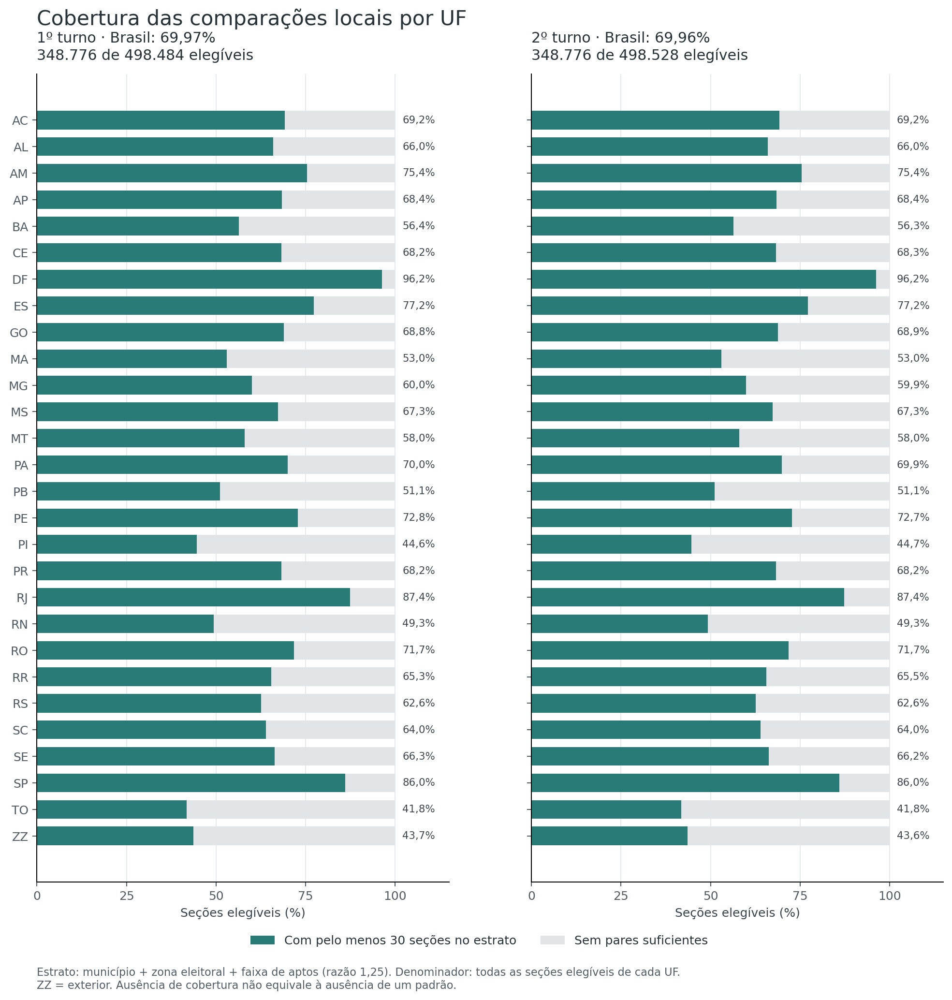
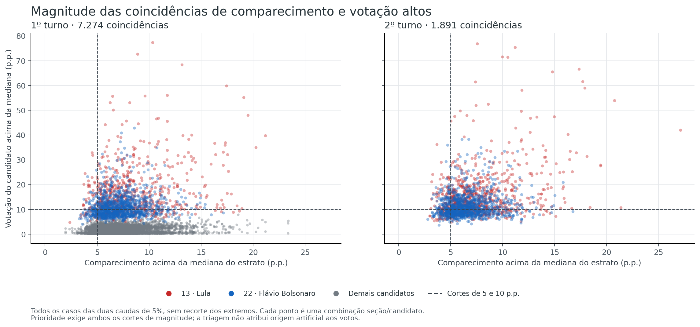

# Hipótese 2 — Comparecimento alto e concentração de votos

[Índice das hipóteses](../README.pt-BR.md) · [Protocolo](METHOD.pt-BR.md) · [Reprodução e arquivos](README.md)

**Resultado:** foram encontradas combinações locais de comparecimento e votação elevados. Na referência formal adotada, houve excesso de coincidências em **cinco das 15 combinações candidato/turno**. Isso rejeita uma hipótese de independência entre duas características, sem identificar sua causa ou demonstrar manipulação. A triagem produziu **2.046 ocorrências prioritárias**; em 165, os dois cortes de magnitude persistiram na comparação com outras seções do mesmo local de votação. Em 890, não havia pares locais suficientes.

Não cabe declarar a H2 integralmente refutada nem interpretar esses números como quantidade de seções manipuladas. A cobertura é parcial e parte importante dos contrastes se atenua com uma referência territorial mais próxima.

## Hipótese e dificuldade

**Hipótese:** algumas seções apresentam simultaneamente comparecimento e concentração de votos em um candidato muito diferentes das observadas em seções comparáveis.

**Dificuldade de identificação: média.** Encontrar extremos é simples; distinguir um sinal estatístico de mobilização e composição social legítimas exige controles e contexto. A direção investigada é comparecimento **alto** com votação **alta**, para todas as candidaturas nominais presentes nos dois turnos. Comparecimento baixo e mudanças entre turnos não são os testes desta entrega.

O [protocolo](METHOD.pt-BR.md) foi definido antes de calcular as caudas; seu hash está no [manifesto](evidence/analysis/manifest.json). Não é pré-registro externo.

## Dados, elegibilidade e cobertura

Os dois CSVs nacionais originais foram relidos. Seus hashes coincidem com os da etapa 1 e da H1. Os votos foram reconciliados por seção; ausência de linha de uma candidatura existente corresponde a zero depois dessa conferência. Campo numérico ausente nunca vira zero.

Entram seções instaladas e não anuladas, com pelo menos 50 aptos, comparecimento positivo e pelo menos 50 votos nominais. O estrato compara **UF, município, zona e faixa de aptos** iguais. A faixa é `floor(log(aptos)/log(1,25))`; seções de uma faixa diferem em tamanho por fator inferior a 1,25. Exigem-se pelo menos 30 seções elegíveis no grupo, sem buscar automaticamente pares em outro município.

| Cobertura | Primeiro turno | Segundo turno |
|---|---:|---:|
| Registros de detalhe | 499.248 | 499.248 |
| Excluídos pela situação da seção | 41 | 41 |
| Excluídos por aptos abaixo de 50 | 256 | 256 |
| Excluídos por comparecimento não positivo | 1 | 1 |
| Excluídos por nominais abaixo de 50 | 466 | 422 |
| Elegíveis | 498.484 | 498.528 |
| Elegíveis sem estrato com 30 seções | 149.708 | 149.752 |
| Seções efetivamente comparadas | **348.776** | **348.776** |
| Cobertura entre elegíveis | **69,97%** | **69,96%** |
| Estratos com suporte | 3.877 | 3.877 |

Os motivos de exclusão são exclusivos, na ordem da tabela. Contagens iguais entre turnos não significam identidade das seções. No exterior, 556 de suas 1.272/1.276 elegíveis têm suporte. As 41 não instaladas da H1 aparecem na primeira exclusão, sem alterar seus registros.

A cobertura varia: cerca de 96,24% no DF, 87,35% no RJ e 86,02% em SP, diante de aproximadamente 41,8% no TO e 44,6% no PI. Municípios e grupos pequenos ficam mais frequentemente sem pares. A conclusão não pode ser estendida aos aproximadamente 30% de elegíveis não comparadas.

Dados completos: [coverage.csv](evidence/analysis/coverage.csv). Porte significa eleitorado registrado, não população ou perfil socioeconômico individual.

## Como foi feita a comparação

Comparecimento é `comparecimento/aptos`; votação é `votos do candidato/nominais`. Dentro do estrato, a seção entra na cauda superior de 5% quando a quantidade de valores **maiores ou iguais ao seu**, dividida pelo tamanho do grupo, é no máximo 5%. Empates são preservados: não se escolhem seções arbitrariamente para preencher uma quota. Grupo constante não tem cauda superior.

Suporte para comparação não garante caudas informativas em todas as candidaturas. Cinco estratos de cada turno não têm cauda de comparecimento; para o candidato 28, no primeiro turno, 1.967 dos 3.877 estratos não têm cauda de votação. Esses grupos contribuem zero para a coincidência. Os tamanhos efetivos das caudas constam em [strata.csv](evidence/analysis/strata.csv).

Toda coincidência das duas caudas entra no inventário. Uma segunda classificação exige comparecimento pelo menos **5 pontos percentuais** e votação pelo menos **10 pontos** acima das respectivas medianas do estrato. Esse é um filtro descritivo de prioridade, sem valor-p individual. As medianas do estrato incluem a própria seção.

Para os casos prioritários, consulta-se o mesmo local de votação, município e zona, com aptos entre 0,8 e 1,25 vezes o valor da seção. Exigem-se quatro **outros** pares elegíveis. Suas medianas excluem a própria seção. Os resultados são persistência dos dois cortes, atenuação de pelo menos um ou contexto insuficiente. Isso acrescenta contexto, sem transformar a comparação em prova independente da origem dos votos.

### O que o teste formal pergunta

Em cada estrato, preservam-se os números de seções nas duas caudas. Se fossem independentes, um grupo de tamanho `n`, com `a` seções de comparecimento alto e `b` de votação alta, teria coincidência esperada `a*b/n`. O total observado é comparado com a soma de referências hipergeométricas dos estratos.

Foram geradas **19.999 realizações por candidatura/turno**, com semente `20261028`, e aplicado Holm a 5% à família fixa de 15 testes. O valor-p usa `(1 + excedências)/20.000`, nunca zero. A busca é unilateral, por excesso. A faixa simulada é uma referência para o total, não intervalo de confiança da eleição nem limite por seção.

**Independência condicional não significa naturalidade.** Mobilização, composição social e geografia legítimas podem associar as duas variáveis dentro do estrato. A referência também não representa todas as dependências espaciais e a variação de precisão dos percentuais. Um excesso indica associação que esse modelo não explica; não identifica inclusão de votos.

## Resultados por candidatura

Todos os testes usam 348.776 seções por turno. “Esperado” é a expectativa sob independência, não um resultado eleitoral esperado. A última coluna é o valor-p ajustado; “sim” indica excesso detectado nessa referência.

| Turno | Candidato | Coincidências | Esperado | Observado/esperado | Prioridade | Excesso; p de Holm |
|---|---|---:|---:|---:|---:|---|
| 1 | 13 — Lula | 720 | 695,8 | 1,03 | 504 | Não; 1,000 |
| 1 | 14 — Renan Santos | 885 | 693,9 | 1,28 | 0 | **Sim; 0,00075** |
| 1 | 16 — Hertz Dias | 368 | 631,9 | 0,58 | 0 | Não; 1,000 |
| 1 | 21 — Edmilson Costa | 368 | 561,9 | 0,65 | 0 | Não; 1,000 |
| 1 | 22 — Flávio Bolsonaro | 1.098 | 695,5 | 1,58 | 527 | **Sim; 0,00075** |
| 1 | 27 — Clariana Barão | 291 | 633,4 | 0,46 | 0 | Não; 1,000 |
| 1 | 28 — Leonardo Araújo | 174 | 169,4 | 1,03 | 0 | Não; 1,000 |
| 1 | 29 — Rui Costa Pimenta | 378 | 446,1 | 0,85 | 0 | Não; 1,000 |
| 1 | 30 — Romeu Zema | 660 | 685,2 | 0,96 | 0 | Não; 1,000 |
| 1 | 35 — Wilson Grassi | 378 | 487,1 | 0,78 | 0 | Não; 1,000 |
| 1 | 55 — Ronaldo Caiado | 674 | 693,0 | 0,97 | 0 | Não; 1,000 |
| 1 | 70 — Augusto Cury | 787 | 693,3 | 1,14 | 0 | **Sim; 0,00275** |
| 1 | 80 — Samara Feitosa | 493 | 678,5 | 0,73 | 0 | Não; 1,000 |
| 2 | 13 — Lula | 817 | 694,9 | 1,18 | 528 | **Sim; 0,00075** |
| 2 | 22 — Flávio Bolsonaro | 1.074 | 694,6 | 1,55 | 487 | **Sim; 0,00075** |

Há associação detectada para 14, 22 e 70 no primeiro turno e 13 e 22 no segundo. Renan Santos e Augusto Cury não têm casos que satisfaçam conjuntamente os cortes de magnitude de 5/10 pontos: significância e tamanho do contraste são questões distintas. Lula tem 504 prioridades no primeiro turno, apesar de não apresentar excesso agregado significativo. Ausência de excesso global não elimina casos locais.

O corte de 10 pontos exige um contraste absoluto grande e pode deixar de selecionar efeitos proporcionalmente expressivos em candidaturas pequenas. Zero prioridades não equivale a ausência de qualquer comportamento atípico.

Os números completos, faixas simuladas e valores-p brutos estão em [association-tests.csv](evidence/analysis/association-tests.csv). Não houve referência degenerada nesta execução.

## Magnitude e contexto no mesmo local

O inventário contém **9.165 ocorrências seção/candidato/turno**, distribuídas por **7.867 chaves seção/turno**. As 2.046 prioridades correspondem a 2.046 chaves seção/turno distintas. Isso não conta seções físicas distintas entre turnos. Os demais 7.119 casos não receberam a avaliação local.

| Turno e candidato | Prioritários | Persistem os dois cortes | Atenua pelo menos um | Pares insuficientes |
|---|---:|---:|---:|---:|
| 1 — Lula | 504 | 62 | 139 | 303 |
| 1 — Flávio Bolsonaro | 527 | 16 | 361 | 150 |
| 2 — Lula | 528 | 74 | 154 | 300 |
| 2 — Flávio Bolsonaro | 487 | 13 | 337 | 137 |
| **Total** | **2.046** | **165** | **991** | **890** |

Entre os 1.156 casos com contexto suficiente, 991 deixam de cumprir pelo menos um corte ao mudar a referência para o mesmo local. Isso é compatível com heterogeneidade dentro da zona, sem demonstrar a causa de cada contraste. Os 165 persistentes continuam no inventário; persistência não é evidência suficiente de manipulação. Os 890 sem suporte tampouco podem ser classificados como explicados.

Em números brutos, SP tem mais prioridades: para o candidato 22, 140/142 nos dois turnos; para 13, 68/84. Entretanto, SP também concentra aproximadamente 25,5% das seções cobertas. Esse ranking não é um teste estadual de anomalia. No CE, das 51/48 prioridades de Lula, 45/44 não têm pares locais suficientes. [uf-summary.csv](evidence/analysis/uf-summary.csv) permite consultar esses recortes, sem valores-p selecionados por UF.

### Exemplos para consultar o inventário

A tabela mostra o maior desvio de comparecimento entre os prioritários de cada finalista/turno. É uma seleção descritiva com a mesma regra para as quatro combinações, sem teste individual ou indicação de irregularidade. Diferenças são em pontos percentuais contra a mediana do estrato.

| Turno; candidato | Município; zona/seção; local | Diferença de comparecimento | Diferença de votação | Contexto local |
|---|---|---:|---:|---|
| 1; 13 | São Carlos/SP; 121/451; 1988 | +21,18 | +39,81 | Sem outros pares elegíveis |
| 1; 22 | Campinas/SP; 33/479; 2313 | +15,39 | +12,10 | 12 pares; diferença de votação cai para +4,71 |
| 2; 13 | Oiapoque/AP; 4/85; 1082 | +27,11 | +41,99 | Três pares; suporte insuficiente |
| 2; 22 | Rio de Janeiro/RJ; 119/439; 1627 | +15,83 | +20,94 | Quatro pares; diferença de votação cai para +8,67 |

Os códigos municipais são 70793, 62910, 6092 e 60011, respectivamente. As chaves, contagens, percentuais e linhas originais estão em [cases.csv](evidence/analysis/cases.csv). Não foram incorporados dados externos que permitissem caracterizar o público dessas seções.

## Sensibilidade das escolhas

Foram definidos sete cenários, incluindo o primário. Cada alternativa altera um parâmetro; não gera novos valores-p para escolher o resultado mais favorável.

| Cenário | Cobertura T1/T2 | Prioridades T1, 13/22 | Prioridades T2, 13/22 |
|---|---:|---:|---:|
| Primário | 348.776 / 348.776 | 504 / 527 | 528 / 487 |
| Cauda de 2,5% | 348.776 / 348.776 | 202 / 168 | 206 / 176 |
| Cauda de 10% | 348.776 / 348.776 | 1.062 / 1.063 | 1.052 / 1.013 |
| Mínimo de 20 seções | 392.130 / 392.096 | 574 / 573 | 615 / 522 |
| Faixa de aptos ×1,5 | 388.445 / 388.332 | 616 / 652 | 679 / 594 |
| Deslocamento de meia faixa | 345.771 / 345.813 | 484 / 527 | 513 / 488 |
| Mínimo de 100 nominais | 348.743 / 348.711 | 504 / 527 | 528 / 487 |

Elevar o piso de nominais mantém as prioridades. Alterar as faixas muda o inventário: no deslocamento de meia faixa, persistem como prioritários 298/442 e 315/481 casos de 13/22 no primeiro turno, e 322/467 e 276/439 no segundo. Os denominadores incluem apenas casos originais ainda cobertos.

A largura da cauda também importa. Com 10%, Lula tem 2.590/2.824 coincidências, abaixo das expectativas de 3.160,9/3.155,5; com 5%, o segundo turno tem excesso. Para 22, o observado supera o esperado nas sete configurações. Essas comparações são descritivas e reforçam que o resultado formal vale para a referência primária de 5%, não para qualquer definição de extremo. [sensitivity.csv](evidence/analysis/sensitivity.csv) contém todas as candidaturas e retenções.

## Validação e alcance da conclusão

A [validação independente](evidence/independent-validation.json) passou, sem divergências: relê os originais sem importar o parser ou modelo primário, usa razões exatas para empates, medianas e cortes e confronta estratos, casos e contexto local. Foram regeneradas e conferidas **299.985 contagens simuladas** dos 15 fluxos, incluindo valores-p e Holm. As seis sensibilidades alternativas não são recalculadas independentemente nessa conferência. Testes artificiais ficam separados das observações eleitorais; consulte [test-results.txt](evidence/test-results.txt).

Uma [conferência de publicação](evidence/publication-validation.json) reconstrói os resumos por UF e do JSON a partir das tabelas primárias já validadas e verifica os artefatos dos gráficos. Essa conferência não acrescenta uma validação independente dos modelos de sensibilidade. O [inventário de arquivos](evidence/artifact-manifest.json) registra os hashes do relatório, código e evidências publicados.

Os **28 testes de implementação passaram**. Entre os controles estão empates, zeros, limites de magnitude, falta de pares, integridade das fontes e do cache, um sinal artificial que preserva as identidades contábeis e um exemplo de heterogeneidade legítima que gera associação. Esses controles verificam o funcionamento do método; não estimam a probabilidade de detectar toda alteração possível.

O [README](README.md) contém os comandos; [strata.csv](evidence/analysis/strata.csv) e os demais arquivos de [evidência](evidence/analysis/) permitem reproduzir a conclusão. Gráficos são formatos complementares; este Markdown é o registro principal.

**Conclusão:** há perfis atípicos e associações de comparecimento/votação que impedem descartar a H2 como ausência geral de sinais. O estudo delimita onde esses sinais aparecem, sua magnitude, sua sensibilidade e onde o contexto é insuficiente. Não demonstra uma origem artificial para eles. Uma ação que afetasse a maioria de um estrato poderia deslocar a própria referência e permanecer invisível; cobertura parcial e características individuais não observadas também limitam a análise. Consistência com dados públicos não autentica as fontes externamente nem garante naturalidade. As hipóteses H3–H7 permanecem sem avaliação.
