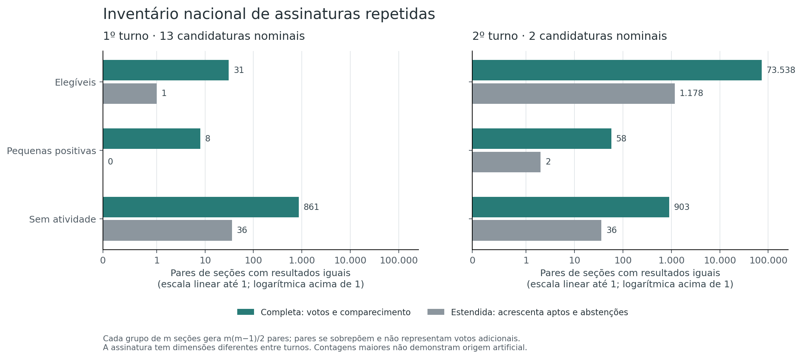
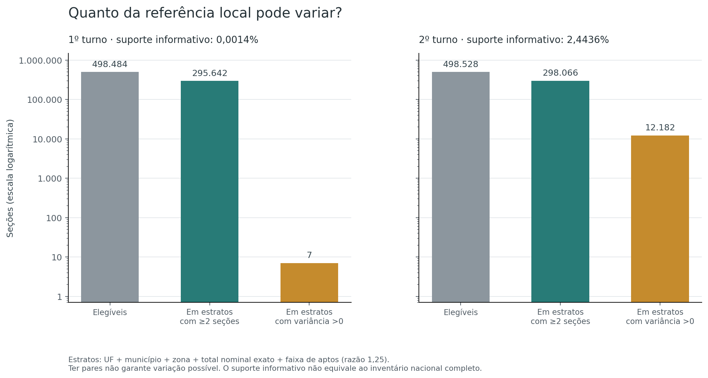

# H3 — Repetition of complete section results

[Hypothesis index](../README.md) · [Method](METHOD.md) · [Evidence and reproduction](README.md)

**Question:** do complete vote results recur across different polling sections more often than their context would suggest? **Identification difficulty: medium.**

**Answer: inconclusive.** The nationwide inventory found **31 matching pairs in round 1 and 73,538 in round 2** among eligible sections. A separate, restricted local test detected no excess, but its informative coverage was too limited to settle the broader question—especially in round 1.

The analysis delivers a traceable inventory of exact matches. It does not establish that all nationwide repetitions are natural or identify copied votes.

## Assessment

**5/10 — Inconclusive.** Scale: **0 — Fully refuted → 10 — Fully confirmed**.

The conditional test found no excess, but it covers only a narrow part of the inventory and preserves repetition within each result block. The evidence therefore does not justify placing the broad hypothesis on either side. This is an ordinal assessment of the statistical hypothesis, not a probability of manipulation; **5 does not mean 50%**. See the [scale rubric](../README.md#assessment-scale).

## What was counted

A match means identical **integer counts** for every candidate, blank and null votes, party-list and separately recorded invalidated votes, and turnout, on **distinct section keys**. Equal rounded percentages do not qualify. Both rounds include all their candidates: 13 in round 1 and two in round 2.

The primary eligible population contains installed, non-annulled sections with at least 50 registered voters, positive turnout, and at least 50 nominal votes. An extended signature also requires registered electorate and abstentions to match. Here, nominal votes means votes assigned to candidates.

| Eligible-section inventory | Round 1 | Round 2 |
|---|---:|---:|
| Sections | 498,484 | 498,528 |
| Groups sharing a complete result | 31 | 54,379 |
| Sections in those groups | 62 | 117,657 |
| Matching unordered pairs | **31** | **73,538** |
| Largest group | 2 sections | 7 sections |
| Pairs also matching electorate and abstentions | 1 | 1,178 |

The pair count is not a count of independent incidents: a seven-section group contributes 21 overlapping pairs. Nor does it count additional votes.

**The difference between rounds is not itself an anomaly test.** A result vector with two candidates has fewer components than one with 13. The rounds also differ in turnout and vote distributions; this inventory does not assign the difference to a single cause.

Sections without activity are reported separately. Their all-zero signatures produce **861 pairs in round 1 and 903 in round 2**, from 42 and 43 sections. These are coincidences of empty vote/turnout vectors, not repeated ballots. The inventory does not independently establish why those sections had no activity.

An example shows the importance of the definition: seven round-2 sections share 87 votes for candidate 13, 126 for candidate 22, three blank votes, four null votes, and turnout of 220. Their registered electorate ranges from 248 to 295, so the vote results match while the full registration records do not. The source keys are traceable through [cluster-members.csv.gz](evidence/analysis/cluster-members.csv.gz).

## What the local test found

The formal reference asks a narrower question: **within comparable local sections, does pairing candidate results with turnout and special-vote counts create too many complete matches?**

It keeps sections within the same state, municipality, electoral zone, exact nominal-vote total, and electorate-size band. It reassigns the entire candidate-count block while keeping the other block fixed. That preserves the observed repetition of each block; it tests their pairing, not every nationwide match.

| Restricted local reference | Round 1 | Round 2 |
|---|---:|---:|
| Strata with a variable pair-count statistic | 1 | 1,575 |
| Sections in those informative strata | **7** | **12,182** |
| Share of eligible sections in informative strata | **0.0014%** | **2.4436%** |
| Observed matching pairs within strata | **0** | **176** |
| Expected pairs under the reference | 0.2381 | 175.2873 |
| Conservative tail bound | 1.00000 | 0.99582 |
| Bound after Holm adjustment | 1.00000 | 1.00000 |
| Excess detected by the defined criterion | No | No |

These are **conservative Cantelli bounds, not exact p-values**. The means and variances use exact rational arithmetic, with no Monte Carlo simulation. The conservative decision rule may have less power than a full exact tail calculation.

**The 176 local pairs are not the 73,538 nationwide pairs.** Their expected count of 175.2873 belongs only to the restricted statistic. Comparing that expectation with the national inventory would answer the wrong question.

The coverage is central to the conclusion. Many strata contain multiple sections but have a pair count that cannot change under reassignment. They provide no information for detecting an excess; they are not classified as evidence of naturalness.

## What the sensitivity checks add

The predefined descriptive alternatives relaxed local grouping or electorate bands, or raised the nominal-vote floor. They were not used to select additional significance tests.

With municipality-wide grouping and no zone or electorate band, informative support rises to **1,235 sections in round 1 and 125,649 in round 2**. Round 1 still has zero local pairs: its 31 national pairs lie between different municipalities. In round 2, the small observed-minus-expected difference changes sign across some definitions. The results do not support a conclusion that is invariant to the chosen local context. Full scenarios are in [sensitivity.csv](evidence/analysis/sensitivity.csv).

## What this establishes—and what remains open

The inventory documents exact repetition without relying on visual similarity or rounded percentages. The local test does not detect excess pairing under its stated reference. **The broader hypothesis remains inconclusive**, because informative support is limited and the reference retains marginal repetition of the candidate blocks.

Matches across contexts, approximate similarities, and changes that dominate a stratum are outside that conclusion. Aggregate matches identify neither individual voter behavior nor an artificial cause. The supplied sources were not independently authenticated against external ballot reports.

## Evidence and validation

The published run passed **31 implementation tests**. A separate parser checked the primary populations, signatures, repeated-group members, all **598,764 primary strata**, rational moments, Cantelli bounds, and Holm adjustment without discrepancies. Alternative sensitivity calculations were not repeated by that independent implementation. These are integrity checks, not independent statistical observations.

Start with [inventory.csv](evidence/analysis/inventory.csv), [conditional-tests.csv](evidence/analysis/conditional-tests.csv), and [coverage.csv](evidence/analysis/coverage.csv). The [method guide](METHOD.md) explains the reference and decision rule; the [README](README.md) links the full evidence, validation record, and reproduction commands. Original figures and frozen execution records retain their original language.
