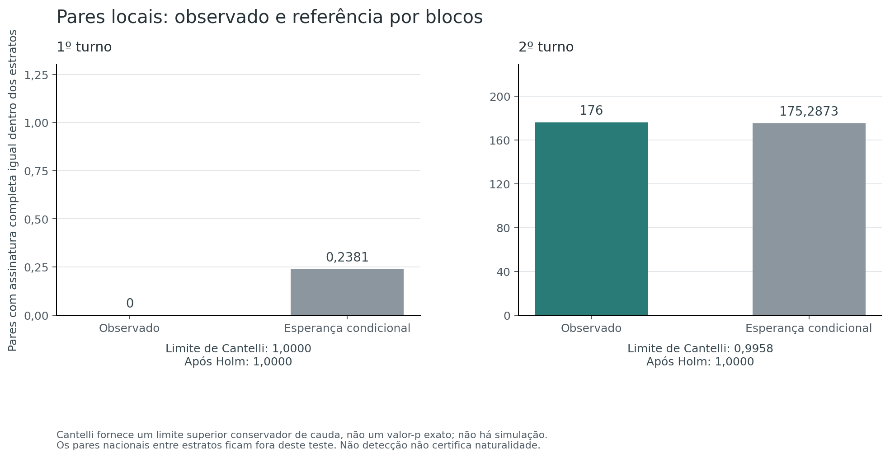

# Hipótese 3 — Repetição de resultados completos

[Índice das hipóteses](../README.pt-BR.md) · [Protocolo](METHOD.pt-BR.md) · [Reprodução e arquivos](README.md)

**Resultado:** não foi detectado excesso de emparelhamentos na referência condicional restrita, mas a H3 ampla permanece **inconclusiva**. O inventário encontrou **31 pares com resultados completos iguais no primeiro turno e 73.538 no segundo** entre as seções elegíveis. Somente **7 seções no primeiro turno e 12.182 no segundo** pertencem a estratos em que a estatística pode variar. A H3 **não foi integralmente refutada**, e a não detecção não certifica que todas as repetições nacionais sejam naturais.

O inventário é exaustivo; o alcance inferencial é limitado. Esses dois resultados precisam ser lidos separadamente.

## Hipótese e dificuldade

**Hipótese:** combinações completas de votos por candidato, brancos, nulos e comparecimento se repetem entre seções com frequência superior à esperada para seu contexto.

**Dificuldade de identificação: média.** Encontrar números iguais é direto. Avaliar se há excesso depende do espaço de combinações possíveis, do tamanho das seções, das preferências locais e de uma referência explícita.

A H1 procurou registros repetidos para a mesma chave. Aqui, as chaves são distintas: coincidência de resultados não é duplicação do registro de uma mesma seção. Os turnos são separados, incluindo todos os 13 candidatos nominais no primeiro e os dois no segundo. Não se analisam apenas os finalistas no primeiro turno.

## Dados, assinaturas e contagem

Foram relidos os dois CSVs nacionais originais, preservando seus registros. Os hashes são conferidos com a etapa 1 e a H1 concluídas; votos e categorias reconciliam por seção. Ausência de linha de uma candidatura existente pode ser zero após essa conferência. Campo numérico ausente nunca vira zero.

A assinatura principal reúne **contagens inteiras**, em ordem fixa: todos os candidatos, brancos, nulos, legenda, anulados em separado e comparecimento. Não usa percentuais arredondados nem apenas o vencedor. Comparecimento é redundante depois da reconciliação, mas fica explícito. A assinatura estendida acrescenta aptos e abstenções.

Um grupo de multiplicidade `m` contribui `m*(m−1)/2` pares não ordenados: sete seções iguais produzem 21 pares. Os pares se sobrepõem; não são 21 eventos independentes nem votos adicionais. Identificadores de assinatura permitem consultar os membros sem substituir os valores inteiros pela interpretação de um hash.

As populações são: elegíveis, pequenas positivas, sem atividade e outros positivos excluídos pela situação. Elegíveis são instaladas e não anuladas, com pelo menos 50 aptos, comparecimento positivo e pelo menos 50 nominais. “Pequenas” significa aptos ou nominais abaixo desse piso, não município pequeno. O inventário de todas as linhas sobrepõe essas populações e não deve ser somado a elas.

## Repetições nacionais encontradas

| Assinatura completa entre elegíveis | Primeiro turno | Segundo turno |
|---|---:|---:|
| Seções | 498.484 | 498.528 |
| Vetores distintos | 498.453 | 435.250 |
| Grupos com pelo menos duas seções | 31 | 54.379 |
| Seções em grupos repetidos | 62 | 117.657 |
| Pares com assinatura igual | **31** | **73.538** |
| Maior multiplicidade | 2 | 7 |

A comparação bruta dos turnos não é um teste de anomalia. Há 13 candidaturas no primeiro e duas no segundo, além de distribuições diferentes de comparecimento e votos. Igualdade em um vetor de menos dimensões não tem a mesma dificuldade combinatória. Esta análise não atribui toda a diferença entre turnos a uma única causa.

| Diagnóstico da assinatura completa | Primeiro turno | Segundo turno |
|---|---:|---:|
| Todas as linhas: seções / pares | 499.248 / 900 | 499.248 / 74.499 |
| Pequenas positivas: seções / pares | 722 / 8 | 677 / 58 |
| Sem atividade: seções / pares | 42 / 861 | 43 / 903 |
| Outros positivos excluídos: seções / pares | 0 / 0 | 0 / 0 |

As seções sem atividade têm vetor de votos e comparecimento zerado. Suas 861/903 coincidências não são votos repetidos nem constituem, por si sós, evidência de cópia: decorrem da própria assinatura vazia. Isso não verifica externamente por que as seções ficaram sem atividade. Seu contexto cadastral permanece documentado na H1; não foi alterado para fechar contas nesta hipótese.

Ao exigir também aptos e abstenções iguais, restam **1 par elegível no primeiro turno e 1.178 no segundo**. São um grupo de duas seções e 1.170 grupos envolvendo 2.344 seções, respectivamente. Acrescentar campos restringe matematicamente as coincidências; essa redução não explica, por si, a origem dos resultados.

O inventário completo está em [inventory.csv](evidence/analysis/inventory.csv). As assinaturas e membros estão em [clusters.csv.gz](evidence/analysis/clusters.csv.gz) e [cluster-members.csv.gz](evidence/analysis/cluster-members.csv.gz). A [distribuição por comparecimento exato](evidence/analysis/turnout-distribution.csv) evita misturar totais de votantes diferentes como se tivessem o mesmo espaço de contagens.

### Exemplo rastreável de coincidência

Uma assinatura de multiplicidade sete no segundo turno tem 87 votos no candidato 13, 126 no 22, três brancos, quatro nulos e zero legenda/separados: **220 votantes**. O grupo reúne Brasília/DF, Ipameri/GO, Areado/MG, Central de Minas/MG, Correia Pinto/SC, Sorocaba/SP e Suzano/SP. Contribui 21 pares nacionais.

Os aptos variam de 248 a 295 e as abstenções, de 28 a 75. Portanto, os registros cadastrais completos não são iguais. Esse exemplo não determina uma causa natural ou artificial; mostra como igualdade do resultado de votos difere de igualdade de todos os campos. O identificador é `e0a445f8886ef87c98c486d911e98d85a86d0933e10b829fa346b2a8e8e7711b`; as sete chaves e linhas de origem estão no inventário de membros.

## O que a referência formal consegue avaliar

O estrato primário exige mesma UF, município, zona, **total nominal exato** e faixa de aptos `floor(log(aptos)/log(1,25))`, dentro do mesmo turno. O bloco A contém o vetor inteiro dos candidatos. O bloco B contém comparecimento e categorias especiais.

A referência redistribui A inteiro entre posições de B no estrato. Isso mantém o eleitorado, comparecimento e categorias especiais de cada seção, a distribuição dos vetores nominais e suas somas. Não embaralha números isolados. Como o total nominal é igual, o resultado redistribuído continua contabilmente coerente.

A pergunta é específica: **o emparelhamento dos dois blocos gera pares completos iguais em excesso?** A frequência marginal de repetição de A fica preservada. Assim, não se testa toda possível reprodução de um vetor de candidatos. Relações legítimas entre preferências e votos inválidos também podem contrariar a referência.

| Suporte da referência primária | Primeiro turno | Segundo turno |
|---|---:|---:|
| Estratos, incluindo unitários | 300.405 | 298.359 |
| Estratos com pelo menos duas seções | 97.563 | 97.897 |
| Seções nesses estratos | 295.642 | 298.066 |
| Estratos com variância positiva | **1** | **1.575** |
| Seções em estratos com variância positiva | **7** | **12.182** |
| Fração das elegíveis em estratos informativos | **0,0014%** | **2,4436%** |

Ter pares no estrato não basta: a estatística pode ser constante por causa das margens observadas. Esses casos não acrescentam informação para detectar excesso. Estratos unitários também não permitem comparação. Não foram tratados como evidência de naturalidade.

As contagens por UF estão em [coverage.csv](evidence/analysis/coverage.csv). Todos os estratos, inclusive unitários, aparecem em [strata.csv.gz](evidence/analysis/strata.csv.gz). A cobertura informativa extremamente baixa do primeiro turno é uma limitação central da conclusão.

## Momentos exatos e limite conservador

Se um estrato tem `n` seções, `P_A` pares iguais no bloco A e `P_B` no B, a expectativa de pares completos é `P_A*P_B/comb(n,2)`. Média e variância são calculadas com frações racionais e somadas entre estratos. A fórmula da variância conta pares que compartilham uma seção ou têm quatro posições distintas; os testes a conferem por pequenas enumerações.

Para o total observado X, a referência fornece E e V. Quando `X > E`, Cantelli limita superiormente a probabilidade de cauda por `V/(V+(X−E)^2)`; quando `X ≤ E`, usa-se o limite trivial 1. Esse **limite não é um valor-p exato**. Com V zero, exige-se X igual a E e classifica-se a referência como não aplicável.

Há dois testes primários, ajustados por Holm a 5%. Não há Monte Carlo, semente ou erro de simulação. A vantagem do cálculo exato dos momentos vem acompanhada de uma decisão mais conservadora e potencialmente menos sensível.

| Teste dentro dos estratos | Primeiro turno | Segundo turno |
|---|---:|---:|
| Pares observados X | 0 | 176 |
| Expectativa E | 0,2381 | 175,2873 |
| Variância V | 0,1814 | 121,0499 |
| Diferença X−E | −0,2381 | +0,7127 |
| Limite de Cantelli | 1,00000 | 0,99582 |
| Limite após Holm | 1,00000 | 1,00000 |
| Excesso detectado pelo critério definido | Não | Não |

**Os 176 pares locais não são os 73.538 pares nacionais.** A expectativa de 175,2873 corresponde somente à estatística dentro dos estratos. Compará-la ao inventário nacional produziria uma conclusão incorreta. Um limite próximo de um também não é a probabilidade de que os resultados sejam naturais.

Valores completos e frações exatas estão em [conditional-tests.csv](evidence/analysis/conditional-tests.csv). Não houve referência totalmente degenerada no agregado de cada turno, embora quase todos os estratos do primeiro turno sejam constantes.

## Sensibilidades previamente definidas

As alternativas mantêm total nominal exato e contexto municipal. São diagnósticos descritivos; não foram usados novos valores-p para selecionar um resultado.

| Cenário | T1: X / E | Seções informativas T1 | T2: X / E | Seções informativas T2 |
|---|---:|---:|---:|---:|
| Primário | 0 / 0,238 | 7 | 176 / 175,287 | 12.182 |
| Sem faixa de aptos | 0 / 0,238 | 7 | 212 / 208,576 | 15.510 |
| Município e faixa, sem zona | 0 / 0,216 | 843 | 815 / 817,768 | 110.051 |
| Município, sem zona nem faixa | 0 / 0,231 | 1.235 | 967 / 977,500 | 125.649 |
| Faixa de aptos ×1,5 | 0 / 0,238 | 7 | 196 / 194,566 | 14.286 |
| Piso de 100 nominais | 0 / 0,238 | 7 | 176 / 175,287 | 12.182 |

O piso de 100 reduz as elegíveis para 493.592/493.803, sem alterar os pares e momentos primários. Ampliar o contexto municipal aumenta o suporte e altera o conjunto de pares considerado. No primeiro turno, mesmo o cenário municipal mais amplo registra zero pares locais: os 31 pares nacionais estão entre municípios diferentes. No segundo, o sinal da pequena diferença entre observado e esperado muda em algumas configurações. Esses resultados não sustentam uma conclusão invariável a qualquer definição de contexto. Consulte [sensitivity.csv](evidence/analysis/sensitivity.csv).

## Validação, reprodução e conclusão

A [implementação independente](code/validate_independently.py) relê os originais sem importar o carregador ou os auxiliares primários. Confere as populações, assinaturas, membros, todos os estratos e os momentos racionais, além de Cantelli e Holm. O resultado é registrado em [independent-validation.json](evidence/independent-validation.json). As sensibilidades alternativas não são recalculadas por essa segunda implementação.

A conferência **passou sem divergências**, inclusive nas frações exatas: foram confrontados os 598.764 estratos primários, todos os grupos e membros repetidos, a distribuição por comparecimento e os resumos. Grupos e membros reaparecem em populações/assinaturas sobrepostas; essas verificações não representam observações estatísticas independentes.

Os testes artificiais ficam separados das observações eleitorais e cobrem empates, seções sem atividade, percentuais iguais com contagens distintas, casos degenerados, um sinal inserido que preserva as identidades contábeis e mudanças que a referência condiciona para fora do teste. A execução está em [test-results.txt](evidence/test-results.txt). O [README](README.md) explica a reprodução e a leitura dos CSVs comprimidos; o [inventário de arquivos](evidence/artifact-manifest.json) permite conferir hashes.

Os **31 testes de implementação passaram**. Eles incluem conferência dos momentos e da validade conservadora de Cantelli por enumeração independente de pequenos exemplos, além de uma execução completa de fontes artificiais com gzip, manifestos e preservação das entradas. Não estimam a sensibilidade contra toda alteração possível. Semelhanças aproximadas entre resultados não são investigadas por este inventário de igualdade exata.

**Conclusão:** o estudo documenta as repetições completas e não detecta excesso do emparelhamento condicional definido. Não determina que todas as coincidências sejam naturais, não estima votos artificiais e não permite refutar integralmente a H3. Repetições marginais preservadas pela referência, alterações que dominem um estrato, pares entre contextos e cobertura informativa limitada permanecem fora de uma conclusão ampla. As fontes também não foram autenticadas por boletins independentes. As hipóteses H4–H7 permanecem sem avaliação.
