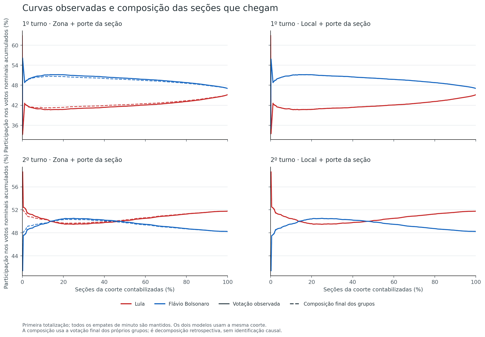
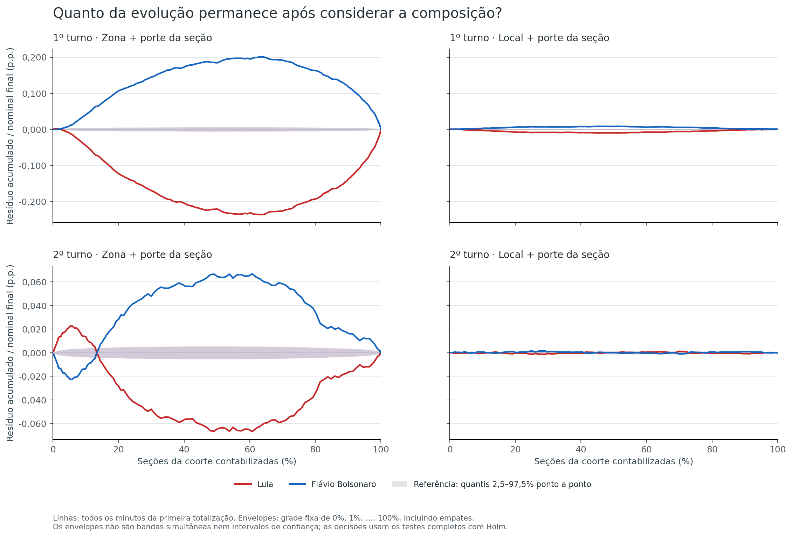
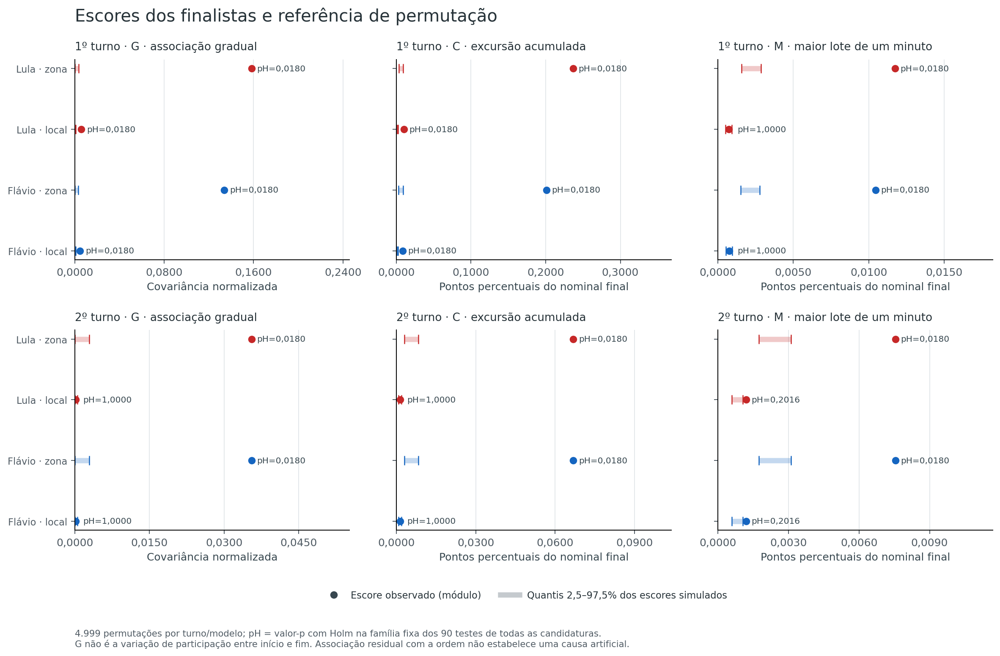
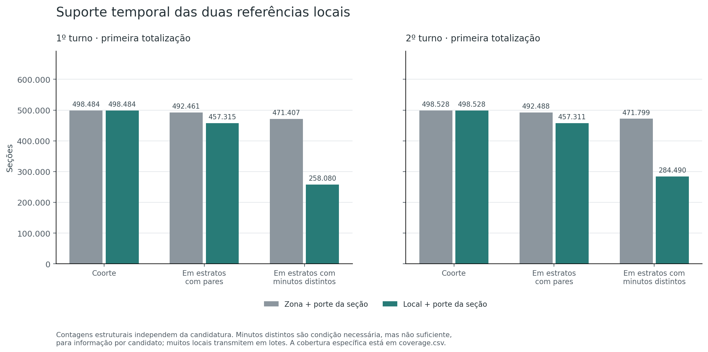

# Hipótese 4 — Evolução temporal após considerar a composição

[Índice das hipóteses](../README.pt-BR.md) · [Protocolo](METHOD.pt-BR.md) · [Reprodução e arquivos](README.md)

**Resultado:** há associação temporal residual em parte dos testes, mas sua magnitude e sua detecção mudam bastante ao controlar também o local de votação. Foram detectados desvios em **40 dos 90 testes predefinidos**, após Holm. Para os finalistas, G/C/M são detectados nos dois turnos na referência por zona; ao fixar o local, **G e C persistem no primeiro turno, sem detecção de M, e nenhum dos três é detectado no segundo**.

A maior excursão acumulada de Lula cai de **0,23686 para 0,01027 ponto percentual** do nominal final no primeiro turno e de **0,06685 para 0,00149** no segundo, ao passar de zona para local. Isso mostra a importância da composição mais fina para descrever a curva; não mede uma fração causalmente explicada nem demonstra a origem dos resíduos. **A H4 não foi integralmente refutada, e uma causa artificial não foi demonstrada.**

## Avaliação na escala

**6/10 — Apoio parcial à hipótese estatística.** Escala: **0 — Integralmente refutada → 10 — Integralmente confirmada**.

A nota considera a presença de associação residual nos dois turnos por zona e a persistência de uma tendência gradual e de uma excursão acumulada no primeiro turno mesmo dentro dos locais. O apoio é parcial: o controle por local reduz muito as magnitudes, os testes locais do segundo turno não detectam desvio após a correção, o suporte temporal é incompleto e fatores legítimos não observados podem produzir os sinais.

Essa avaliação resume qualitativamente os dois turnos depois da análise. **Não significa 60% de probabilidade de manipulação**, proporção de votos suspeitos ou conversão de valor-p. A [rubrica do índice](../README.pt-BR.md#escala-de-avaliação) define as faixas.

## Hipótese e dificuldade

**Hipótese:** a evolução da votação ao longo da apuração apresenta desvios residuais, inclusive tendências sutis e graduais ou contribuições abruptas, que não são explicados pela composição observada das seções dentro das referências locais definidas.

**Dificuldade de identificação: alta.** Uma curva nacional pode mudar porque entram seções de localidades com preferências diferentes. Mesmo depois de controlar a geografia, transmissão em lotes e diferenças entre as seções podem associar votação e horário. A análise precisa distinguir a curva bruta, a composição retrospectiva e o resíduo que cada referência consegue examinar.

Os dois turnos são analisados separadamente, com **todas as 13 candidaturas nominais no primeiro e as duas no segundo**. A regra é bilateral e igual para qualquer candidato. Os gráficos dos finalistas servem à leitura; as tabelas incluem todas as candidaturas.

No segundo turno, os resíduos dos candidatos 13 e 22 são opostos por construção, porque suas contagens somam todos os votos nominais. Seus escores absolutos coincidem: não são duas evidências independentes. Essa complementaridade não vale para os finalistas no primeiro turno, com 13 candidaturas. Holm permite dependência entre os testes.

O [protocolo](METHOD.pt-BR.md) foi fixado antes de relacionar votação e ordem temporal nesta entrega. Seu hash integra o [manifesto da execução](evidence/analysis/manifest.json). Não constitui pré-registro externo.

## Dados, coorte e horários

São relidos os dois CSVs nacionais originais de votação e detalhe, com hashes conferidos e reconciliação das categorias por seção. A unidade é seção/turno. Ausência de linha de uma candidatura existente pode corresponder a zero após a reconciliação; uma quantidade numérica ausente nunca é preenchida com zero.

Entram seções instaladas e não anuladas, com pelo menos 50 aptos, comparecimento positivo e pelo menos 50 votos nominais. A coorte temporal exige também local de votação conhecido e ambos os horários válidos, permitindo comparar primeira totalização e recebimento de BU no mesmo conjunto. As exclusões têm ordem exclusiva e não dependem dos votos de um candidato.

| Cobertura e exclusões exclusivas | Primeiro turno | Segundo turno |
|---|---:|---:|
| Registros de detalhe | 499.248 | 499.248 |
| Excluídos pela situação da seção | 41 | 41 |
| Aptos abaixo de 50 | 256 | 256 |
| Comparecimento não positivo | 1 | 1 |
| Nominais abaixo de 50 | 466 | 422 |
| Exclusões adicionais por local ou horários | 0 | 0 |
| **Seções da coorte** | **498.484** | **498.528** |
| Votos nominais da coorte | 119.279.111 | 124.057.722 |

Incluem-se as 27 UFs brasileiras e o exterior (`ZZ`). Os votos nominais excluídos são 26.923/24.551; por isso, os percentuais finais desta coorte podem diferir ligeiramente dos totais nacionais de todas as seções. A [elegibilidade por UF](evidence/analysis/eligibility.csv) publica todos os denominadores. Somar os turnos não conta eleitores distintos.

Os segundos são truncados para o minuto. Todas as seções empatadas entram juntas, sem desempate por voto ou por ordem de leitura. As datas completas e a convenção “Hora TSE” são preservadas, sem conversão de fuso não comprovada. Os campos representam primeira totalização parcial e recebimento de BU; **não reconstituem o histórico completo das atualizações públicas nem alterações intermediárias de uma seção**.

## O que significa controlar a composição

São avaliadas duas referências predefinidas:

| Referência | Grupos comparados | Alcance e limite |
|---|---|---|
| Zona e porte (`zone_size`) | Mesma UF, município, zona e faixa de aptos da seção | Preserva a composição territorial e de porte; diferenças entre locais da mesma zona continuam possíveis |
| Local e porte (`place_size`) | Os mesmos campos, acrescentando o local de votação | Controla também o local; pode absorver um movimento que atinja todas as suas seções |

A faixa de aptos é `floor(log(aptos)/log(1,25))`. Porte da seção significa eleitorado registrado, não população, renda, idade ou outra característica individual. Região, capital e porte municipal ficam fixos dentro de município; suas quantidades de seções por minuto são preservadas pelas duas referências. Os pesos por votos nominais não ficam fixos ao redistribuir as seções. Nos escores, essa variação é representada pelo deslocamento conjunto dos votos e nominais no resíduo.

Grupos unitários permanecem nas curvas e nos denominadores, com resíduo zero e sem informação para permutar. Ter dois ou mais membros também não basta: é preciso haver minutos diferentes e resíduos não constantes para a candidatura. Essa cobertura informa o alcance do teste; não classifica o restante como natural.

| Suporte na primeira totalização | Zona T1 | Local T1 | Zona T2 | Local T2 |
|---|---:|---:|---:|---:|
| Grupos | 25.549 | 115.108 | 25.586 | 115.149 |
| Seções em grupos com pelo menos dois membros | 492.461 | 457.315 | 492.488 | 457.311 |
| Seções em grupos com minutos diferentes | 471.407 | 258.080 | 471.799 | 284.490 |
| Seções informativas para Lula | 471.401 | 258.072 | 471.793 | 284.480 |
| Seções informativas para Flávio Bolsonaro | 471.397 | 258.071 | 471.793 | 284.480 |
| Amplitude temporal mediana dos grupos com pares, em minutos | 47 | 1 | 18 | 1 |

Na referência por local, metade dos grupos com pares tem amplitude de até um minuto entre a primeira e a última chegada, após truncar segundos. Apenas 32.668/9.568 seções pertencem a grupos locais com amplitude de pelo menos uma hora. Esse limite é relevante para investigar uma tendência nacional que dure horas: um movimento inteiro de um local pode ficar condicionado para fora da referência. Não basta o número de seções ser grande.

Consulte [coverage.csv](evidence/analysis/coverage.csv), [group-spans.csv](evidence/analysis/group-spans.csv) e [span-summary.csv](evidence/analysis/span-summary.csv). O [inventário de grupos](evidence/analysis/group-totals.csv.gz) preserva totais e amplitudes de todos os estratos, incluindo unitários.

## Curva bruta, composição e resíduo

Em cada grupo e candidato, calcula-se a participação final `p_g = votos do candidato / votos nominais`. O valor previsto para a seção é `p_g * nominais da seção`, e seu resíduo é:

```text
r_i = votos do candidato na seção − p_g * nominais da seção
```

Os resíduos somam zero em cada grupo. O cálculo usa a própria preferência final observada do grupo: é uma **decomposição retrospectiva**, sem previsão externa ou identificação causal. Uma alteração uniforme que preserve a preferência relativa de todas as seções do grupo pode ficar fora dessa referência.

A curva efetiva e a curva de composição dividem seus votos acumulados pelo mesmo total nominal acumulado corrente. A diferença em pontos percentuais é o resíduo corrente. Para os escores formais abaixo, o denominador é o nominal **final** da coorte; isso evita atribuir o mesmo peso nacional a uma oscilação inicial com poucos votos.



Os percentuais das curvas são participações nos votos nominais acumulados da coorte. A proximidade entre curva efetiva e composição descreve o ajuste retrospectivo; não prova a causa dos resultados nem a autenticidade das fontes.

## Como se procuram tendências graduais e contribuições abruptas

Dentro de cada grupo, as permutações redistribuem a seção completa entre pares fixos de horários. Candidatos, nominal e categorias especiais viajam juntos. Permanecem preservados as somas locais e nacionais, as identidades contábeis, os lotes de horários e o contexto definido pelo grupo.

Seja `x_i` o posto intermediário do minuto na ordem nacional por seções, dividido pelo número de seções e centrado em 0,5. Com `N` igual ao total nominal final da coorte:

| Escore | Definição | O que procura |
|---|---|---|
| **G** | `100 * abs(soma x_i*r_i) / N` | Associação gradual residual com a ordem de entrada; seu sinal distingue resíduos mais positivos no início ou no fim |
| **C** | `100 * max abs(resíduo acumulado por minuto) / N` | Maior excursão acumulada, que pode responder a movimentos graduais ou concentrados |
| **M** | `100 * max abs(resíduo de um minuto) / N` | Maior contribuição residual abrupta de um lote de um minuto |

G é um escore de covariância normalizado, não uma inclinação convencional nem o ganho percentual de um candidato entre início e fim. C e M usam pontos percentuais do nominal final. O máximo é procurado em todos os minutos, inclusive os vazios entre a primeira e a última chegada; não se escolhe uma janela depois de olhar o resultado. O minuto do máximo é descritivo e não identifica uma causa ou um evento oficial.

Uma tendência sutil não precisa produzir um salto visível para ser examinada. Se, dentro dos contextos comparados, resíduos mais positivos de uma candidatura chegam sistematicamente mais tarde, o G assinado tende a ser positivo; mais cedo, negativo. C examina o desvio que se acumula durante esse movimento. O teste procura essa associação com a ordem, sem pressupor que uma tendência suave tenha origem artificial.

São **4.999 permutações por turno e referência**, com semente-base `20261028` e fluxos determinísticos por realização. Cada atribuição é compartilhada pelos candidatos e pelos pares de horários de primeira totalização e BU. Os valores-p usam a regra de mais um, com resolução mínima `0,0002`; Holm a 5% controla a família fixa de **90 testes** das duas referências, dos três escores e de todas as candidaturas/turnos.

A primeira totalização é a fonte primária. O recebimento de BU é sensibilidade emparelhada, sem nova família de valores-p. Os envelopes são quantis simulados de 2,5% e 97,5% na grade fixa de 0% a 100% das seções, incluindo empates. São referências ponto a ponto, não bandas simultâneas nem intervalos de confiança da eleição.



Aqui o resíduo acumulado é dividido pelo nominal **final**, diferentemente do percentual corrente da figura anterior. A escala vertical compartilhada entre as referências de um mesmo turno permite comparar magnitudes. Um ponto fora do envelope não fornece um teste isolado: a decisão formal vem dos escores e da correção da família.

## Tendências dos finalistas e suas magnitudes

A tabela reúne os escores dos finalistas na primeira totalização. **G assinado é uma covariância normalizada; C e M são pontos percentuais do nominal final nacional da coorte.** Os valores-p são ajustados conjuntamente pelos 90 testes; G/C/M não são três escolhas alternativas para selecionar o menor valor-p.

| Turno; referência; candidato | G assinado | C | M | Holm G / C / M |
|---|---:|---:|---:|---|
| T1; zona; Lula | +0,158274 | 0,236859 | 0,011742 | 0,018 / 0,018 / 0,018 |
| T1; zona; Flávio Bolsonaro | −0,133916 | 0,200988 | 0,010454 | 0,018 / 0,018 / 0,018 |
| T1; local; Lula | +0,005956 | 0,010273 | 0,000738 | 0,018 / 0,018 / 1,000 |
| T1; local; Flávio Bolsonaro | −0,004711 | 0,008294 | 0,000769 | 0,018 / 0,018 / 1,000 |
| T2; zona; Lula | +0,035519 | 0,066855 | 0,007546 | 0,018 / 0,018 / 0,018 |
| T2; zona; Flávio Bolsonaro | −0,035519 | 0,066855 | 0,007546 | 0,018 / 0,018 / 0,018 |
| T2; local; Lula | +0,000207 | 0,001487 | 0,001203 | 1,000 / 1,000 / 0,2016 |
| T2; local; Flávio Bolsonaro | −0,000207 | 0,001487 | 0,001203 | 1,000 / 1,000 / 0,2016 |

**No primeiro turno, permanece um sinal gradual pequeno dentro dos locais.** O G positivo de Lula indica resíduos relativamente mais positivos nas chegadas tardias, enquanto o de Flávio é negativo. Não significa que Lula ganhou 0,005956 ponto percentual entre início e fim: esse número é o escore definido. O C local máximo de Lula é negativo e ocorre às 18:41; o de Flávio é positivo e ocorre às 18:47. As magnitudes são pequenas na escala nacional, mas excedem a referência condicional adotada. Os maiores lotes residuais de um minuto não são detectados após a correção nessa referência.

**No segundo turno, a associação por zona não persiste como detecção ao fixar o local.** Os valores-p brutos locais de G e C são 0,3838 e 0,2270; para M, 0,0042 passa a 0,2016 após Holm. Portanto, nem um valor-p bruto pequeno deve ser destacado como achado formal isolado. A não detecção vale para o alcance desse desenho, sem demonstrar naturalidade.

Em todos os casos detectados dos finalistas, nenhuma das 4.999 realizações alcançou o escore observado: aplica-se o valor-p mínimo **0,0002**, nunca zero. O ajuste resulta em 0,018. Os horários dos máximos e todos os valores estão em [tests.csv](evidence/analysis/tests.csv); não são testes de um minuto individual.

### Como isso aparece na curva corrente

Nos marcos por número de seções, a diferença entre votação efetiva de Lula e composição é:

| Turno; referência | 10% das seções | 50% | 90% |
|---|---:|---:|---:|
| T1; zona | −0,47093 p.p. | −0,45436 p.p. | −0,15406 p.p. |
| T1; local | −0,03244 p.p. | −0,02013 p.p. | −0,00194 p.p. |
| T2; zona | +0,09968 p.p. | −0,12890 p.p. | −0,01796 p.p. |
| T2; local | −0,00425 p.p. | −0,00012 p.p. | −0,00093 p.p. |

Esta tabela usa o nominal **acumulado corrente**, diferente do denominador de C/M. Os marcos incluem todos os empates do minuto que alcança o estágio. A curva bruta de Lula passa de 40,74693% no marco de 10% para 45,15763% ao fim do primeiro turno e de 50,44810% para 51,78263% no segundo. A composição por local acompanha de perto esses movimentos, restando as diferenças da tabela. O resíduo final é zero por construção dos grupos; isso não é uma confirmação independente. Consulte [milestones.csv](evidence/analysis/milestones.csv) e [curves.csv.gz](evidence/analysis/curves.csv.gz).

## Todas as candidaturas

Dos 90 testes, **40 detectaram associação residual, 50 não detectaram e nenhum foi não aplicável**. A tabela indica apenas os escores detectados após Holm; “—” significa não detecção dos três escores, sem certificar ausência de qualquer padrão.

| Turno | Candidato | Zona e porte: escores detectados | Local e porte: escores detectados |
|---|---:|---|---|
| 1 | 13 | G, C, M | G, C |
| 1 | 14 | G, C, M | G, C |
| 1 | 16 | G, C | — |
| 1 | 21 | — | — |
| 1 | 22 | G, C, M | G, C |
| 1 | 27 | — | — |
| 1 | 28 | — | — |
| 1 | 29 | G, C | — |
| 1 | 30 | G, C, M | — |
| 1 | 35 | G, C | — |
| 1 | 55 | G, C | G, C |
| 1 | 70 | G, C | G, C |
| 1 | 80 | G, C | — |
| 2 | 13 | G, C, M | — |
| 2 | 22 | G, C, M | — |

São testes dependentes de curvas nacionais, não uma contagem de seções anômalas ou votos artificiais. A referência por zona tem 30 detecções; a por local, dez, todas em G/C de cinco candidaturas do primeiro turno. A restrição por local reduz também o suporte temporal, portanto a diferença não é uma identificação causal da composição dos locais.



As faixas simuladas descrevem a distribuição dos escores sob cada referência; não são intervalos de confiança da eleição. Os resultados formais incluem todas as candidaturas, mesmo quando a figura destaca os finalistas.



A existência de pares e a diversidade dos minutos são medidas diferentes. Grupos cujas seções entram juntas têm pouca ou nenhuma capacidade de informar a ordem temporal; esse limite permanece mesmo quando a cobertura geográfica é ampla.

## Sensibilidades e recortes estaduais

As alternativas foram definidas antes dos resultados e não geram novas decisões formais. Para Lula:

| Referência e sensibilidade | T1: G assinado / C | T2: G assinado / C |
|---|---:|---:|
| Zona, primeira totalização | +0,158274 / 0,236859 | +0,035519 / 0,066855 |
| Zona, recebimento de BU | +0,158212 / 0,237703 | +0,035433 / 0,066159 |
| Local, primeira totalização | +0,005956 / 0,010273 | +0,000207 / 0,001487 |
| Local, recebimento de BU | +0,005834 / 0,010055 | +0,000165 / 0,001394 |
| Local sem faixa de aptos, primeira totalização | +0,006366 / 0,010759 | +0,000154 / 0,001214 |
| Zona, piso de 100 nominais | +0,158669 / 0,237522 | +0,035545 / 0,066882 |
| Local, piso de 100 nominais | +0,005976 / 0,010307 | +0,000210 / 0,001491 |

As magnitudes de G/C mudam pouco com a fonte de horário e com o piso nominal, e a diferença entre os níveis territoriais permanece. Isso é uma descrição das configurações observadas, sem testar formalmente a diferença entre fontes ou turnos. O BU usa os mesmos pares de slots e as mesmas atribuições das simulações; não foi criada uma segunda família para selecionar valores-p. A tabela completa, com M e todas as candidaturas, está em [sensitivity.csv](evidence/analysis/sensitivity.csv).

Os recortes de UF são **descritivos**, sem novos testes selecionados. Em SP, o C de Lula é 0,15690/0,09031 ponto percentual do nominal final **estadual** na referência por zona e 0,00383/0,00265 na referência por local, nos dois turnos. Assim, a melhora da curva paulista acompanha em grande parte a composição mais fina na decomposição retrospectiva, com resíduos locais pequenos. Isso não demonstra a causa de cada variação nem pode ser comparado diretamente ao C nacional sem observar o denominador. As 27 UFs e o exterior, ambos os candidatos finais e todas as demais candidaturas estão em [uf-summary.csv](evidence/analysis/uf-summary.csv).

## Validação e alcance da conclusão

A [implementação independente](code/validate_independently.py) relê as fontes sem importar o carregador ou os auxiliares primários. Confere coorte, agrupamentos, totais, resíduos, curvas por minuto, escores, cobertura e ajuste da família, incluindo as sensibilidades descritivas. O resultado e o número de comparações ficam em [independent-validation.json](evidence/independent-validation.json).

A validação **passou sem divergências em 6.676.231 verificações**, com diferença numérica máxima de `3,33e−16`. Foram conferidas as 281.392 linhas de grupos, as 33.748 linhas de curvas por minuto, todos os 90 testes e as demais tabelas, inclusive as alternativas descritivas. Todos os 90 escores primários tiveram variabilidade possível demonstrada; nenhum foi classificado como não aplicável. A contagem de verificações não representa seções, eleitores ou observações estatísticas independentes.

A conferência recalcula excedências, valores-p, Holm e envelopes a partir dos escores e curvas simulados retidos. Também reconstrói as atribuições das realizações 0 e 1 em cada uma das quatro combinações turno/referência, totalizando oito conferências de geração. **Não repete independentemente todas as 19.996 atribuições**. Os arquivos comprimidos mantêm todas as linhas; a compressão não é amostragem.

Os **55 testes de implementação passaram**. Os casos artificiais ficam separados das observações eleitorais e verificam tendências graduais, lotes abruptos, empates, grupos unitários, proporções constantes, referências sem variabilidade e heterogeneidade legítima. Incluem enumerações pequenas e controles de atribuição conjunta dos candidatos e dos totais. Eles verificam o funcionamento do desenho, sem estimar a capacidade de detectar toda alteração possível. Consulte [test-results.txt](evidence/test-results.txt). O [inventário de arquivos](evidence/artifact-manifest.json) registra os hashes publicados, e o [README](README.md) detalha reprodução, caches e leitura das tabelas.

**Conclusão:** o estudo encontra tendências residuais graduais detectáveis no primeiro turno mesmo após controlar local e porte, com magnitude nacional pequena. No segundo turno, os sinais da referência por zona deixam de ser detectados ao fixar também o local, dentro do alcance do desenho. A H4 recebe apoio parcial como hipótese estatística de associação temporal residual, sem demonstração de uma origem artificial.

Transmissão em lotes, composição individual não observada e distribuição do eleitorado entre seções do mesmo local podem gerar padrões legítimos. A não detecção não encerra a hipótese ampla: movimentos coordenados de todo um grupo e alterações que preservem os resultados finais podem permanecer invisíveis. A consistência interna não autentica as fontes de forma independente.
