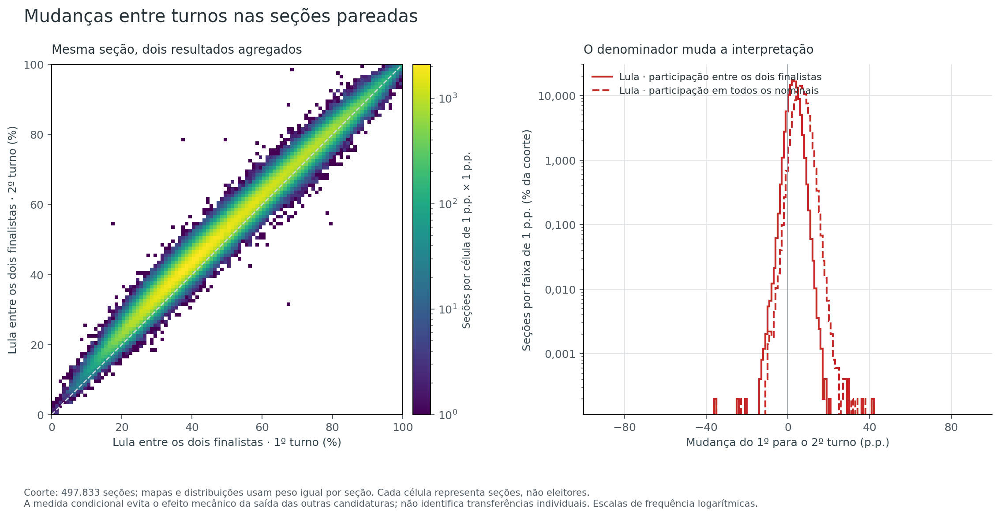
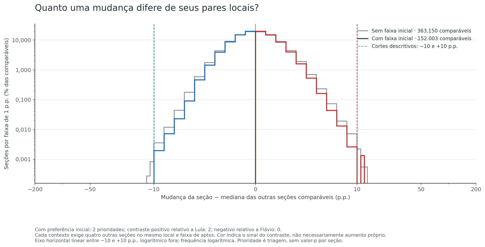
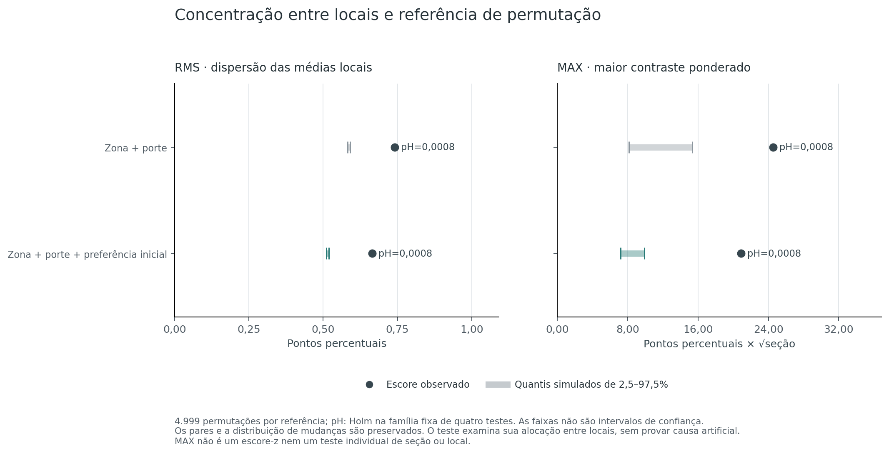

# H5 — Localized changes between rounds

[Hypothesis index](../README.md) · [Method](METHOD.md) · [Evidence and reproduction](README.md)

**Question:** did some sections change differently from comparable sections, and were changes concentrated in particular polling places?

**Answer:** the strict section screen found **two contrasts of at least 10 percentage points**, both in overseas voting. Separately, all four formal tests detected concentration **between polling places**, including after accounting for initial preference. These findings identify local differences under the stated comparisons; they do not establish an artificial cause.

**Assessment: 6/10 — partial support for the statistical hypothesis.** Scale: **0 — Fully refuted → 10 — Fully confirmed**. The two descriptive contrasts and the formal concentration results support a bounded finding. The strict screen covers only 30.53% of the cohort, and the formal tests do not assess the nationwide number or magnitude of extreme changes. The score is qualitative, not a probability of manipulation; see the [scale rubric](../README.md#assessment-scale). Identification difficulty: **high**.

## What changed, and how it was compared

The analysis matches **499,248 physical section keys** across the two rounds. After the predefined eligibility checks, **497,833 pairs** remain, covering Brazil's 27 federative units and the overseas category (`ZZ`).

The comparison uses each finalist's share **among the two finalists** in both rounds. This avoids treating the disappearance of other first-round candidates as a shift between Lula and Flávio Bolsonaro. A positive change favors Lula; the conditional change for Flávio Bolsonaro is exactly its opposite. These are aggregate shares, not movements by identified voters.

The mean conditional change for Lula is **+2.90504 p.p. per section**, with a median of **+2.87879 p.p.** Each section has equal weight here; these are not changes in the national vote-weighted share. The analysis asks whether particular sections or places depart from comparable contexts within that observed movement.

## Two section contrasts met the strict screening threshold

Each section is compared with at least four **other** eligible sections in the same polling place, electorate-size band, and first-round preference band. The contrast is its change minus the median change of those peers. An absolute contrast of **10 p.p.** is a descriptive screening threshold, not an individual significance test.

| Comparison | Sections with enough peers | Share of cohort | Contrasts meeting the threshold |
|---|---:|---:|---:|
| Strict: same place, size and initial preference | **152,003** | **30.53%** | **2** |
| Additional context: same place and size | 363,150 | 72.95% | 16 |

Both strict cases are in the overseas source unit named **PORTO**, code `30341`, electoral zone `1`, polling place `1015`. This is not a Brazilian municipality. The table below separates each section's change from its contrast against peers.

| Section | Own conditional-share change | Peer median change | Contrast | Other peers |
|---|---:|---:|---:|---:|
| 1894 | +13.28107 p.p. | +1.31064 p.p. | **+11.97043 p.p.** | 5 |
| 3576 | +13.79081 p.p. | +2.30858 p.p. | **+11.48224 p.p.** | 25 |

Among the **151,353 domestic sections with strict support**, none meets the threshold. The other **345,830 cohort sections** lack sufficient strict peers and remain unclassified by this screen. The 16 cases from the broader context include the two strict cases; they are not additional independent findings.

In section 3576, Flávio Bolsonaro's vote count increases from **85 to 88** while his conditional share decreases. This illustrates why vote-count gains and share changes must be kept separate. Neither the contrasting shares nor the unchanged registered-electorate counts identify who voted or changed preference.

## Changes were also concentrated between polling places

A coherent shift across sections in one place can escape a comparison against nearby sections. The second part therefore asks a different question: **are the observed changes grouped by polling place more than the conditional allocation references allow?**

The references reassign complete two-round section pairs within municipality, electoral zone and initial-electorate bands. The second reference also holds first-round preference bands fixed. They preserve the observed section changes and assess where those changes are located.

The formal targets are **42,727 polling places** with at least five cohort sections, containing **392,211 pairs**. `RMS` measures the overall dispersion of residual place means; `MAX` finds the largest size-weighted residual contrast across the target places.

| Reference | RMS observed / simulated mean, p.p. | MAX observed / simulated mean | Holm-adjusted p, both scores |
|---|---:|---:|---:|
| Zone and electorate size | 0.741076 / 0.586725 | 24.553876 / 11.294305 | **0.0008** |
| Also accounting for initial preference | 0.665688 / 0.514994 | 20.913947 / 8.227965 | **0.0008** |

`MAX` is measured in p.p. × square root of section count, not p.p. of candidate share or a z-score. Neither score was reached by any of the **4,999 allocations per reference**. The four results belong to one Holm-adjusted family and are dependent comparisons, not four separate incidents.

Accounting for initial preference reduces both observed scores but does not remove the detected concentration. The difference between references is descriptive; it is not a causal percentage explained by initial preference.

### Why the São Paulo maximum is a different finding

Both references attain `MAX` at a polling place in **São Paulo/SP**, municipality `71072`, zone `2`, place `1546`, with **seven sections**. Their mean conditional change for Lula is **−9.62733 p.p.** After accounting for initial preference, the residual mean is **−7.90473 p.p.**, a relative shift toward candidate 22 compared with that reference.

**None of these seven sections has enough strict peers.** The place can therefore contribute to formal concentration without appearing among the two section-screening cases. The global maximum test includes the search across all target places; it supplies no individual p-value for this place.

The source names the venue as Colégio Equipe. Its name, address and machine-model fields provide traceability, without establishing demographics or an explanation for the result. The [selected source context](evidence/selected-source-context.csv) records both this place and the two overseas screening cases.

## What this establishes—and what remains unresolved

The findings support **localization under the stated comparisons**: two section-to-peer contrasts meet the predefined magnitude screen, and the allocation tests detect clustering of changes between places. Those results concern different units and should remain separate.

Three limits matter to that conclusion:

- **Coverage:** absence of strict-screen cases among supported domestic sections does not cover sections lacking peers. The [coverage figure](figures/comparison-coverage.png) and [case summary](evidence/analysis/case-summary.csv) show those denominators.
- **Reference scope:** the permutations retain the observed distribution of changes. They do not test whether its nationwide extremes are natural, and a movement shared by an entire stratum can be conditioned out.
- **Cause:** the observed bands cannot capture all composition, turnout or campaign differences. Matching section keys does not identify individual voters, and neither a contrast nor a rejected reference establishes artificial votes.

The predefined [sensitivity results](evidence/analysis/sensitivity.csv) change one design choice at a time, without additional formal tests. For example, narrowing initial-preference bands to 2.5 p.p. leaves two strict cases but reduces supported sections to **55,525**; widening them to 10 p.p. covers **248,570** sections and selects five. These are different comparison sets, not competing estimates of a single anomaly count.

The [method guide](METHOD.md) documents definitions and statistical scope. The [reproduction guide](README.md) links complete evidence and the original validation records. This editorial revision uses published results; no calculations were rerun.
