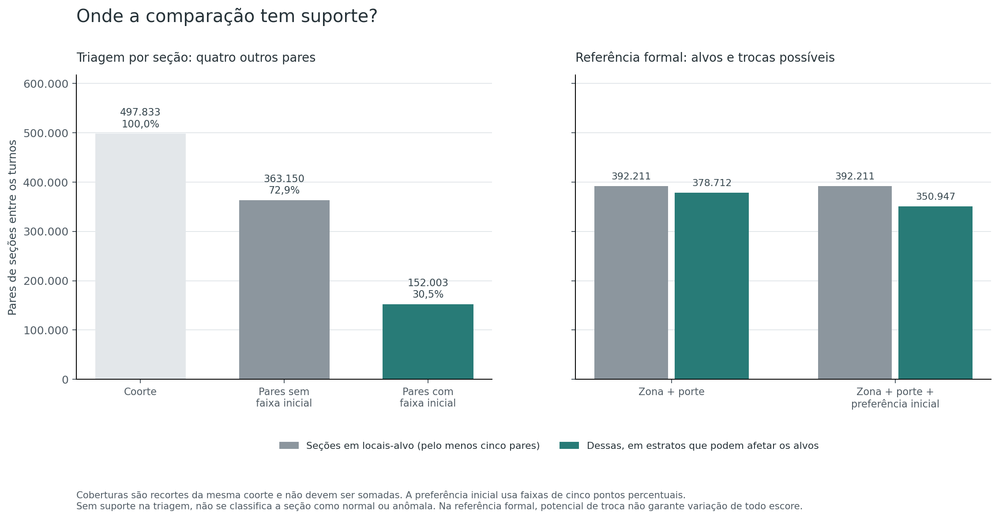

# Hipótese 5 — Mudanças localizadas entre turnos

[Índice das hipóteses](../README.pt-BR.md) · [Protocolo](METHOD.pt-BR.md) · [Reprodução e arquivos](README.md)

**Resultado:** a triagem estrita encontrou **duas seções com contraste de pelo menos 10 pontos percentuais entre 152.003 seções com pares suficientes**. Ambas pertencem ao exterior (`ZZ`), no município denominado **PORTO** pela fonte. Nas 151.353 seções domésticas efetivamente comparáveis nesse recorte, nenhuma atingiu o corte. Isso não classifica as demais seções sem suporte.

Separadamente, os **quatro testes formais detectaram concentração de mudanças entre locais**, inclusive após condicionar pela preferência inicial, com Holm de `0,0008`. As constatações são compatíveis: um movimento pode ser coerente entre várias seções de um local, sem produzir um grande contraste de uma seção contra suas vizinhas. A referência formal preserva as mudanças por seção e não testa se a quantidade ou magnitude nacional dos extremos é natural. **A H5 não foi integralmente refutada, e uma causa artificial não foi demonstrada.**

## Avaliação na escala

**6/10 — Apoio parcial à hipótese estatística.** Escala: **0 — Integralmente refutada → 10 — Integralmente confirmada**.

A nota considera os dois contrastes grandes com suporte local e a concentração entre locais detectada nas duas referências. O apoio é parcial: a triagem estrita cobre somente 30,53% da coorte; as permutações não avaliam a quantidade ou magnitude marginal dos extremos; e composição não observada, mobilização e outros movimentos legítimos continuam sendo explicações possíveis.

A avaliação resume qualitativamente o pareamento dos dois turnos. **Não significa 60% de probabilidade de manipulação**, proporção de votos suspeitos ou conversão de valor-p. A [rubrica do índice](../README.pt-BR.md#escala-de-avaliação) define as faixas.

## Hipótese e dificuldade

**Hipótese:** as mudanças entre turnos apresentam valores excepcionalmente localizados em determinadas seções, além do movimento de seções comparáveis.

**Dificuldade de identificação: alta.** Uma mudança grande pode refletir diferenças no público que compareceu, nas preferências iniciais ou no movimento de campanha. Além disso, a presença de muitas candidaturas no primeiro turno cria um efeito de denominador que precisa ser separado de uma mudança entre os finalistas.

A avaliação tem duas partes:

| Parte | Pergunta | O que não permite concluir |
|---|---|---|
| Triagem descritiva por seção | A mudança de uma seção difere muito da mudança de outros pares locais comparáveis? | Um contraste grande não recebe valor-p individual nem indica causa artificial |
| Referência formal entre locais | Mudanças semelhantes se concentram em certos locais mais do que admite a redistribuição condicional dos pares? | O teste preserva a distribuição das mudanças e não determina se o número ou a magnitude nacional de extremos é natural |

Essas perguntas não são intercambiáveis. A não detecção na segunda parte não refuta, por construção, toda hipótese sobre mudanças extremas de seções. Os dois turnos também não são amostras independentes de pessoas; os dados agregados não identificam transferências individuais.

O [protocolo](METHOD.pt-BR.md) foi fixado antes de calcular as mudanças nesta entrega. Seu hash integra o [manifesto da execução](evidence/analysis/manifest.json). Não constitui pré-registro externo.

## Fontes, pareamento e coorte

São relidos os dois CSVs nacionais originais, com hashes conferidos e reconciliação das categorias de voto por seção. A chave física do pareamento é `UF + município + zona + seção`, no mesmo ano e cargo presidencial. Código de eleição e turno distinguem a origem dos registros, mas não são incluídos na chave que relaciona as duas rodadas.

Chaves ambíguas ou sem contraparte recebem diagnóstico, sem agregação silenciosa ou mudança inventada. Ausência de linha de uma candidatura existente pode corresponder a zero após a reconciliação; quantidade numérica ausente nunca vira zero.

Os arquivos [pairing.csv](evidence/analysis/pairing.csv), [eligibility.csv](evidence/analysis/eligibility.csv) e [unmatched.csv](evidence/analysis/unmatched.csv) registram pareamento, exclusões e eventuais chaves sem contraparte. O inventário [paired-sections.csv.gz](evidence/analysis/paired-sections.csv.gz) mantém as contagens dos dois turnos, linhas de origem e decisões de coorte para todas as chaves pareadas.

A coorte principal exige, nos dois turnos, seção instalada e não anulada, pelo menos 50 aptos, comparecimento positivo e pelo menos 50 nominais. Exige também soma dos finalistas de pelo menos 50 votos no primeiro turno, local conhecido e igual entre turnos, e razão simétrica de aptos de no máximo 1,25. As exclusões são exclusivas e têm ordem predefinida.

| Pareamento e exclusões exclusivas | Seções ou pares |
|---|---:|
| Registros de detalhe em cada turno | 499.248 |
| Chaves pareadas entre os turnos | 499.248 |
| Chaves presentes apenas em um turno | 0 |
| Excluídas pela situação da seção | 41 |
| Aptos abaixo de 50 em algum turno | 258 |
| Comparecimento não positivo | 1 |
| Nominais abaixo de 50 em algum turno | 532 |
| Soma inicial dos finalistas abaixo de 50 | 146 |
| Identificação de local ausente | 0 |
| Local alterado entre turnos | 430 |
| Razão de aptos acima de 1,25 | 7 |
| **Coorte principal** | **497.833** |

As 27 UFs brasileiras e o exterior entram na análise. A coorte reúne 119.164.547/123.938.419 votos nominais nos dois turnos. Há **55.602 pares com algum ajuste de aptos** dentro do limite permitido; exigir igualdade cadastral de contagens retiraria esses pares, sem comprovar identidade individual nos restantes. Essa escolha é examinada como sensibilidade, sem alterar os registros originais.

Mesmo com a mesma chave, o mesmo local e o mesmo número de aptos, **não se comprova que as mesmas pessoas votaram nos dois turnos**. A continuidade cadastral é uma aproximação observável. Os arquivos não contêm cadastro individual que resolva essa questão.

## O que é uma mudança comparável

No primeiro turno há 13 candidaturas nominais; no segundo, duas. Para não interpretar a simples saída das demais como deslocamento entre finalistas, usa-se:

```text
F_t = votos de Lula + votos de Flávio Bolsonaro
q_t = votos de Lula / F_t
delta = 100 * (q_2 − q_1)
```

`delta` mede pontos percentuais de participação **condicional aos dois finalistas**. Valor positivo corresponde a uma mudança relativa para Lula; negativo, para Flávio Bolsonaro. A mudança condicional do candidato 22 é exatamente o oposto, por isso não se duplicam os testes complementares.

Esse indicador não é ganho absoluto de votos, não usa todos os nominais no primeiro turno e não elimina todas as mudanças possíveis na composição do público votante. As diferenças de participação sobre todos os nominais e os ganhos de contagens permanecem como diagnósticos separados, sem identificar de onde vieram os votos adicionais.

As razões são calculadas com contagens não arredondadas. A faixa de preferência inicial é de cinco pontos percentuais, definida por `min(19, floor(20*votos_13,1/F_1))`; 100% entra na última faixa. O porte da seção usa aptos do primeiro turno, em faixas `floor(log(aptos_1)/log(1,25))`. Não se inferem renda, escolaridade, idade ou outro atributo individual.

### Distribuição das mudanças observadas

| Medida por seção | Média simples | Mediana | Quantis descritivos de 2,5%–97,5% |
|---|---:|---:|---|
| Mudança condicional de Lula entre os dois finalistas | +2,90504 p.p. | +2,87879 p.p. | −1,63934 a +7,61445 p.p. |
| Mudança de Lula sobre todos os nominais | +6,43052 p.p. | +6,39003 p.p. | +0,90161 a +12,19397 p.p. |
| Mudança de Flávio Bolsonaro sobre todos os nominais | +1,23974 p.p. | +1,06424 p.p. | −3,91468 a +7,39610 p.p. |

As médias dão o mesmo peso a cada uma das 497.833 seções; **não são diferenças dos percentuais nacionais agregados por votos**. Os dois finalistas podem aumentar a participação sobre todos os nominais quando as demais candidaturas deixam de integrar esse denominador no segundo turno. A medida condicional evita confundir esse componente com deslocamento entre os dois finalistas, sem identificar transferências individuais. Os quantis descrevem a distribuição observada, sem interpretação de intervalo de confiança. Consulte [distribution.csv](evidence/analysis/distribution.csv).

A mudança condicional bruta varia de **−35,48692 a +41,55384 p.p.** na coorte. Ela é distinta do contraste contra os outros pares: uma mudança grande sem contexto comparável permanece sem classificação pela triagem estrita.


## Triagem por seção e suporte dos pares

Os pares primários têm mesma UF, município, zona, local, faixa de aptos e faixa de preferência inicial. A própria seção é excluída da referência. Com pelo menos quatro **outras** seções, calcula-se:

```text
contraste = delta da seção − mediana do delta dos outros pares
```

Uma seção recebe prioridade descritiva quando o módulo desse contraste alcança **10 pontos percentuais**, com tolerância de `1e-12` p.p. É um filtro de magnitude, sem valor-p individual. Todas as seções e todos os contrastes comparáveis são publicados; sem quatro pares, o resultado é suporte insuficiente, não normalidade.

O sinal do contraste se refere aos pares: positivo significa mudança relativamente mais favorável a Lula; negativo, a Flávio Bolsonaro. Isso não exige que a participação do primeiro tenha aumentado ou a do segundo diminuído na própria seção. As duas medidas — mudança e contraste — aparecem separadamente em [section-screening.csv.gz](evidence/analysis/section-screening.csv.gz); os totais por UF estão em [case-summary.csv](evidence/analysis/case-summary.csv).

O contexto adicional retira somente a faixa de preferência inicial, mantendo o mesmo local, porte e mínimo de quatro outros pares. Ele amplia cobertura, mas compara seções com preferências iniciais mais distintas. Diferenças entre os dois contrastes não determinam sua causa, e as comparações sobrepostas não são observações independentes.

A faixa inicial reduz parte da diferença de ponto de partida, mas não corrige continuamente efeitos de teto, regressão à média ou composição individual não observada. A própria preferência inicial é medida por contagens finitas. Esses limites também se aplicam à referência formal que acrescenta essa faixa.

### Cobertura e prioridades da triagem

| Contexto | Seções com quatro outros pares | Fração da coorte | Prioridades | Contraste para 13 / para 22 |
|---|---:|---:|---:|---:|
| Estrito: mesmo local, porte e preferência inicial | **152.003** | **30,53%** | **2** | 2 / 0 |
| Adicional: mesmo local e porte, sem faixa inicial | 363.150 | 72,95% | 16 | 12 / 4 |

O contexto estrito deixa **345.830 seções sem comparação suficiente**. As duas prioridades estão em `ZZ`: ali, 650 das 1.268 seções da coorte têm suporte estrito. Nas **151.353 seções domésticas com suporte estrito**, o corte não selecionou prioridades; a afirmação não cobre todas as seções brasileiras. As 16 prioridades do contexto adicional incluem as duas estritas e não devem ser somadas a elas. As comparações também usam universos e referências diferentes.

Os contrastes estritos têm mediana de +0,00021 p.p. e quantis de 2,5%/97,5% de −3,82547/+3,94698 p.p. Esses valores descrevem os 152.003 casos comparáveis, sem atribuir probabilidade aos extremos.


### As duas prioridades rastreáveis

Ambas estão no município chamado **PORTO**, código `30341`, UF `ZZ`, zona `1`, local `1015`. O nome é o declarado no arquivo; não se acrescentou país ou caracterização demográfica por inferência externa.

| Seção | Participação condicional de Lula T1 → T2 | Mudança da seção | Mediana dos outros pares | Contraste | Outros pares |
|---|---|---:|---:|---:|---:|
| 1894 | 56,59341% → 69,87448% | +13,28107 p.p. | +1,31064 p.p. | **+11,97043 p.p.** | 5 |
| 3576 | 51,14943% → 64,94024% | +13,79081 p.p. | +2,30858 p.p. | **+11,48224 p.p.** | 25 |

Na seção 1894, os votos dos finalistas passam de 103/79 para 167/72; na 3576, de 89/85 para 163/88. Os denominadores condicionais são 182 → 239 e 174 → 251. Na segunda seção, a contagem do candidato 22 aumenta, embora sua participação condicional caia: contagem e percentual são medidas diferentes. Esses agregados não revelam quais pessoas mudaram de preferência ou compareceram em apenas um turno.

Os aptos permanecem em **797 na seção 1894 e 798 na seção 3576, nos dois turnos**, sem que isso assegure a mesma composição de votantes. No contexto adicional, os contrastes são +11,61166 e +12,12140 p.p., com 55 outros pares. Persistência do contraste não identifica sua causa. As linhas originais de detalhe T1/T2 são `827310/757952` e `27669/681558`; as contagens e chaves completas estão em [paired-sections.csv.gz](evidence/analysis/paired-sections.csv.gz).

O campo original identifica o local como **“ISEP - R. DR. ANTONIO BERNARDINO / R. DE SÃO TOMÉ (ENTRADAS SEPARADAS)”**. As duas seções estão instaladas, não anuladas, com origem “Urna Eletrônica” e modelo declarado `UE 2013`, nos dois turnos. Esses campos foram extraídos para rastreabilidade; nome, endereço ou modelo não explicam por si a diferença observada. O [contexto original selecionado](evidence/selected-source-context.csv) preserva os valores integrais.

## Concentração entre locais: referência formal

São usadas duas referências predefinidas:

| Referência | Campos mantidos no estrato | Limite |
|---|---|---|
| `zone_size` | UF, município, zona e faixa de aptos inicial | Diferenças de preferência inicial continuam possíveis |
| `zone_size_baseline` | Os mesmos campos, com faixa inicial de cinco p.p. | Controla parte dessa heterogeneidade, sem caracterizar toda a composição do eleitorado |

Em cada estrato calcula-se a média simples de `delta` por seção e o resíduo `r_i = delta_i − média_do_estrato`. Esse peso igual não representa a participação agregada de votos do grupo. Os resíduos somam zero no estrato, e mudanças que atinjam uniformemente todo ele podem ficar fora da referência.

O par completo dos dois turnos se desloca junto entre posições fixas do mesmo estrato. Votos, denominadores e categorias dos dois registros permanecem inseparáveis. O tamanho de cada local fica fixo; as seções de locais pequenos continuam disponíveis para as trocas. Para esses escores, deslocar os resíduos é matematicamente equivalente a deslocar o par inteiro, pois a média do estrato é invariável.

Os alvos são os locais com pelo menos cinco seções da coorte. Se `n_l` é a quantidade fixa de seções do alvo e `S_l` a soma de seus resíduos:

| Escore | Definição | Leitura |
|---|---|---|
| **RMS** | `sqrt(soma_l(S_l²/n_l) / soma_l(n_l))` | Raiz da média quadrática das médias residuais locais, ponderada pelo número de seções; em p.p. |
| **MAX** | `max_l abs(S_l)/sqrt(n_l)` | Maior média residual local em módulo, multiplicada por raiz do número de seções; em p.p. × raiz de seção |

MAX não é escore-z nem estatística studentizada pela variância de cada local. Os dois escores avaliam concentração nos dois sentidos. A busca entre todos os alvos já faz parte de MAX; não surge um teste individual para o local que apresente o máximo.

São **4.999 permutações por referência**, com semente-base `20261029` e subfluxos determinísticos por realização. O valor-p usa a regra de mais um, com resolução mínima `0,0002`; Holm a 5% controla a família fixa de **quatro testes**. Os quantis de 2,5% e 97,5% dos escores simulados são referências condicionais, não intervalos de confiança da eleição.

Ter resíduos variáveis e mais de um local não garante variação dos escores em módulo. A aplicabilidade exige testemunhas de escores diferentes ou enumeração de órbitas pequenas; constância amostral não é prova de referência constante. Situações sem conclusão são interrompidas para diagnóstico, em vez de virar uma não detecção.

Todos os grupos estão em [concentration-groups.csv.gz](evidence/analysis/concentration-groups.csv.gz), os locais em [place-results.csv.gz](evidence/analysis/place-results.csv.gz), os denominadores em [coverage.csv](evidence/analysis/coverage.csv) e as quatro decisões em [tests.csv](evidence/analysis/tests.csv).

### Suporte da referência entre locais

Há 93.431 locais na coorte. **42.727 têm pelo menos cinco seções**, totalizando 392.211 pares, e são os alvos formais. As seções dos locais menores continuam nas permutações.

| Suporte | Zona e porte | Zona, porte e preferência inicial |
|---|---:|---:|
| Estratos | 25.401 | 87.878 |
| Seções em estratos com pelo menos dois locais | 476.664 | 426.115 |
| Estratos com mudança variável e possibilidade de alterar alvos | 11.731 | 32.665 |
| Seções nesses estratos | 452.362 | 401.987 |
| Slots de alvos nesses estratos | 378.712 | 350.947 |
| Locais-alvo alcançáveis pelas trocas informativas | 41.528 | 40.786 |

O suporte formal e o suporte da triagem estrita são medidas distintas. Um grupo pode informar a alocação entre locais mesmo que uma seção não tenha quatro outras seções no contexto estrito de seu próprio local. Também não basta contar seções com pares: grupos sem variação ou restritos a um local podem não alterar os agregados-alvo.



### Concentração observada e simulada

| Referência; escore | Observado | Média simulada | Quantis simulados de 2,5%–97,5% | Holm |
|---|---:|---:|---|---:|
| Zona e porte; RMS | 0,741076 | 0,586725 | 0,582358–0,590936 | 0,0008 |
| Com preferência inicial; RMS | 0,665688 | 0,514994 | 0,511131–0,518769 | 0,0008 |
| Zona e porte; MAX | 24,553876 | 11,294305 | 8,147040–15,330429 | 0,0008 |
| Com preferência inicial; MAX | 20,913947 | 8,227965 | 7,185250–9,925145 | 0,0008 |

RMS está em p.p.; MAX, em p.p. × raiz de seção. **Os quatro testes detectam concentração superior à referência definida.** Nenhuma das 4.999 realizações alcançou o respectivo escore observado; o valor-p bruto é o mínimo de 0,0002, nunca zero. Os testes e modelos são dependentes, sem invalidar Holm, e não são quatro ocorrências independentes de irregularidade.

Acrescentar a preferência inicial reduz RMS de 0,74108 para 0,66569 e MAX de 24,55388 para 20,91395, mas mantém a detecção. Isso mostra que a faixa inicial não absorve toda a concentração espacial observada. Não mede uma fração causalmente explicada nem elimina composição mais fina, campanha ou outras causas legítimas.


### Exemplo do local que determina MAX

Nas duas referências, MAX ocorre em **SÃO PAULO/SP**, município `71072`, zona `2`, local `1546`, com **sete seções**. Sua mudança condicional média é −9,62733 p.p. No modelo com preferência inicial, a média prevista pelos estratos é −1,72260 p.p. e a média residual local é **−7,90473 p.p.**, um contraste relativo no sentido do candidato 22. O produto `sqrt(7)*7,90473` produz o MAX de 20,91395; não é uma mudança de 20,91395 pontos percentuais da votação.

Nenhuma das sete seções tem quatro outros pares no contexto estrito: `strict_supported=0` nesse local. O exemplo evidencia por que concentração entre locais e contraste de uma seção contra vizinhas são perguntas diferentes. O teste global de MAX considera a busca entre todos os alvos; **não fornece um valor-p individual para esse local**. A identificação do máximo não demonstra uma causa artificial. Seus resultados completos estão em [place-results.csv.gz](evidence/analysis/place-results.csv.gz).

Na fonte, o local é **COLÉGIO EQUIPE**, Rua São Vicente de Paula, 374, com as seções `491`, `501`, `506`, `509`, `519`, `532` e `539`. Os registros dos dois turnos indicam seções instaladas e não anuladas, origem “Urna Eletrônica” e modelo `UE 2015`. Não se inferiu composição demográfica, natureza especial das seções ou causa do movimento pelo nome da instituição.

O [extrator de contexto](code/extract_context.py) seleciona automaticamente todas as prioridades estritas e todas as seções dos alvos que atingem MAX em qualquer referência. A extração reúne **18 linhas originais, de nove seções nos dois turnos**, com [manifesto próprio](evidence/context-manifest.json), hashes e linhas de origem. Esse contexto foi acrescentado após os resultados para consulta, sem novo teste estatístico ou alteração do protocolo.

## Resultados e sensibilidades

As sensibilidades predefinidas alteram uma escolha por vez, sem novos valores-p ou seleção de um substituto para o desenho principal. A tabela mostra a referência que inclui preferência inicial:

| Cenário | Pares da coorte | RMS | MAX | Suporte estrito | Prioridades estritas |
|---|---:|---:|---:|---:|---:|
| Primário, faixa inicial de 5 p.p. | 497.833 | 0,665688 | 20,913947 | 152.003 | 2 |
| Faixa inicial de 2,5 p.p. | 497.833 | 0,639351 | 19,043255 | 55.525 | 2 |
| Faixa inicial de 10 p.p. | 497.833 | 0,681342 | 22,562125 | 248.570 | 5 |
| Aptos exatamente iguais entre turnos | 442.231 | 0,666334 | 17,155509 | 114.007 | 1 |
| Pelo menos 100 votos iniciais dos finalistas | 492.046 | 0,666390 | 20,913947 | 151.952 | 2 |
| Pelo menos dez seções no local-alvo | 497.833 | 0,610697 | 15,123660 | 152.003 | 2 |

A granularidade inicial muda a cobertura e os contrastes disponíveis. Exigir aptos iguais altera também a composição da coorte; retirar pares não testa a causa de seus movimentos. Ao elevar o mínimo do alvo, restam 15.993 locais e 213.305 slots-alvo, portanto os escores examinam outro conjunto. Os totais não devem ser somados como eventos adicionais. As duas referências e todos os cenários estão em [sensitivity.csv](evidence/analysis/sensitivity.csv).

## Validação e alcance da conclusão

A implementação independente relê as fontes sem importar o carregador ou os auxiliares primários. A conferência reconstrói pareamento, denominadores, coorte, grupos, contrastes, locais e escores; excedências e Holm são recalculados a partir dos vetores simulados retidos. Seu resultado em [independent-validation.json](evidence/independent-validation.json) explicita quantas atribuições foram novamente geradas de forma independente, em vez de confundir a auditoria dos caches com uma repetição integral da simulação.

A conferência **passou em 32.563.485 verificações, com zero divergências** e diferença numérica máxima de `4,83e−13`. Foram reconstruídos os 14 CSVs de evidências numéricas, incluindo as dez linhas de sensibilidades e os resumos. Esses números são verificações de integridade sobre arquivos e cálculos sobrepostos, não observações estatísticas independentes.

Também foram novamente geradas as atribuições 0 e 1 de cada referência, com hashes dos pares completos e comparação dos escores: **quatro atribuições independentes**. Elas confirmaram a variabilidade dos quatro escores. **Não foram geradas novamente todas as 9.998 atribuições**; os demais escores preservados foram auditados quanto a hashes, excedências, médias, quantis e ajuste da família.

Os **56 testes de implementação passaram**. Testes artificiais separam observações eleitorais de controles de funcionamento: chaves sem contraparte, alterações cadastrais, efeito do denominador dos minoritários, complemento dos finalistas, exclusão da própria seção, empates, fronteiras de faixas, contrastes isolados, heterogeneidade legítima e referências constantes. Eles verificam o desenho e sua implementação, sem estimar a capacidade de detectar toda alteração possível. Consulte [test-results.txt](evidence/test-results.txt). O [README](README.md) detalha reprodução e leitura das tabelas comprimidas; o [inventário de arquivos](evidence/artifact-manifest.json) registra os hashes publicados.

Uma concentração detectável ou um contraste grande pode resultar de mobilização, campanha, distribuição do eleitorado e outras mudanças legítimas. As faixas observadas não descrevem todos esses fatores. Rejeitar a referência não identifica uma causa artificial; não rejeitá-la não demonstra naturalidade. A triagem por seção e o teste de alocação entre locais precisam permanecer separados na conclusão. A continuidade das chaves e dos hashes não autentica os registros contra boletins ou cadastro independentes.

**Conclusão:** há dois contrastes descritivos grandes no exterior entre as seções com suporte estrito, além de concentração entre locais detectável nas duas referências formais. O local que determina MAX pertence a outro recorte, em São Paulo, no sentido relativo do candidato 22. Esses achados sustentam apoio parcial à localização estatística das mudanças, sem demonstrar origem artificial. A cobertura estrita limitada e a preservação das mudanças marginais nas permutações impedem afirmar que toda a hipótese ampla foi refutada ou confirmada.
