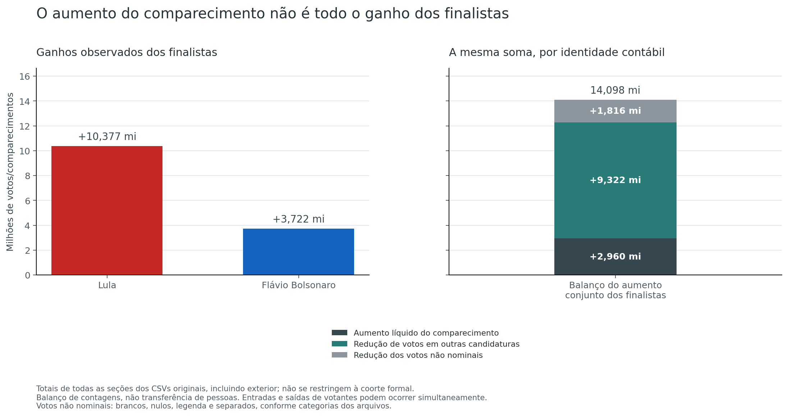
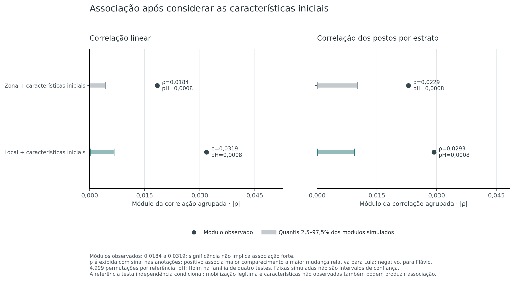

# H6 — Did higher turnout accompany larger gains for one finalist?

[Hypothesis index](../README.md) · [Method](METHOD.md) · [Evidence and reproduction](README.md)

**Answer:** the finalists' combined gain is larger than net turnout growth because the second round also has no votes for the other first-round candidates and fewer blank/null votes. Separately, sections with larger turnout increases show a **small positive association with a relative shift toward Lula** after the stated controls. That association is statistically detectable, but does not identify its cause or the votes of people who attended only one round.

## First, reconcile the national gains

Across all original records, Lula gains **10,376,694 votes** and Flávio Bolsonaro **3,721,538**. Their combined gain balances exactly:

| Change between rounds | Votes |
|---|---:|
| Net increase in turnout | +2,960,239 |
| Votes for other candidates in round 1, absent in round 2 | 9,321,993 |
| Reduction in blank/null votes | 1,816,000 |
| **Combined gain of the two finalists** | **14,098,232** |

The balance shows why net turnout growth alone is an incomplete denominator for interpreting the finalists' gains. It **does not allocate** the former other-candidate, blank, or null votes to either finalist. Nor does net turnout growth count everyone who entered the voting population: entries and exits can offset one another.

These are totals for all original records, including sections outside the comparable cohort. The source's electorate-identity residual of 423 registered voters per round is retained; the full balance and regional/state totals are in [totals.csv](evidence/analysis/totals.csv).

## Then, test the relationship between sections

**Hypothesis:** turnout increases are associated with a finalist's gains beyond the observed initial characteristics of comparable sections. **Identification difficulty: high.** The formal test concerns conditional association, rather than campaign effects, individual voter choices, or the order in which results arrived.

The study matches **499,248 physical section keys** across rounds and retains **497,833 comparable pairs**. For each included section, it compares:

- The change in turnout as a percentage of that round's registered electorate.
- The change in Lula's share **among the two finalists**, excluding the other first-round candidates from this preference denominator.

A positive relationship means a larger turnout increase accompanies a larger conditional shift toward Lula. Flávio Bolsonaro's conditional change is exactly the opposite, so it is not a separate independent test. Both candidates can gain absolute votes while this conditional share changes.

The references compare sections within the same municipality and electoral zone, with bands for initial electorate size, turnout, finalist preference, and other-candidate share. The second reference also requires the same polling place. Only groups with variation in both changes contribute.

| Reference | Informative sections | Share of cohort | Linear correlation | Pooled within-group rank correlation |
|---|---:|---:|---:|---:|
| Electoral zone and initial characteristics | 359,215 | 72.16% | **+0.0184** | +0.0229 |
| Same polling place and initial characteristics | 195,536 | 39.28% | **+0.0319** | +0.0293 |

All four tests detect an association after Holm adjustment, with **p = 0.0008**. Each reference uses 4,999 permutations. The correlations are small: statistical detection and the strength of the relationship are different findings. The tests overlap and do not represent four independent irregularities.

The descriptive linear slopes are **+0.0194** and **+0.0337** preference percentage points per turnout percentage point. They are not the fraction of additional voters choosing Lula and do not estimate a causal turnout effect. The two references also cover different subsets, so their correlation difference cannot isolate the effect of adding polling-place controls.

## What else the results tell us

An arithmetic decomposition separates each section's change in candidate votes per registered voter into turnout and vote-composition terms. Giving every section equal weight produces:

| Mean across the 497,833 cohort sections | Total change | Turnout component | Vote-composition component |
|---|---:|---:|---:|
| Lula | +6.38791 pp | +0.79700 pp | +5.59091 pp |
| Flávio Bolsonaro | +2.25365 pp | +0.77833 pp | +1.47532 pp |

The turnout terms are similar in this accounting summary; the composition terms differ more. These are identities between rates, not estimates of who changed votes. They are equally weighted section means, not national vote-share changes or observed vote-count gains. Full measures appear in [descriptive.csv](evidence/analysis/descriptive.csv).

The association is not a uniform territorial rule. The polling-place correlation is **+0.0040 in the Northeast**, **+0.0075 in the North**, and **+0.0698 in the South**. State signs also differ—for example, **+0.0421 in São Paulo** and **−0.0810 in Amapá**. These are descriptive comparisons without additional regional or state significance tests.

The 14 predefined sensitivity rows retain positive, small associations, including unchanged-electorate and domestic-only cohorts. Finer controls substantially reduce support, however; the polling-place comparison falls from 195,536 to 55,828 informative sections with narrower initial bands. Sensitivities do not receive additional p-values.

## Assessment and limits

**6/10 — partial support for the statistical hypothesis.** Scale: **0 — Fully refuted → 10 — Fully confirmed**. The four primary tests detect conditional association, with small magnitudes and positive sensitivity results. Partial coverage, territorial differences, and the limits of the reference prevent a broader conclusion about a non-natural movement. The score is qualitative, not a probability of manipulation; see the [assessment scale](../README.md#assessment-scale).

The permutations preserve observed turnout and preference trajectories while testing their conditional independence. They do not model all legitimate campaign or mobilization mechanisms. Unobserved composition, measurement effects, and remaining variation within the initial bands can also produce association. Sections without informative peers are outside the formal comparison, rather than classified as normal.

Aggregate counts do not reveal individual transitions, and matching a section key does not establish that the same people voted. The supplied files have not been independently authenticated against external ballot reports. The supported conclusion is therefore specific: **a weak conditional association is present; its cause is unresolved**.

The [method guide](METHOD.md) defines the cohort, reference, and validation scope. The [reproduction guide](README.md) links every section, the four tests, sensitivity tables, and retained simulation scores.
