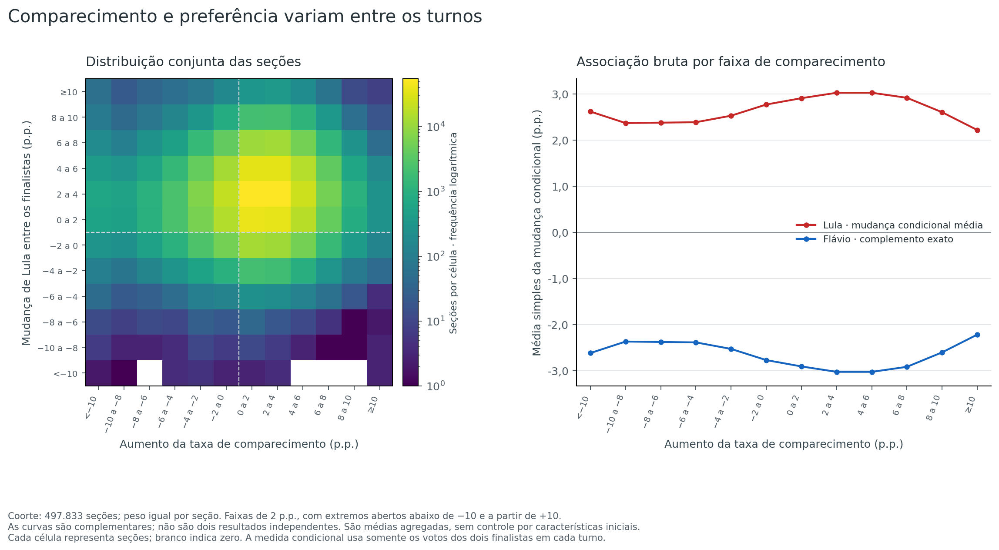
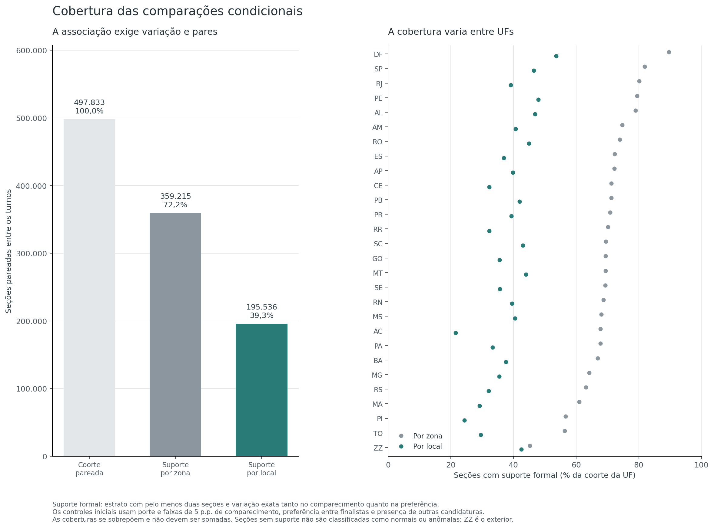

# H6 — Comparecimento e ganhos dos finalistas entre turnos

[Índice de hipóteses](../README.pt-BR.md) · [Protocolo](METHOD.pt-BR.md) · [Reprodução em inglês](README.md)

**Hipótese:** a redução da abstenção se associa de maneira excepcional ao ganho de um dos finalistas entre os turnos, além das características iniciais observadas das seções. **Dificuldade de identificação: alta.**

**Resultado:** há uma associação residual positiva, mas fraca, entre aumento do comparecimento e mudança relativa para Lula. Ela é detectada nas duas referências e nos dois escores, com Holm de 0,0008; as correlações lineares são **+0,0184 por zona e +0,0319 por local**. O sinal não é uniforme entre regiões e UFs, e a referência por local cobre 39,28% da coorte. Esses resultados não demonstram uma causa artificial.

O ganho nacional de **10.376.694 votos para Lula e 3.721.538 para Flávio Bolsonaro** não deve ser atribuído automaticamente aos 2.960.239 comparecimentos líquidos adicionais. O balanço também inclui 9.321.993 votos das candidaturas ausentes no segundo turno e redução de 1.816.000 brancos/nulos. Essa conciliação é contábil, sem identificar quais pessoas mudaram de voto ou compareceram em apenas um turno.

## Avaliação na escala

**6/10 — apoio parcial à hipótese estatística.** Escala: **0 — Integralmente refutada → 10 — Integralmente confirmada**. Os quatro testes dependentes detectam uma associação positiva, e as sensibilidades mantêm uma relação positiva de magnitude pequena. Isso sustenta apoio parcial à presença de associação além dos controles observados.

A magnitude fraca, a cobertura parcial, a heterogeneidade territorial e a referência de independência — que não representa todos os mecanismos naturais de mobilização — impedem tratar a associação como demonstração de um movimento não natural ou confirmação integral da hipótese ampla. A nota foi atribuída após os resultados e é uma síntese qualitativa ordinal; **não significa 60% de chance de manipulação**, proporção de votos suspeitos ou transformação de valor-p. Consulte a [rubrica do índice](../README.pt-BR.md#escala-de-avaliação).

## Pergunta e medidas

A análise distingue três perguntas: quanto cresceram os votos de cada finalista; como esse crescimento se concilia com o comparecimento e a saída das demais candidaturas; e se seções com maior aumento do comparecimento também mudaram mais a preferência entre os finalistas. As duas primeiras são descritivas e contábeis. A terceira recebe uma referência estatística condicional.

Sejam `A` os aptos, `T` o comparecimento e `F = V13 + V22` os votos dos dois finalistas. Por seção, são calculados:

```text
x = 100 * (T2/A2 − T1/A1)
q_t = V13_t / (V13_t + V22_t)
y = 100 * (q2 − q1)
```

`x` mede a mudança do comparecimento em pontos percentuais do eleitorado; `y`, a mudança da participação de Lula **condicional aos dois finalistas**. Para Flávio Bolsonaro, essa última mudança é exatamente `−y`. Ganhar votos absolutos, ganhar participação sobre todos os nominais e ganhar participação entre os dois finalistas são medidas diferentes. A saída das demais candidaturas pode aumentar os votos dos dois finalistas sem produzir uma mudança de preferência condicional entre eles.

Uma associação positiva entre `x` e `y` significa que maior aumento de comparecimento acompanha uma mudança relativa maior para Lula; negativa, para Flávio Bolsonaro. **Não identifica o voto das pessoas que compareceram em apenas um turno.** O aumento líquido de comparecimento não mede todo o ingresso de votantes: entradas e saídas podem ocorrer simultaneamente.

Esta pergunta usa o resultado das mesmas chaves de seção nos dois turnos; não testa a ordem de chegada dos boletins durante a apuração. Tampouco identifica renda, escolaridade, idade ou outras características individuais.

## Fontes e coorte

Os dois CSVs nacionais originais de votação e detalhe são relidos diretamente, sem exigir o banco do replay ou resultados numéricos de outra hipótese. Os hashes e totais são conferidos contra os manifestos anteriores. O carregador é uma cópia identificada do código de leitura existente, com cache próprio. A unicidade das chaves de detalhe é conferida na leitura; a unicidade dos registros de votação se apoia na auditoria contábil concluída para os mesmos hashes. A continuidade desses arquivos não equivale à sua autenticação contra boletins externos.

O pareamento usa `UF + município + zona + seção`, preservando os códigos de eleição e turnos como procedência. A coorte exige seção instalada e não anulada, pelo menos 50 aptos e votos nominais e comparecimento positivo nos dois turnos; pelo menos 50 votos somados dos finalistas no primeiro turno; mesmo local conhecido; e razão simétrica de aptos até 1,25. A identidade `aptos = comparecimento + abstenções` precisa valer em todos os pares incluídos.

As taxas usam o eleitorado de cada turno. Pequenas alterações cadastrais são admitidas no desenho principal e retiradas em uma sensibilidade. Com aptos distintos, redução da **contagem** de abstenções não equivale necessariamente a aumento da contagem de comparecimento. Mesma chave, local e número de aptos não asseguram que exatamente as mesmas pessoas votaram.

O protocolo foi fixado antes dos cálculos de associação desta entrega, quando os totais nacionais e a estrutura pareada já eram conhecidos. Não é um pré-registro externo. Seu SHA-256 é `6a63f96ead6de3641c53cc123d7258282b506f160494fd228b257a02dba51687`.

### Cobertura do pareamento

As mesmas **499.248 chaves físicas** aparecem em ambos os turnos, sem chaves exclusivas de um turno. A coorte inclui **497.833 pares**. As exclusões são exclusivas e seguem a ordem do protocolo:

| Motivo | Pares excluídos |
|---|---:|
| Situação não instalada ou anulada | 41 |
| Aptos abaixo de 50 em algum turno | 258 |
| Comparecimento não positivo | 1 |
| Nominais abaixo de 50 | 532 |
| Menos de 50 votos dos finalistas no primeiro turno | 146 |
| Local ausente | 0 |
| Local alterado | 430 |
| Razão simétrica de aptos acima de 1,25 | 7 |

Há **55.602 pares com alguma mudança de aptos** na coorte; a sensibilidade de aptos iguais retém 442.231 pares. A identidade de eleitorado é satisfeita em todos os pares incluídos. Os inventários completos estão em [pairing.csv](evidence/analysis/pairing.csv), [eligibility.csv](evidence/analysis/eligibility.csv), [unmatched.csv](evidence/analysis/unmatched.csv) e [paired-sections.csv.gz](evidence/analysis/paired-sections.csv.gz).

Os totais brutos preservam a ressalva da identidade de eleitorado: **423 aptos por turno** não aparecem na soma de comparecimento e abstenções, nas mesmas 41 seções do exterior marcadas como não instaladas, sem votos, comparecimento ou abstenções. Elas ficam fora da coorte pela situação da seção. O contexto não resolve de forma independente a convenção do arquivo; os valores não foram normalizados. Veja a [documentação contábil da fonte](../01-accounting-integrity/REPORT.pt-BR.md) e os campos `aptos_identity_residual_1/2` de [totals.csv](evidence/analysis/totals.csv).

## Balanço nacional: ganho dos finalistas e comparecimento

A tabela usa **todos os registros originais**, incluindo os que ficaram fora da coorte comparável:

| Medida | Primeiro turno | Segundo turno | Variação |
|---|---:|---:|---:|
| Aptos | 158.745.502 | 158.745.502 | 0 |
| Comparecimento | 125.275.835 | 128.236.074 | **+2.960.239** |
| Abstenções registradas | 33.469.244 | 30.509.005 | −2.960.239 |
| Votos de Lula | 53.879.538 | 64.256.232 | **+10.376.694** |
| Votos de Flávio Bolsonaro | 56.104.503 | 59.826.041 | **+3.721.538** |
| Demais candidaturas | 9.321.993 | 0 | −9.321.993 |
| Brancos | 2.300.798 | 1.430.496 | −870.302 |
| Nulos | 3.669.003 | 2.723.305 | −945.698 |

A taxa nacional agregada de comparecimento sobe de **78,91615% para 80,78092%**, ou +1,86477 p.p. Legenda e votos separados são zero nos dois turnos. A identidade de contagens é exata:

```text
ganho de Lula + ganho de Flávio Bolsonaro
= aumento do comparecimento − mudança de outras candidaturas e votos não nominais

10.376.694 + 3.721.538
= 2.960.239 + 9.321.993 + 1.816.000
= 14.098.232
```

O desaparecimento das demais candidaturas do segundo turno altera o conjunto de opções. Assim, comparar diretamente o ganho dos finalistas com o aumento líquido do comparecimento deixa de fora parte relevante do balanço. A identidade fecha sem resíduo, mas **não aloca os votos anteriores a cada finalista**. Também não permite limitar todos os novos votantes ao saldo de 2.960.239, pois entradas e saídas podem se compensar. Os valores completos, por UF e região, estão em [totals.csv](evidence/analysis/totals.csv).


## Decomposição aritmética

Além do balanço de contagens, cada candidato tem uma decomposição simétrica por seção. Com `t=T/A`, `s=Vc/T` e `v=Vc/A`:

```text
100*Δv = 100*((s1+s2)/2)*Δt + 100*((t1+t2)/2)*Δs
```

O primeiro termo é o **componente aritmético de comparecimento**; o segundo, o **componente aritmético de composição do voto**. A identidade é exata e trata os turnos simetricamente. Ela não estima efeito causal de mobilização nem transferência individual de eleitores. O componente de composição inclui a participação das demais candidaturas e dos votos não nominais, além da relação entre finalistas.

As médias em pontos percentuais dão o mesmo peso a cada seção. As somas ponderadas por `A1` são equivalentes com o eleitorado inicial; onde `A1 != A2`, não são os ganhos observados de contagens. O balanço nacional de votos é apresentado separadamente. Todas as medidas constam em [section-measures.csv.gz](evidence/analysis/section-measures.csv.gz), e os resumos em [descriptive.csv](evidence/analysis/descriptive.csv).

| Média simples nas 497.833 seções da coorte | Ganho de votos/aptos | Componente de comparecimento | Componente de composição do voto |
|---|---:|---:|---:|
| Lula | +6,38791 p.p. | +0,79700 p.p. | +5,59091 p.p. |
| Flávio Bolsonaro | +2,25365 p.p. | +0,77833 p.p. | +1,47532 p.p. |

Neste resumo, os componentes aritméticos de comparecimento são próximos; os de composição diferem mais. Isso descreve como a identidade se distribui entre termos, sem estimar o voto dos antigos abstencionistas. A média simples da mudança de comparecimento é **+1,72096 p.p.**, e a mudança condicional média entre finalistas é **+2,90504 p.p. para Lula**. Essas médias por seção não são mudanças dos percentuais nacionais ponderados por votos.

A taxa de comparecimento aumenta em **382.745 seções**, permanece exatamente igual em 16.461 e diminui em 98.627. O ganho relativo entre finalistas aparece também em faixas de queda do comparecimento: por exemplo, entre −2 e 0 p.p., a mudança condicional média de Lula é +2,76855 p.p.; entre 2 e 4 p.p., +3,02274 p.p.; entre 8 e 10 p.p., +2,60109 p.p. A relação bruta entre as duas mudanças é positiva e fraca, `rho = +0,04952`, sem crescimento monotônico em todas as faixas. Veja [x-bins.csv](evidence/analysis/x-bins.csv).



## Referência de associação condicional

São avaliadas duas referências definidas previamente:

| Referência | Características mantidas no estrato |
|---|---|
| `zone_baseline` | UF, município, zona, faixa de aptos inicial com razão 1,25, comparecimento inicial, preferência inicial entre finalistas e participação inicial das demais candidaturas |
| `place_baseline` | Os mesmos campos, acrescentando o local de votação |

As três proporções iniciais usam faixas de cinco pontos percentuais. O comparecimento usa `T1/A1`; a preferência, `V13_1/F1`; a participação das demais candidaturas, `(N1−F1)/T1`. As faixas são calculadas com inteiros, sem arredondar as razões; 100% entra na última faixa.

Só contribuem estratos com pelo menos duas seções e variação exata em **ambas** as mudanças. Seções sem suporte não são classificadas como normais. Dentro de cada estrato informativo, centralizam-se `x` e `y` pelas médias simples. A correlação linear agrupada é:

```text
rho = soma(rx*ry) / raiz(soma(rx²)*soma(ry²))
beta = soma(rx*ry) / soma(rx²)
```

O teste usa `abs(rho)` para detectar associação nos dois sentidos; a correlação com sinal acompanha o resultado. A inclinação `beta` mede pontos de preferência entre finalistas por ponto de comparecimento, sem interpretação de fração de novos eleitores. O segundo escore usa **postos médios dentro de cada estrato**, com empates e ordenação racionais exatos, e depois agrupa os postos centralizados. Não é a correlação de postos nacional nem uma média de correlações dos estratos. Estratos maiores podem influenciar mais esse escore porque seus postos abrangem uma escala maior.

Em cada uma de 4.999 atribuições por referência, a trajetória de preferência dos dois turnos se desloca como bloco entre os rótulos fixos de comparecimento do mesmo estrato. As distribuições marginais são preservadas. A simulação desacopla as trajetórias para testar independência condicional; **não constrói boletins sintéticos fisicamente viáveis**. Os controles por faixas não igualam continuamente os pontos de partida.

Os subfluxos NumPy/PCG64 usam semente-base `20261029` e `SeedSequence([20261029, 6, model_id], spawn_key=(rep,))`. O valor-p usa a regra de mais um e resolução mínima de 0,0002, nunca zero. Holm a 5% ajusta a família fixa de **quatro testes**: dois escores e duas referências. Eles são dependentes e não representam quatro irregularidades independentes. Os quantis simulados são referências condicionais, sem interpretação de intervalo de confiança da eleição.

Os [grupos completos](evidence/analysis/association-groups.csv.gz), a [cobertura](evidence/analysis/coverage.csv), os [testes](evidence/analysis/tests.csv) e todos os [escores simulados](evidence/analysis/permutation-scores.csv.gz) são publicados. Não há valores-p por seção, UF, candidato ou sensibilidade.

### Cobertura informativa

| Medida | Por zona | Por local |
|---|---:|---:|
| Estratos na coorte | 221.198 | 380.759 |
| Seções em estratos unitários | 138.305 | 301.648 |
| Seções em estratos com comparecimento constante e preferência variável | 313 | 645 |
| Seções em estratos com preferência constante e comparecimento variável | 0 | 4 |
| Estratos informativos | **82.737** | **78.788** |
| Seções informativas | **359.215** | **195.536** |
| Parcela da coorte informativa | **72,16%** | **39,28%** |

Não há estratos não unitários com ambas as mudanças constantes. A referência por zona deixa 138.618 seções fora do suporte formal; a por local, 302.297. Acrescentar o local melhora a proximidade do contexto, mas reduz a cobertura. As duas correlações são obtidas em universos comparáveis diferentes, portanto sua diferença não isola o efeito causal do local.



### Associação observada e referência simulada

| Referência | Estatística | Correlação observada com sinal | Quantis de 2,5%–97,5% dos módulos simulados | Holm |
|---|---|---:|---|---:|
| Zona | Linear | **+0,018404** | 0,000074–0,004317 | **0,0008** |
| Zona | Postos | **+0,022882** | 0,000141–0,010110 | **0,0008** |
| Local | Linear | **+0,031852** | 0,000091–0,006643 | **0,0008** |
| Local | Postos | **+0,029309** | 0,000132–0,009396 | **0,0008** |

Nenhuma das 4.999 atribuições de cada referência alcançou o respectivo módulo observado; os quatro valores-p brutos são 0,0002. Há associação detectável além da referência de independência condicional, mas **a magnitude é pequena**. Significância e força da relação são informações distintas.

A inclinação linear é **+0,01940** na referência por zona e **+0,03373** na por local: um ponto de desvio de comparecimento acompanha, no resumo linear residual, aproximadamente 0,019 ou 0,034 ponto de desvio da preferência condicional de Lula. Não são efeitos causais, percentuais de novos votantes ou previsões individuais. Para o candidato 22, os sinais condicionais se invertem exatamente.

Os quatro escores tiveram sua variabilidade confirmada por atribuições com resultados distintos. A associação não desaparece quando se acrescenta o local, mas a correlação maior nesse desenho não significa que o controle fortaleça causalmente um mecanismo: o suporte também mudou. Tampouco se pode converter a diferença entre correlações em parcela explicada da mudança nacional de votos.


## Regiões e UFs: o padrão não é uniforme

Os recortes abaixo são **descritivos**, sem novos valores-p. As médias de `x` e `y` dão peso igual a cada seção da coorte regional; as correlações condicionais usam apenas os respectivos estratos informativos, mantendo a definição local do estrato.

| Região | Média de x, p.p. | Média de y, p.p. | rho bruta | rho por zona | rho por local | Seções com suporte por local |
|---|---:|---:|---:|---:|---:|---:|
| Centro-Oeste | +1,604 | +3,247 | +0,1087 | +0,0477 | +0,0553 | 15.801 |
| Nordeste | +1,692 | +1,995 | −0,0182 | −0,0038 | +0,0040 | 52.074 |
| Norte | −2,018 | +2,561 | +0,0388 | −0,0328 | +0,0075 | 15.326 |
| Sudeste | +2,365 | +3,508 | −0,0198 | +0,0252 | +0,0371 | 84.917 |
| Sul | +2,241 | +3,031 | +0,0940 | +0,0659 | +0,0698 | 26.879 |
| Exterior | +4,250 | +1,724 | +0,0337 | +0,0944 | +0,0902 | 539 |

O Nordeste tem correlação por local próxima de zero, apesar do aumento médio de comparecimento e do ganho relativo médio de Lula. O Norte registra queda média de comparecimento e aumento médio da preferência condicional de Lula; sua correlação muda de sinal entre as duas referências e também fica próxima de zero por local. Centro-Oeste e Sul apresentam relações positivas maiores, ainda fracas. Assim, o agregado nacional não descreve uma regra uniforme para todas as regiões.

Nas UFs, **SP** tem correlação por local de +0,0421 entre 48.151 seções com suporte; **MT**, +0,1060 entre 3.629. Em sentido oposto, **AP** tem −0,0810 entre 758; **RR**, −0,0734 entre 488; e **PI**, −0,0656 entre 2.479. São magnitudes e sinais descritivos, não classificações de irregularidade nem testes estaduais. O Nordeste também contém sinais distintos entre UFs: MA, PB, PI e RN são negativos por local; AL, BA, CE e PE, positivos. O conjunto completo, sem selecionar apenas exemplos, aparece abaixo e em [descriptive.csv](evidence/analysis/descriptive.csv).

<details>
<summary>Todas as UFs: mudanças médias e correlações condicionais</summary>

| UF | Média de x, p.p. | Média de y, p.p. | rho por zona | rho por local | Seções com suporte por local |
|---|---:|---:|---:|---:|---:|
| AC | −5,948 | +2,725 | −0,0925 | +0,0150 | 490 |
| AL | +0,339 | +3,267 | +0,0052 | +0,0459 | 3.325 |
| AM | −1,718 | +2,797 | −0,0446 | −0,0217 | 3.299 |
| AP | −8,284 | +3,239 | −0,1449 | −0,0810 | 758 |
| BA | +3,040 | +1,382 | +0,0115 | +0,0152 | 13.312 |
| CE | +1,523 | +2,049 | −0,0169 | +0,0109 | 7.652 |
| DF | +1,589 | +3,105 | +0,0018 | −0,0205 | 3.737 |
| ES | +1,868 | +2,789 | +0,0419 | +0,0437 | 3.625 |
| GO | +1,415 | +3,527 | +0,0424 | +0,0492 | 5.564 |
| MA | −0,775 | +2,242 | −0,0199 | −0,0121 | 5.261 |
| MG | +2,415 | +3,037 | +0,0220 | +0,0368 | 18.394 |
| MS | +2,576 | +3,146 | +0,0877 | +0,0898 | 2.871 |
| MT | +1,139 | +2,924 | +0,0715 | +0,1060 | 3.629 |
| PA | −1,450 | +2,335 | −0,0018 | +0,0433 | 6.892 |
| PB | +1,773 | +2,547 | +0,0065 | −0,0173 | 4.489 |
| PE | +2,893 | +2,040 | +0,0201 | +0,0189 | 10.255 |
| PI | −0,149 | +1,294 | −0,0682 | −0,0656 | 2.479 |
| PR | +2,512 | +3,127 | +0,0726 | +0,0693 | 10.638 |
| RJ | +1,526 | +4,130 | −0,0049 | +0,0199 | 14.747 |
| RN | +2,140 | +2,612 | +0,0052 | −0,0414 | 3.194 |
| RO | −0,204 | +2,586 | −0,0209 | −0,0271 | 2.103 |
| RR | −6,228 | +3,361 | −0,0510 | −0,0734 | 488 |
| RS | +2,155 | +2,857 | +0,0516 | +0,0628 | 8.797 |
| SC | +1,954 | +3,156 | +0,0765 | +0,0794 | 7.444 |
| SE | +1,512 | +2,370 | −0,0202 | +0,0026 | 2.107 |
| SP | +2,692 | +3,586 | +0,0367 | +0,0421 | 48.151 |
| TO | −0,977 | +2,505 | −0,0275 | +0,0557 | 1.296 |
| ZZ | +4,250 | +1,724 | +0,0944 | +0,0902 | 539 |

</details>

Brasil, regiões e UFs resumem os mesmos registros em níveis diferentes. Suas contagens não devem ser somadas, e diferenças de correlação entre esses níveis podem refletir composição e agregação. A tabela também não equivale a um ranking de suspeita.

## Sensibilidades predefinidas

Cada alternativa modifica uma definição por vez e recebe somente uma descrição de magnitude e suporte. As sete linhas abaixo resumem as **14 combinações de cenário e referência** de [sensitivity.csv](evidence/analysis/sensitivity.csv); nenhuma recebe novo valor-p.

| Cenário | Pares da coorte | Suporte por zona | rho linear por zona | Suporte por local | rho linear por local |
|---|---:|---:|---:|---:|---:|
| Primário: faixas de 5 p.p. | 497.833 | 359.215 | +0,01840 | 195.536 | +0,03185 |
| Faixas iniciais de 2,5 p.p. | 497.833 | 201.897 | +0,01673 | 55.828 | +0,03535 |
| Faixas iniciais de 10 p.p. | 497.833 | 445.457 | +0,02036 | 336.447 | +0,03084 |
| Aptos exatamente iguais | 442.231 | 308.742 | +0,01858 | 161.145 | +0,03556 |
| Pelo menos 100 votos iniciais dos finalistas | 492.046 | 359.028 | +0,01855 | 195.501 | +0,03187 |
| Apenas território nacional | 496.565 | 358.642 | +0,01833 | 194.997 | +0,03170 |
| Preferência final `100*q2`, em lugar da mudança `y` | 497.833 | 359.049 | +0,02585 | 195.236 | +0,03691 |

As relações lineares e por postos permanecem positivas e pequenas em todos esses recortes. Isso descreve persistência de sinal, sem estender aos cenários a decisão formal do desenho primário. Restringir a aptos iguais ou retirar o exterior não elimina a associação descritiva. Faixas mais estreitas mudam muito o suporte: por local, a queda é de 195.536 para 55.828 seções. O cenário com preferência final examina outro desfecho e não prova que toda dependência com o ponto de partida foi removida.

## Validação e reprodução

Os **65 testes de implementação passaram**, com controles artificiais de pareamento, exclusões, identidades, decomposição simétrica, denominadores diferentes, saída das demais candidaturas, empates e fronteiras de faixas. Também verificam relações positivas/negativas, controle por estrato, preservação das trajetórias, escores constantes, enumeração finita, proteção de caches e reprodução com quantidades diferentes de processos. Esses controles verificam o desenho implementado; não estimam a capacidade de detectar toda alteração possível. Consulte [test-results.txt](evidence/test-results.txt).

Uma implementação independente relê os CSVs originais sem importar o carregador ou as funções estatísticas primárias. A auditoria **passou em 51.488.243 verificações, com zero divergências**, e diferença numérica absoluta máxima de `4,66e−10`. Ela abrange os 14 CSVs numéricos, reconstrói pareamento, coorte, medidas, decomposições, estratos, resumos e as 14 linhas de sensibilidade, e confere procedência e resumo da execução. As verificações se sobrepõem sobre arquivos e cálculos; não são observações estatísticas independentes. O resultado e o escopo estão em [independent-validation.json](evidence/independent-validation.json).

Foram geradas novamente, de forma independente, as atribuições 0 e 1 de cada referência: **quatro atribuições completas**, com hashes e escores conferidos. Os **9.998 pares de escores assinados retidos** foram auditados quanto à publicação, médias, quantis, excedências e ajuste de Holm. **Não foram novamente geradas todas as 9.998 atribuições**. A tabela pública de escores permite consultar todos os resultados numéricos sem o cache binário privado; isso é diferente de repetir suas atribuições.

O [README](README.md) traz comandos que usam novos caminhos de saída para preservar a evidência publicada. Código, testes, tabelas completas comprimidas, quatro gráficos PNG/SVG e documentos ficam nesta pasta; caches privados ficam em `.work/`. O [manifesto da execução](evidence/analysis/manifest.json) identifica método, fontes, código, parâmetros e hashes numéricos; o [inventário de publicação](evidence/artifact-manifest.json) cobre os arquivos publicados.

## Limites de interpretação

Independência condicional é uma referência verificável, não uma definição completa de uma eleição natural. Mobilização, campanha, composição não observada e outros mecanismos legítimos podem produzir associação. As faixas não removem toda heterogeneidade contínua, regressão à média ou dependência de medidas baseadas nas mesmas contagens. A sensibilidade com preferência final em lugar de sua mudança expõe parte da relação com a medida inicial; não resolve todo erro de medida.

Movimentos uniformes de um estrato são condicionados para fora do teste. A relação entre médias de estratos, seções sem suporte e comportamentos não capturados por correlação linear ou monotônica ficam fora desse alcance. Uma atenuação após acrescentar o local não identifica causalmente quanto ele explica, pois muda também o conjunto comparável.

Rejeitar a referência revela associação no recorte definido; não demonstra origem artificial. Não rejeitar não certifica naturalidade. A coerência contábil e os hashes não autenticam externamente os registros, e agregados não revelam transferências individuais de voto.
