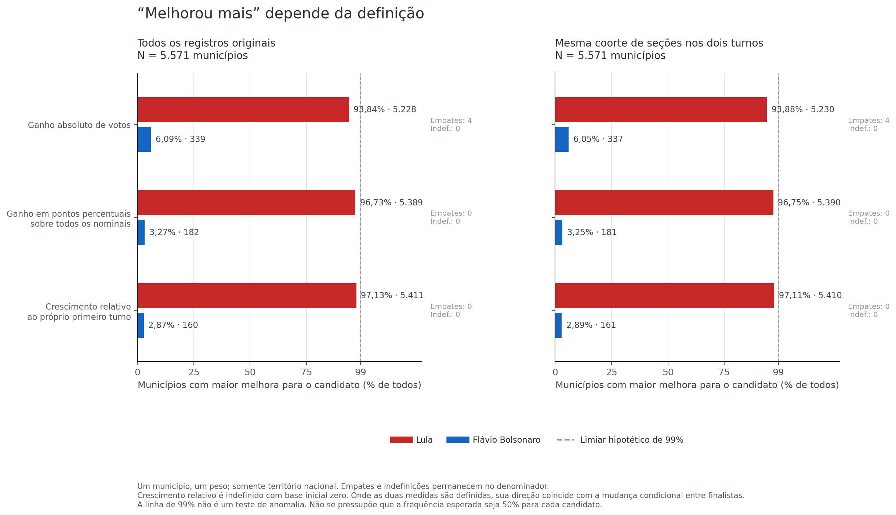
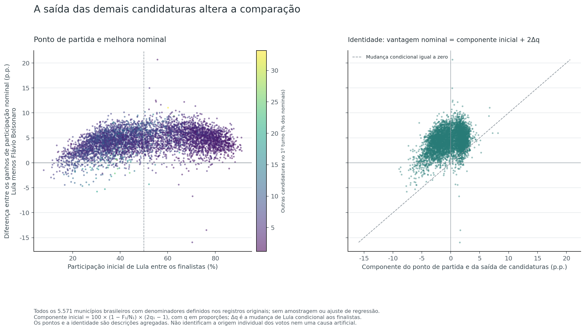
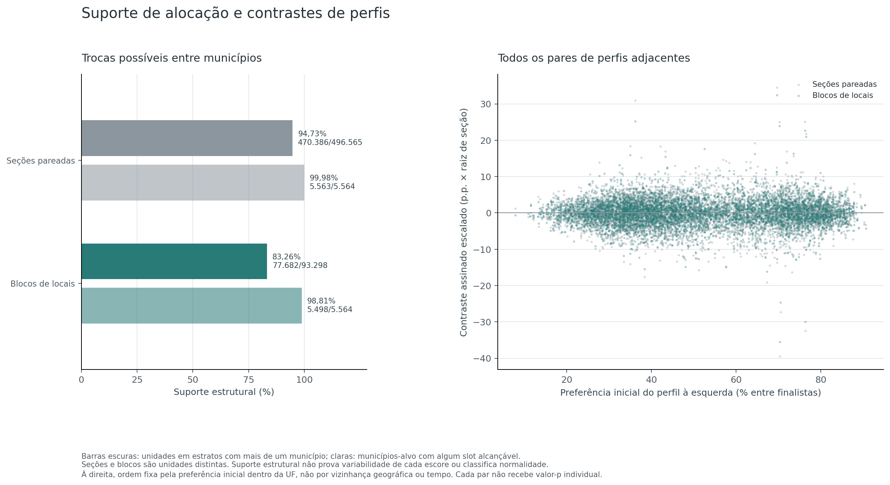
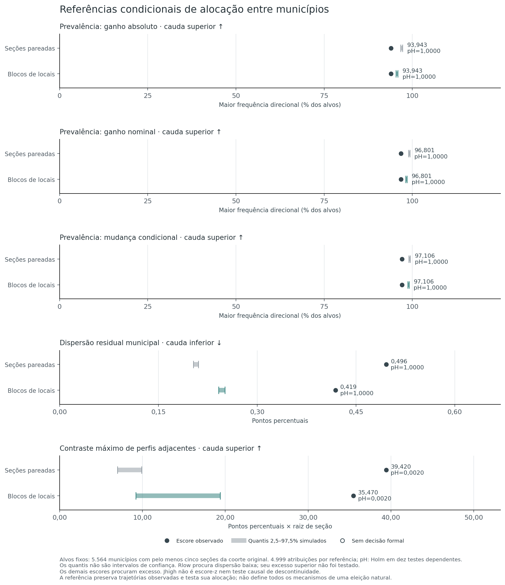

# H7 — Regularidade e contrastes da redistribuição entre turnos

[Índice de hipóteses](../README.pt-BR.md) · [Protocolo](METHOD.pt-BR.md) · [Reprodução em inglês](README.md)

**Hipótese:** a redistribuição entre turnos apresenta regularidades ou contrastes abruptos além das referências de composição territorial definidas nesta análise. **Dificuldade de identificação: muito alta.**

**Resultado:** o padrão hipotético nacional de “99% dos municípios” **não se verifica nas definições avaliadas neste snapshot**. Entre os 5.571 códigos municipais domésticos presentes nas fontes, Lula tem melhora maior em **93,8431%** por ganho absoluto, **96,7331%** por ganho nominal e **97,1280%** por crescimento relativo. Há frequências regionais acima de 99%, mas são outros recortes.

Os testes não detectam excesso de prevalência ou uniformidade nas caudas previstas. Detectam **contrastes residuais entre perfis iniciais adjacentes** nas duas referências, com Holm de **0,002**. Esses contrastes dão apoio parcial à hipótese estatística e não demonstram causa artificial.

## Avaliação na escala

**6/10 — apoio parcial à hipótese estatística.** Escala: **0 — Integralmente refutada → 10 — Integralmente confirmada**. O apoio vem dos dois testes de contraste `Jhigh`, que detectam diferenças além das referências de alocação definidas. Os outros oito testes não detectam excesso de prevalência nem dispersão excessivamente baixa nas respectivas caudas.

A avaliação considera o alcance parcial das referências, a heterogeneidade territorial preservada ou rompida por cada desenho e a ausência de identificação causal. Não confirma a naturalidade das mudanças marginais nem uma origem artificial dos contrastes. A nota é uma síntese qualitativa ordinal atribuída após os resultados; **não significa 60% de chance de manipulação**, parcela de votos suspeitos ou transformação de valor-p. Veja a [rubrica do índice](../README.pt-BR.md#escala-de-avaliação).

## A pergunta dos 99%

“Um candidato melhorou mais que o outro em 99% dos municípios” é uma afirmação que depende da medida usada. Ganhar mais votos absolutos, ganhar mais pontos percentuais e crescer mais em relação à própria votação inicial são comparações diferentes. A H7 calcula essas frequências antes de interpretá-las e separa o censo municipal dos testes de alocação territorial.

Não se adota a expectativa de que cada candidato deva melhorar mais em metade dos municípios. A posição inicial e a saída das demais candidaturas tornam uma referência de 50%/50% inadequada. Tampouco se trata uma frequência elevada, isoladamente, como demonstração de origem artificial.

Cada município brasileiro recebe peso um nesse censo. As unidades cadastrais do exterior, identificadas por `ZZ`, aparecem separadamente e não entram no denominador de municípios brasileiros. Os números de municípios, regiões e UFs resumem os mesmos registros em diferentes níveis e não devem ser somados como observações independentes.

## Censo municipal: qual frequência aparece nos arquivos?

O universo nacional bruto contém **5.571 códigos municipais das 27 UFs domésticas**. É o inventário das unidades presentes nos arquivos fornecidos, sem validação contra um cadastro municipal externo. As mesmas 5.571 unidades têm dados na coorte. Há também **186 unidades cadastrais do exterior**, publicadas separadamente.

Em todas as medidas abaixo, os 5.571 casos domésticos são definidos: o denominador de todos os municípios coincide com o de casos definidos. A direção condicional tem os mesmos números do crescimento relativo, sem constituir um teste ou achado independente.

| Universo | Definição de melhora maior | Lula | Flávio Bolsonaro | Empates | Lula sobre 5.571 | Algum sentido atinge 99%? |
|---|---|---:|---:|---:|---:|---|
| Bruto | Ganho absoluto | 5.228 | 339 | 4 | 93,8431% | Não |
| Bruto | Ganho de participação nominal | 5.389 | 182 | 0 | 96,7331% | Não |
| Bruto | Crescimento relativo / direção condicional | 5.411 | 160 | 0 | 97,1280% | Não |
| Coorte pareada | Ganho absoluto | 5.230 | 337 | 4 | 93,8790% | Não |
| Coorte pareada | Ganho de participação nominal | 5.390 | 181 | 0 | 96,7510% | Não |
| Coorte pareada | Crescimento relativo / direção condicional | 5.410 | 161 | 0 | 97,1100% | Não |

O recorte da coorte altera poucos sinais, mas deve continuar identificado. Nenhuma das três definições nacionais chega ao limiar de 99%. As contagens e as verificações inteiras do limiar estão em [gain-directions.csv](evidence/analysis/gain-directions.csv), e cada unidade pode ser conferida em [municipal-census.csv](evidence/analysis/municipal-census.csv).

Uma ponderação diferente pode ultrapassar 99%: os municípios onde Lula tem maior ganho nominal reúnem **122.927.338 dos 123.710.622 votos nominais domésticos do segundo turno**, ou **99,3668%**. Pelo crescimento relativo, reúnem 122.520.362 desses votos, ou 99,0379%. Isso mede o peso eleitoral dos municípios classificados naquele sentido; **não significa 99% dos municípios, votos do candidato ou pessoas que mudaram de preferência**.



### Os recortes regionais mudam a resposta

A tabela mostra, no universo bruto, o número de códigos municipais em que Lula melhora mais, com peso igual por município. Não há valores-p regionais adicionais.

| Região | Unidades | Ganho absoluto | Ganho nominal | Crescimento relativo / direção condicional |
|---|---:|---:|---:|---:|
| Centro-Oeste | 468 | 430/468 (91,88%) | 443/468 (94,66%) | 460/468 (98,29%) |
| Nordeste | 1.794 | 1.777/1.794 (99,05%) | 1.771/1.794 (98,72%) | 1.671/1.794 (93,14%) |
| Norte | 450 | 436/450 (96,89%) | 444/450 (98,67%) | 446/450 (99,11%) |
| Sudeste | 1.668 | 1.644/1.668 (98,56%) | 1.659/1.668 (99,46%) | 1.652/1.668 (99,04%) |
| Sul | 1.191 | 941/1.191 (79,01%) | 1.072/1.191 (90,01%) | 1.182/1.191 (99,24%) |

Por exemplo, o Nordeste supera 99% pelo ganho absoluto, enquanto Norte, Sudeste e Sul superam 99% pelo crescimento relativo. Isso não transforma esses percentuais em uma frequência nacional nem estabelece uma causa. Os recortes completos por UF e região estão no CSV, incluindo os dois sentidos e empates.

<details>
<summary>Todas as UFs domésticas: frequência de melhora maior para Lula no universo bruto</summary>

Os percentuais têm peso igual por código municipal e denominador da UF; não são participações de votos do candidato. A direção condicional coincide com crescimento relativo neste universo definido.

| UF | Unidades | Ganho absoluto | Ganho nominal | Crescimento relativo |
|---|---:|---:|---:|---:|
| AC | 22 | 21/22 (95,45%) | 20/22 (90,91%) | 21/22 (95,45%) |
| AL | 102 | 101/102 (99,02%) | 101/102 (99,02%) | 101/102 (99,02%) |
| AM | 62 | 58/62 (93,55%) | 62/62 (100,00%) | 62/62 (100,00%) |
| AP | 16 | 15/16 (93,75%) | 16/16 (100,00%) | 16/16 (100,00%) |
| BA | 417 | 413/417 (99,04%) | 402/417 (96,40%) | 331/417 (79,38%) |
| CE | 184 | 184/184 (100,00%) | 183/184 (99,46%) | 175/184 (95,11%) |
| DF | 1 | 1/1 (100,00%) | 1/1 (100,00%) | 1/1 (100,00%) |
| ES | 78 | 78/78 (100,00%) | 78/78 (100,00%) | 78/78 (100,00%) |
| GO | 246 | 213/246 (86,59%) | 221/246 (89,84%) | 238/246 (96,75%) |
| MA | 217 | 212/217 (97,70%) | 216/217 (99,54%) | 216/217 (99,54%) |
| MG | 853 | 838/853 (98,24%) | 846/853 (99,18%) | 839/853 (98,36%) |
| MS | 79 | 79/79 (100,00%) | 79/79 (100,00%) | 79/79 (100,00%) |
| MT | 142 | 137/142 (96,48%) | 142/142 (100,00%) | 142/142 (100,00%) |
| PA | 144 | 141/144 (97,92%) | 143/144 (99,31%) | 143/144 (99,31%) |
| PB | 223 | 223/223 (100,00%) | 223/223 (100,00%) | 222/223 (99,55%) |
| PE | 185 | 185/185 (100,00%) | 185/185 (100,00%) | 182/185 (98,38%) |
| PI | 224 | 217/224 (96,88%) | 219/224 (97,77%) | 203/224 (90,62%) |
| PR | 399 | 372/399 (93,23%) | 388/399 (97,24%) | 396/399 (99,25%) |
| RJ | 92 | 92/92 (100,00%) | 92/92 (100,00%) | 92/92 (100,00%) |
| RN | 167 | 167/167 (100,00%) | 167/167 (100,00%) | 166/167 (99,40%) |
| RO | 52 | 49/52 (94,23%) | 50/52 (96,15%) | 52/52 (100,00%) |
| RR | 15 | 15/15 (100,00%) | 15/15 (100,00%) | 15/15 (100,00%) |
| RS | 497 | 354/497 (71,23%) | 418/497 (84,10%) | 491/497 (98,79%) |
| SC | 295 | 215/295 (72,88%) | 266/295 (90,17%) | 295/295 (100,00%) |
| SE | 75 | 75/75 (100,00%) | 75/75 (100,00%) | 75/75 (100,00%) |
| SP | 645 | 636/645 (98,60%) | 643/645 (99,69%) | 643/645 (99,69%) |
| TO | 139 | 137/139 (98,56%) | 138/139 (99,28%) | 137/139 (98,56%) |

</details>

No exterior, os denominadores diferem: entre as 186 unidades brutas, o ganho nominal é definido em 144 e o crescimento relativo em 143. A mudança condicional é definida em 144; a diferença decorre do domínio das bases de cálculo. Esses códigos `ZZ` não entram nas contagens domésticas acima e não são apresentados como municípios brasileiros.

## Fontes, pareamento e universos

Os dois CSVs nacionais originais de votação e detalhe são relidos diretamente, sem exigir a base do replay ou as tabelas numéricas de outra hipótese. Os hashes e totais são conferidos contra os manifestos existentes. O carregador é uma cópia local atribuída ao código anterior; confere diretamente a unicidade dos detalhes e se apoia na auditoria contábil dos mesmos hashes para a unicidade das linhas de votação. Continuidade de hashes não autentica os arquivos contra boletins externos.

O pareamento usa `UF + município + zona + seção`, preservando códigos de eleição, turnos e linhas originais como procedência. A coorte exige seção instalada e não anulada, pelo menos 50 aptos e votos nominais e comparecimento positivo nos dois turnos; pelo menos 50 votos dos finalistas somados no primeiro turno; mesmo local conhecido; e razão simétrica de aptos até 1,25. A identidade de eleitorado e a reconciliação das categorias devem valer em cada registro incluído; não se exclui silenciosamente uma falha.

São publicados dois universos municipais separados: **todos os registros originais por turno** e **somas das mesmas seções da coorte pareada nos dois turnos**. A chave municipal é `UF + código`, não o nome. Municípios sem coorte permanecem no inventário; medidas sem denominador são indefinidas. Presenças por turno, totais de aptos e cobertura de seções/nominais permitem verificar o efeito do recorte. Chaves e números de aptos iguais não identificam exatamente as mesmas pessoas votantes.

Os totais brutos preservam a ressalva contábil de **423 aptos por turno** nas mesmas 41 seções do exterior não instaladas, sem votos, comparecimento ou abstenções registrados. Elas ficam fora da coorte pela situação da seção; o contexto não resolve de forma independente a convenção do arquivo. Os dados fornecidos são preservados. Veja a [documentação contábil da fonte](../01-accounting-integrity/REPORT.pt-BR.md).

O protocolo foi fixado antes dos cálculos municipais e testes desta entrega, quando os totais nacionais e a estrutura pareada já eram conhecidos. Não é pré-registro externo. Seu SHA-256 é `7212a1f6941c2357b751bb3b44dae60e931e2cdba5801c7dc231bd86bcb44066`.

### Cobertura do pareamento e do recorte

As mesmas **499.248 chaves físicas** aparecem nos dois turnos, sem chaves exclusivas. A coorte inclui **497.833 pares**, dos quais **496.565 domésticos** e 1.268 do exterior. O recorte formal usa os domésticos; as unidades do exterior continuam no censo separado.

| Exclusão exclusiva, na ordem do protocolo | Pares |
|---|---:|
| Situação não instalada/anulada | 41 |
| Aptos abaixo de 50 | 258 |
| Comparecimento não positivo | 1 |
| Nominais abaixo de 50 | 532 |
| Menos de 50 votos dos finalistas no primeiro turno | 146 |
| Local ausente | 0 |
| Local alterado | 430 |
| Razão simétrica de aptos acima de 1,25 | 7 |

Os inventários completos estão em [pairing.csv](evidence/analysis/pairing.csv), [eligibility.csv](evidence/analysis/eligibility.csv) e [unmatched.csv](evidence/analysis/unmatched.csv). Os [pares da coorte](evidence/analysis/cohort-sections.csv.gz) conservam as chaves, linhas originais, contagens e mudanças condicionais.

## Definições de melhora e aritmética da comparação

Para um município, sejam `Vc,t` os votos do candidato `c`, `N_t` todos os votos nominais, `F_t=V13,t+V22,t` e `q_t=V13,t/F_t`:

| Medida | Cálculo por candidato | Comparação |
|---|---|---|
| Ganho absoluto | `Gc=Vc,2−Vc,1` | Sinal de `G13−G22` |
| Ganho de participação nominal | `Pc=100*(Vc,2/N2−Vc,1/N1)` | Sinal de `P13−P22` |
| Crescimento relativo à própria base | `Rc=100*(Vc,2/Vc,1−1)` | Sinal de `R13−R22`; base zero implica indefinido |
| Mudança condicional entre finalistas | `d=100*(q2−q1)` para Lula; `−d` para Flávio Bolsonaro | Sinal de `d` |

Onde ambas as medidas estão definidas, com bases iniciais positivas, **crescimento relativo e mudança condicional têm exatamente o mesmo sentido**. Ambos dependem do sinal de `V13,2*V22,1−V22,2*V13,1`; não representam evidências independentes. Os valores e unidades, porém, são diferentes. Bases zero não recebem pseudocontagem.

O censo conserva os números inteiros de municípios em cada sentido, empates e indefinições. O limiar hipotético é verificado por `100*k >= 99*M`, sem transformar 98,995% em 99% por arredondamento. São apresentados denominadores de todas as unidades e das que têm a medida definida.

Como o segundo turno contém apenas os dois finalistas, nas unidades com denominadores positivos valem, em proporções:

```text
P13/100 − P22/100 = 2*(q2−q1) + (1−F1/N1)*(2*q1−1)
G13 − G22 = 2*F2*(q2−q1) + (F2−F1)*(2*q1−1)
```

As identidades mostram por que o resultado inicial e os votos das demais candidaturas importam. Uma diferença entre ganhos pode existir mesmo sem mudança da preferência condicional entre os finalistas. Essas igualdades não atribuem os votos anteriores a pessoas ou candidatos específicos. O aumento líquido do comparecimento também não mede todas as entradas de votantes: entradas e saídas podem se compensar.

**Exemplo aritmético artificial:** no primeiro turno, A tem 64% dos nominais, B tem 16% e as demais candidaturas, 20%; no segundo, A tem 80% e B, 20%. A ganha 16 p.p. e B, 4 p.p., mas a participação condicional de A entre A e B é 80% nos dois turnos. O exemplo ilustra a diferença entre as medidas, sem representar um município observado ou uma transferência individual.



## Referências de alocação territorial

As duas referências mantêm juntas as contagens e denominadores dos dois turnos. As trajetórias observadas são redistribuídas entre slots municipais dentro de estratos de composição inicial.

O carregador lê e reconcilia todas as candidaturas originais. Nos campos numéricos das unidades e nos escores, as demais candidaturas são representadas pelo agregado `O=N−F`; os totais municipais por candidatura ficam em [candidate-totals.csv.gz](evidence/analysis/candidate-totals.csv.gz). Um único índice de atribuição se aplica ao registro pareado inteiro ou ao bloco, sem redistribuir candidatos separadamente. A chave física e a composição original do bloco permitem relacionar essa representação aos registros completos da fonte.

| Referência | Unidade que se move | Características iniciais do estrato |
|---|---|---|
| `section` | Par completo de uma seção | UF; aptos em faixa de razão 1,25; faixas de 5 p.p. de comparecimento, preferência entre finalistas e participação das demais candidaturas |
| `place_block` | Todas as seções da coorte do mesmo UF/município/zona/local, como bloco indivisível | Os mesmos controles, calculados pelas contagens agregadas do bloco |

As proporções iniciais são `T1/A1`, `V13,1/F1` e `(N1−F1)/T1`. Suas faixas são calculadas com inteiros; 100% entra na última faixa. Só se permutam estratos com pelo menos dois municípios de origem. A permutação de municípios já agregados conservaria a frequência de sinais e não responderia à pergunta dos 99%; por isso, a alocação é feita antes da reagregação municipal.

A referência por seção mantém o número de seções de cada município. A de blocos mantém o número de slots de locais, mas pode mudar quantidades de seções e totais municipais; tudo é recalculado em cada atribuição. Os controles por faixas não preservam exatamente os totais municipais iniciais. A segunda referência conserva a dependência dentro do local observado; a primeira a rompe. Ambas deixam fora parte da heterogeneidade municipal legítima.

Os alvos formais são os municípios com pelo menos **cinco seções da coorte original doméstica**. Esse conjunto permanece fixo mesmo que uma atribuição de blocos reduza seu número de seções. Municípios da coorte abaixo do piso mantêm seus slots como doadores/destinos, sem entrar nos escores; os sem coorte aparecem somente no censo. Suporte estrutural não é classificação de normalidade nem garantia de que cada estatística varie.

### Cobertura estrutural da alocação

O conjunto fixo de alvos contém **5.564 municípios**, com 496.537 seções originais. Sete municípios, com 28 seções, ficam abaixo do piso de cinco e continuam fora dos escores. Os três escores de prevalência usam, portanto, denominador 5.564, distinto dos 5.571 códigos do censo nacional.

| Medida | Seção | Bloco de local |
|---|---:|---:|
| Seções da coorte doméstica | 496.565 | 496.565 |
| Unidades de alocação | 496.565 | 93.298 |
| Estratos | 25.013 | 25.864 |
| Estratos que permitem troca entre municípios | 14.264 | 12.241 |
| Unidades nesses estratos | 470.386 | 77.682 |
| Seções carregadas por essas unidades | 470.386 | 419.476 |
| Municípios-alvo | 5.564 | 5.564 |
| Alvos com alguma unidade em estrato de troca | 5.563 | 5.498 |
| Pares adjacentes de perfis | 5.537 | 5.537 |

A possibilidade de troca cobre 470.386/496.565 unidades-seção (**94,73%**) ou 77.682/93.298 blocos (**83,26%**). São denominadores de unidades diferentes; os blocos móveis carregam 419.476 seções. O DF contém uma única unidade municipal nas fontes e não permite troca entre municípios da mesma UF nem pares de perfis. Ausência de mobilidade não classifica um resultado individual como normal.



## Escores, caudas e interpretação

Em cada referência, são avaliados cinco escores:

| Escore | O que resume | Cauda formal | Unidade |
|---|---|---|---|
| `Ucount` | Maior fração de municípios-alvo com vantagem de ganho absoluto em um dos sentidos | Superior | Fração de municípios |
| `Unominal` | Maior fração com vantagem de ganho de participação nominal | Superior | Fração de municípios |
| `Uconditional` | Maior fração com mudança condicional no mesmo sentido | Superior | Fração de municípios |
| `Rlow` | Dispersão das médias municipais residuais de mudanças por seção | **Inferior**, para excesso de uniformidade | Pontos percentuais |
| `Jhigh` | Maior contraste residual entre perfis iniciais adjacentes dentro da UF | Superior | P.p. × raiz de seção |

Os escores de prevalência usam `max(n_sentido13,n_sentido22)/M`, com o número fixo de municípios-alvo `M`. Empates permanecem no denominador. A definição é simétrica; os sentidos são publicados separadamente. Não se duplica a direção do crescimento relativo em um sexto teste.

Para os outros escores, cada seção tem mudança `d_i=100*(q2−q1)`. Uma unidade contém `n_u` seções e a soma `D_u` dessas mudanças. Em seu estrato, `mu_g=sum(D_u)/sum(n_u)` e `r_u=D_u−mu_g*n_u`. No município, `n_m=sum(n_u)` e `R_m=sum(r_u)/n_m`. Assim:

```text
Rlow = raiz(sum_alvos(n_m*R_m²) / sum_alvos(n_m))
Jhigh = max_pares |R_esquerda−R_direita| / raiz(1/n_esquerda+1/n_direita)
```

`Rlow` usa médias de mudanças por seção, com peso igual a cada seção. **Não é a dispersão da mudança calculada pela proporção agregada de votos do município**. Essa distinção também vale para o resíduo usado em `Jhigh`.

Os pares de `Jhigh` são definidos antes das simulações: municípios-alvo ordenados dentro da UF pela preferência agregada inicial `q1`, com razões exatas e desempate por código. A ordem original permanece fixa. **Adjacência de perfil não significa proximidade geográfica ou sequência temporal.** `Jhigh` não é escore-z, teste causal de descontinuidade ou contraste em um limiar escolhido. Seu máximo incorpora a busca entre todos os pares; o valor-p global não pertence individualmente ao par que atinge o máximo.

Comparar as duas referências muda a unidade, os controles agregados, a residualização e a cobertura. Diferenças de resultados não isolam causalmente o efeito de preservar blocos.

## Simulação e multiplicidade

Cada referência usa **4.999 atribuições**, com NumPy/PCG64, semente-base `20261029` e `SeedSequence([20261029,7,model_id], spawn_key=(rep,))`. Os IDs são 0 para seção e 1 para bloco. A mesma atribuição calcula os cinco escores; os 9.998 conjuntos completos ficam publicados.

O valor-p usa a regra de mais um, com resolução mínima de 0,0002, nunca zero. Para cauda superior contam-se escores pelo menos tão altos quanto o observado; para `Rlow`, tão baixos quanto o observado, com a tolerância numérica definida no protocolo. Holm a 5% ajusta a família fixa de **dez testes**. São testes dependentes, sem dez evidências independentes ou valores-p individuais por município, UF ou par.

Quantis simulados são referências condicionais, não intervalos de confiança da eleição. Variabilidade deve ser demonstrada por atribuições distintas ou por prova/enumeração finita. Constância comprovada e variabilidade não resolvida são registradas separadamente como não aplicáveis, sem uma decisão de não detecção; usam p=1 apenas internamente no ajuste conservador.

## Resultados dos testes

Todos os dez escores tiveram variabilidade demonstrada; não houve teste não aplicável ou com variabilidade não resolvida. A tabela mantém a unidade original de cada escore e a cauda definida antes dos resultados.

| Referência | Escore | Observado | Média simulada | Quantis simulados 2,5%–97,5% | Cauda | Holm | Resultado |
|---|---|---:|---:|---|---|---:|---|
| Seção | `Ucount` | 0,939432 | 0,970025 | 0,967290–0,972682 | Superior | 1,000 | Não detectado |
| Seção | `Unominal` | 0,968009 | 0,991330 | 0,989396–0,993170 | Superior | 1,000 | Não detectado |
| Seção | `Uconditional` | 0,971064 | 0,992273 | 0,990474–0,994069 | Superior | 1,000 | Não detectado |
| Seção | `Rlow` | 0,495865 | 0,207065 | 0,203191–0,210921 | Inferior | 1,000 | Não detectado |
| Seção | `Jhigh` | 39,420189 | 8,104806 | 6,981511–9,901048 | Superior | 0,002 | Detectado |
| Bloco de local | `Ucount` | 0,939432 | 0,956348 | 0,953451–0,959202 | Superior | 1,000 | Não detectado |
| Bloco de local | `Unominal` | 0,968009 | 0,983212 | 0,981129–0,985262 | Superior | 1,000 | Não detectado |
| Bloco de local | `Uconditional` | 0,971064 | 0,988869 | 0,986880–0,990834 | Superior | 1,000 | Não detectado |
| Bloco de local | `Rlow` | 0,419046 | 0,246054 | 0,241269–0,250970 | Inferior | 1,000 | Não detectado |
| Bloco de local | `Jhigh` | 35,470432 | 11,876326 | 9,198460–19,384570 | Superior | 0,002 | Detectado |

Os três escores `U` são frações de municípios, não percentuais de votos. Nos alvos originais, a maior direção é a de Lula: **93,9432% por ganho absoluto, 96,8009% por ganho nominal e 97,1064% por mudança condicional**. Esses valores observados são iguais nas duas referências; sua distribuição simulada pode mudar com a unidade de alocação.

**Prevalência:** em cada um dos seis testes, todas as 4.999 realizações atingem prevalência pelo menos tão alta quanto a observada. A observação fica **abaixo**, e não dentro, dos intervalos condicionais mostrados. A cauda formal examina excesso de prevalência, produzindo `p=1`: não há detecção desse excesso. Não foi atribuído um novo valor-p à cauda oposta depois dos resultados.

**Uniformidade:** `Rlow` observado é 0,495865 p.p. na referência por seção e 0,419046 p.p. na referência por blocos, contra médias simuladas de 0,207065 e 0,246054. Todas as realizações têm dispersão tão baixa ou mais baixa que a observada. Assim, a cauda inferior prevista não detecta uniformidade excessiva (`p=1`). A maior dispersão observada é uma descrição; não se cria aqui um teste formal de cauda superior.

**Contrastes de perfis:** `Jhigh` é maior que todos os 4.999 valores simulados em cada referência. Os dois valores-p brutos são 0,0002 e os ajustados por Holm, **0,002**. O resultado identifica contrastes além destas referências, sem estabelecer causa artificial ou uma descontinuidade causal.

Os oito resultados `p=1` não certificam naturalidade nem significam que os dados se situem no centro das referências. As permutações tendem a produzir prevalência mais ampla e menor heterogeneidade municipal do que a observada. Os resultados completos estão em [tests.csv](evidence/analysis/tests.csv) e todos os 9.998 conjuntos de cinco escores em [permutation-scores.csv.gz](evidence/analysis/permutation-scores.csv.gz).



### Onde está o maior contraste de perfis?

Nas duas referências, o máximo aparece entre **Belo Monte/AL (código 27170)** e **Quebrangulo/AL (28517)**. As preferências iniciais agregadas de Lula entre finalistas são próximas: **70,33860% e 70,34876%**, diferença de 0,01016 p.p. Isso os torna adjacentes na ordenação de perfil definida; não afirma que sejam geograficamente vizinhos.

| Medida no par | Belo Monte | Quebrangulo |
|---|---:|---:|
| Seções originais da coorte | 16 | 37 |
| Mudança condicional agregada municipal de Lula | −8,75297 p.p. | +3,69647 p.p. |
| Média residual por seção, referência `section` | −10,99963 p.p. | +0,79531 p.p. |
| Média residual por seção, referência `place_block` | −9,74426 p.p. | +0,86887 p.p. |

Os contrastes residuais são −11,79494 p.p. e −10,61313 p.p.; após o fator de tamanho previsto, `Jhigh` é 39,42019 e 35,47043 p.p. × raiz de seção. Os resíduos não são as mudanças agregadas municipais da linha anterior. O valor-p é da busca global entre 5.537 pares, **não um valor-p individual dessas cidades**, uma estimativa de votos artificiais ou um diagnóstico de sua causa. Os dois testes também não representam dois episódios independentes: atingem o mesmo par com residualizações diferentes. Veja todos os [pares de perfis](evidence/analysis/adjacent-profiles.csv) e [resultados municipais](evidence/analysis/municipality-results.csv).

## Distribuição de magnitudes e repetições exatas

A mudança condicional agregada municipal de Lula não tem magnitude uniforme. No universo bruto, vai de **−8,75297 a +10,18866 p.p.**, com mediana **+2,37083 p.p.** e quantis de 2,5%/97,5% de −0,06898/+4,59146 p.p. Na coorte, a mediana é +2,37055 p.p.; são medidas com peso igual por município, diferentes da média por seção usada nos resíduos.

As **5.571 mudanças condicionais municipais são razões exatas distintas**, tanto no bruto quanto na coorte. Isso é um inventário de valores, sem valor-p para a naturalidade da distribuição marginal e sem excluir alterações que não produzam repetições exatas. Diferenças inteiras de ganhos absolutos podem se repetir: a mais frequente no bruto é +98 votos, em 19 municípios; é uma coincidência desse resumo, não de todos os resultados. Veja [distribution.csv](evidence/analysis/distribution.csv) e [exact-repetitions.csv.gz](evidence/analysis/exact-repetitions.csv.gz), com os universos doméstico e exterior separados.

## Sensibilidades predefinidas

As **14 linhas** de [sensitivity.csv](evidence/analysis/sensitivity.csv) recalculam os dois modelos no primário e em seis alternativas, alterando uma definição por vez. São comparações de magnitude e cobertura, **sem novos valores-p** ou extensão automática da decisão primária.

Os escores de prevalência observados coincidem entre as duas referências em cada cenário, pois a agregação original dos votos é a mesma. Os valores abaixo são `100*U`, em porcentagem dos respectivos municípios-alvo, e não a frequência do censo bruto de todas as unidades.

| Cenário | Seções domésticas | Alvos | Ganho absoluto | Ganho nominal | Mudança condicional |
|---|---:|---:|---:|---:|---:|
| Primário: faixas de 5 p.p. | 496.565 | 5.564 | 93,9432% | 96,8009% | 97,1064% |
| Faixas de 2,5 p.p. | 496.565 | 5.564 | 93,9432% | 96,8009% | 97,1064% |
| Faixas de 10 p.p. | 496.565 | 5.564 | 93,9432% | 96,8009% | 97,1064% |
| Aptos exatamente iguais | 441.275 | 5.549 | 93,9809% | 96,6300% | 96,9544% |
| Pelo menos 100 votos iniciais dos finalistas | 490.829 | 5.562 | 93,9410% | 96,8716% | 97,0514% |
| Alvos com uma seção | 496.565 | 5.571 | 93,8790% | 96,7510% | 97,1100% |
| Alvos com dez seções | 496.565 | 5.235 | 95,0525% | 97,5549% | 97,0583% |

Nenhuma dessas prevalências chega a 99% no respectivo conjunto de alvos. Alterar o piso ou a coorte muda o denominador; isso não é um novo teste nacional de todos os municípios.

| Cenário | `Rlow` seção, p.p. | `Rlow` bloco, p.p. | `Jhigh` seção, p.p. × raiz de seção | `Jhigh` bloco, p.p. × raiz de seção |
|---|---:|---:|---:|---:|
| Primário: faixas de 5 p.p. | 0,49587 | 0,41905 | 39,42019 | 35,47043 |
| Faixas de 2,5 p.p. | 0,43556 | 0,28021 | 35,66356 | 23,86082 |
| Faixas de 10 p.p. | 0,53360 | 0,51087 | 40,31036 | 37,70543 |
| Aptos exatamente iguais | 0,50448 | 0,42739 | 39,85156 | 34,46278 |
| Pelo menos 100 votos iniciais dos finalistas | 0,49973 | 0,42067 | 39,42019 | 35,47043 |
| Alvos com uma seção | 0,49609 | 0,41925 | 39,42019 | 35,47043 |
| Alvos com dez seções | 0,48995 | 0,41349 | 39,42019 | 35,47043 |

As faixas mais estreitas reduzem as magnitudes residuais, sobretudo no modelo de blocos, mas mudam os controles, a residualização e a possibilidade de troca. A diferença não estima uma parcela causal explicada por composição. A igualdade de aptos e o piso de 100 votos iniciais mantêm contrastes descritivos; não recebem nova conclusão formal. Quando a coorte ou o piso de alvos muda, os alvos e a ordem de perfis são recalculados conforme o protocolo.

## Validação e reprodução

Os **65 testes de implementação passaram**, com controles artificiais de chaves físicas, exclusões, agregação, bases zero, identidade dos ganhos, direção equivalente entre crescimento relativo e mudança condicional, empates exatos e limiar de 99%. Eles também verificam movimentos de composição, alvos fixos, preservação dos blocos, uniformidade e contrastes construídos, constância/variabilidade, enumeração finita, proteção dos caches e resultados determinísticos com quantidades diferentes de processos. São verificações do desenho implementado, sem uma estimativa de poder contra toda alteração possível. Veja [test-results.txt](evidence/test-results.txt).

Uma implementação independente relê as fontes com parser próprio, sem importar os cálculos primários. A auditoria **passou em 47.764.799 verificações, com zero divergências**, e diferença numérica absoluta máxima de `1,4551915228366852e−10`. Reconstrói os **17 CSVs numéricos**, o censo bruto e da coorte, categorias, pareamento, unidades/blocos, estratos, alvos, perfis, escores, as **14 sensibilidades**, o resumo e a procedência. As contagens se sobrepõem sobre arquivos e cálculos e não representam observações estatísticas independentes. Consulte [independent-validation.json](evidence/independent-validation.json).

Foram geradas novamente, de forma independente, as atribuições 0 e 1 de cada referência: **quatro atribuições completas**, com hashes e cinco escores conferidos. Os **9.998 conjuntos de cinco escores retidos** foram auditados quanto à publicação, momentos, quantis, excedências e Holm; os valores publicados em CSV correspondem bit a bit aos caches numéricos. **Não foram novamente geradas todas as 9.998 atribuições**. A auditoria dos escores retidos é distinta da repetição integral das simulações.

O [README](README.md) traz comandos para reproduzir em novos caminhos de saída, preservando as evidências publicadas. Código, testes, tabelas completas comprimidas, quatro gráficos PNG/SVG e documentos ficam nesta pasta; caches privados e rascunhos ficam em `.work/`. O [manifesto da execução](evidence/analysis/manifest.json) registra fontes, método, implementação e resultados; o [inventário de publicação](evidence/artifact-manifest.json) cobre os arquivos publicados.

## Limites de interpretação

As referências preservam a distribuição empírica de trajetórias de seção ou local. Por isso, não testam a naturalidade de todos os ganhos marginais nem excluem uma alteração uniforme condicionada para fora do desenho. O teste de prevalência trata sua alocação entre municípios comparáveis, sem pressupor uma frequência natural de 50%.

Composição não observada, geografia, campanha, mobilização e seleção de quem compareceu podem produzir padrões. O modelo de blocos conserva a dependência interna dos locais, mas não toda a estrutura municipal; faixas observadas não equivalem a perfis individuais idênticos.

Rejeitar uma referência indica uma diferença no recorte definido e não identifica causa artificial. Não rejeitar não demonstra naturalidade. Agregados não revelam transferências individuais, e hashes não autenticam externamente a origem dos registros.
